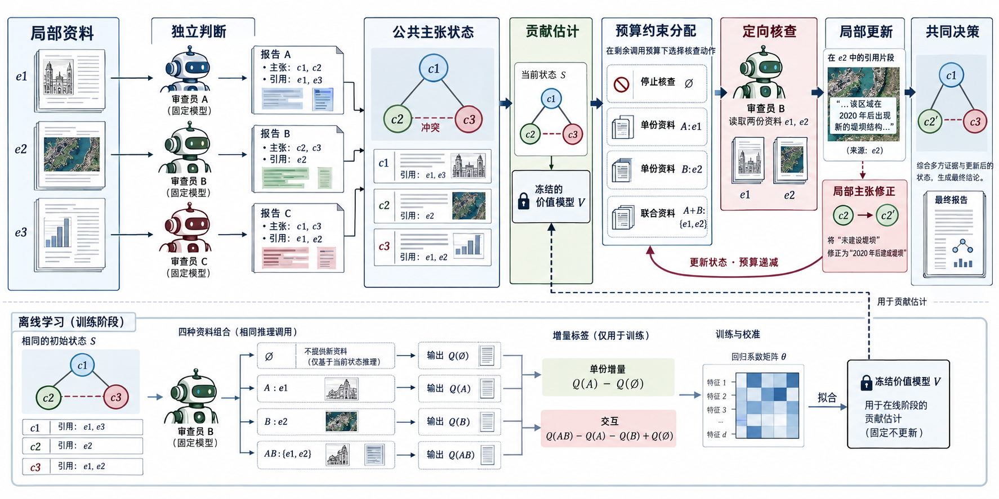
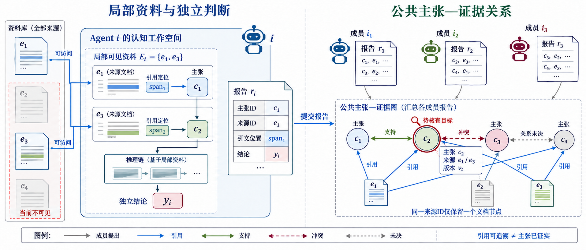

# 博弈驱动的去中心化语义共识机制及在影视推荐中的应用

## 一、研究内容简介

### 1. 选题背景

大语言模型通过对大规模语料进行预训练，形成了自然语言理解、知识表达和复杂任务推理能力。随着工具调用和智能体技术的发展，语言模型的应用逐渐从单次问答扩展为具有环境感知、任务规划、信息检索和结果反馈的连续决策过程。不同智能体能够围绕共同任务承担局部职责，通过交换观察与推理结果完成单一模型难以独立处理的工作。已有综述从角色组织、通信结构、协调协议和运行环境等方面总结了基于大语言模型的多智能体系统，为协同推理与自主决策研究提供了基础[1,2,3]。

在多智能体协作中，各成员受到局部材料、模型能力和推理路径的影响，可能形成不同的判断。差异既是信息互补的来源，也是形成共同决策的障碍。一方面，成员能够提供其他成员尚未掌握的事实，补充缺失前提，或者发现已有结论中的矛盾；另一方面，成员也可能重复相同依据、混淆事实与推断，甚至在交流中传播错误。由此，多智能体系统的关键问题不仅是如何产生更多回答，还包括如何辨别局部判断的依据、处理不同判断之间的关系，并将交流结果落实为共同决策。

围绕推理过程的研究为这一问题提供了不同思路。思维链提示通过显式中间步骤增强复杂推理，自一致性通过独立路径的答案聚合减轻单次生成的不稳定性[4,5]。ReAct将推理与外部行动结合，使智能体能够依据环境反馈继续处理任务；Tree of Thoughts和Graph of Thoughts进一步引入分支搜索、评价与组合，扩展了连续生成之外的推理结构[6,7,8]。这些工作表明，推理质量与信息获取、候选路径和选择过程共同相关，增加生成次数本身并不等于获得有效的新信息。

多智能体讨论将不同推理路径组织为成员间交互。Du等通过多成员交换论证研究事实性与推理表现，Liang等利用相互质疑促进发散思考，ChatEval则将多角色讨论用于结果评价[11,10,9]。与独立采样相比，讨论允许成员根据他人的材料和解释修订判断，但同时带来额外通信成本，以及错误观点相互强化的可能。关于讨论框架与干预的研究进一步说明，成员能力、初始分歧和交流协议均会影响讨论结果[13]。

为提高通信效率，稀疏拓扑方法减少成员间不必要的信息传递，GroupDebate通过组内与组间交流组织讨论，多样化讨论和ReConcile则关注不同推理方式或不同模型之间的互补性[12,14,15,16]。这些研究将通信结构与成员差异引入方法设计，但如何判断一次交流是否值得执行，仍需结合任务中的实际信息与决策后果。投票和讨论的比较也表明，讨论的作用应相对于足够强的独立聚合进行考察，而不是只与单次生成比较[17,18]。

语义共识的形成还涉及判断依据的可靠性。同一含义可以具有不同表述，相似表述也可能对应不同主体、时间和适用条件。语义一致性研究因而强调意义关系而非字符串相同[21]。在生成文本中，引用能够使主张具有可追溯来源，ALCE和FActScore分别从引用生成和原子事实评价角度研究了依据与结论之间的关系[22,23]。对共识机制而言，需要进一步回答：被引用的材料是否支持指定主张，以及这一支持关系是否足以改变当前共同判断。

核验研究为信息更新提供了可借鉴的过程设计。Chain-of-Verification将生成与验证组织为相互关联的阶段，REVEAL关注推理链中验证环节的错误[24,25]。另一方面，关于自我纠正和上下文充分性的研究说明，缺少有效反馈时的重复反思具有局限，资料是否包含必要信息也会影响推理表现[26,27]。因此，证据核查需要明确的目标和适用范围，更新机制需要区分支持、反驳与证据不足，而任务评价还应区分材料缺失和材料利用失败。

博弈论为多成员的行动协调提供了形式化工具。The Consensus Game通过生成与判别角色之间的均衡搜索研究语言模型推断，说明策略互动可以参与共识形成过程[19]。潜势博弈建立了个体效用变化与共同目标变化之间的联系，适于描述合作成员的局部行动调整；演化博弈则从群体策略随收益变化的角度分析合作与稳定性[28,29]。本课题关注核查行动的资源竞争及信息互补，将成员行动、证据贡献和共同决策质量联系起来，为语义共识建立可执行的协调模型。

证据价值具有组合性与状态依赖性。重复材料可能只增加阅读成本，两份分别不足的资料也可能共同补全推理所需前提。Shapley交互研究为组合贡献提供了分析视角，自适应优化则强调根据已有观察调整后续行动[30,31]。将这一思想用于多智能体核查，需要在相同决策状态下估计单份与联合资料的增量，并考虑不同成员对相同资料的理解差异。由此，行动价值估计和协调求解应当与实际核查过程共同设计。

影视推荐为上述研究提供了具有明确决策对象的应用场景。用户需求通常同时包含题材偏好、历史兴趣、情境描述和排除条件；系统既要召回合法影片，也要综合不同依据形成排序。ReDial和INSPIRED提供了会话推荐数据与交互研究基础[35,36]。KBRD、KGSF和UniCRS分别从知识利用、语义融合和统一建模角度增强推荐能力，CRSLab则为任务实现和评价提供了工具支持[37,38,39,40]。与以静态评分为主要观察的MovieLens相比，会话推荐更强调当前对话前缀与推荐时点的信息边界[41]。

在影视推荐中，多成员可以分别处理当前需求、目录事实和历史预测信息，但这些信息具有不同语义地位。影片属性属于可核对事实，历史相似用户的行为属于预测依据，当前用户的明确表达属于需求约束。若将这些依据直接混合，可能产生主体混淆或不恰当推断；若只对最终片名投票，又难以解释分歧来源。对具体主张进行核查并局部调整排序，有助于建立依据、协商和推荐结果之间的对应关系。

综上，本课题研究博弈驱动的多智能体语义共识机制，通过结构化主张与证据描述局部认知，利用核验反馈形成局部状态更新，并在预算约束下协调具有不同预计贡献的核查行动。其研究意义在于，将交流从一般性意见交换转化为具有对象、依据和决策后果的行动，使信息利用、共识更新与资源协调形成统一机制；同时，通过影视推荐系统实现该机制的任务承载与过程展示，为公开数据评价与实际应用分析提供共同基础。

### 2. 研究内容

#### （1）研究内容一：基于证据贡献博弈的多智能体语义共识方法

本课题针对多智能体推理中依据重复、分歧难以定位和交流成本缺乏有效协调的问题，研究基于证据贡献博弈的语义共识方法。方法以结构化主张为认知单元，以资料核查为交流行动，以共同答案或共同排序为决策对象，将证据表示、核验更新与预算协调组织为相互依赖的处理过程。

首先，建立主张与证据的关联表示，描述成员判断的内容、来源和语义适用范围，形成可定位的公共共识状态。其次，围绕具体分歧执行证据核查，根据支持、反驳或证据不足的判断更新目标主张，并通过受限操作调整共同决策。最后，估计核查行动的单份增量和联合交互，构造考虑来源重叠、成员条件与执行成本的集合价值函数，利用边际贡献效用协调有限资源下的行动选择。

该方法的核心在于核验与协调之间的闭环。核验规定一个行动如何改变认识和决策，贡献估计规定行动在当前状态下的预计价值，博弈求解规定不同成员如何在共享约束下选择行动。每次执行后，公共状态与已读资料发生变化，后续行动随之重新估值。由此，方法在有限预算内逐步形成具有依据的共同决策，而不是仅通过增加固定讨论轮数追求意见一致。

#### （2）研究内容二：博弈驱动的多智能体影视推荐系统的设计与实现

本课题面向自然语言影视检索与推荐需求，设计能够处理用户条件、组织成员分析并展示推荐依据的应用系统。系统以结构化请求和影片目录为输入，通过候选召回、角色审议、条件核验和共同排序输出推荐结果，并保存相关来源、判断与执行轨迹。

系统采用交互层、服务层、共识处理层与数据层相结合的结构。交互层负责需求输入、候选展示和过程查看；服务层负责请求规范化、任务规划和接口组织；共识处理层负责成员报告、约束门控与结果聚合；数据层负责目录、证据及任务轨迹。方法研究形成的任务、行动和局部更新对象，通过统一接口与应用流程衔接。

系统实现既承担影视推荐功能，也为共识过程提供可观察载体。用户可以查看推荐理由及未解决分歧，研究者可以依据封存轨迹分析核查前后的变化。系统功能测试关注输入约束、实体合法性、异常处理和运行过程，公开推荐任务则评价目标命中与排序质量，二者共同构成方法应用的验证基础。

### 3. 关键技术

#### 关键技术一：面向语义共识的主张与证据表示

自然语言判断中常同时包含事实、假设与推断，直接比较整段文本难以确定冲突位置。本课题将成员报告中的任务相关前提表示为具有唯一身份的主张，并将引用指向实际资料片段。主张对象保存作者、文本和活动状态，资料对象保存来源、正文与主体范围，二者通过引用与核查关系关联。

公共状态在此基础上描述共同决策及其依据。已有主张、可见资料、核验意见和状态变化形成连续记录，能够区分原始判断、后续反驳和当前仍被使用的信息。语义适用范围用于约束材料的解释方式，使历史用户行为、当前需求和目录事实在推理过程中保持各自身份，为后续局部更新提供明确边界。

#### 关键技术二：证据核验驱动的局部共识更新

核查行动以指定主张和允许资料为输入，输出语义关系判断、原文依据及可选决策补丁。支持关系用于补强已有判断，反驳关系用于使错误主张退出活动状态，证据不足则保留不确定性。局部补丁分别适配问答答案设置和推荐列表交换，使核验结果能够进入共同决策。

局部更新将语义判断与状态操作分离。核查者负责解释材料与目标的关系，执行器负责检查来源、目标和操作范围，并以一致方式提交变化。该机制限制无关改写，保存原始文本及更新历史，为分析错误修正、正确内容保留和后续行动价值提供可追溯基础。

#### 关键技术三：预算约束下的证据贡献博弈与协调求解

核查行动的价值取决于成员已知信息、资料互补性和最终决策。为控制再次思考的影响，本课题在相同初始状态下采集空集、单份与联合核查分支，根据任务质量差构造增量和交互标签。在线估计器仅使用行动执行前可得特征，为不同成员预测资料贡献。

协调层以预计证据集合价值与执行成本构造共同潜势，并以成员对完整分配的边际贡献定义效用。在共享调用、资料和费用约束下，通过可行最佳响应进行局部调整，求解后检查有利偏离。执行一个行动后重新构造状态和价值，使预算分配随共识过程演进。该技术将开题提出的验证反馈与博弈协调具体落实到有限行动选择问题。

### 4. 论文计划

论文研究按照问题分析、方法建模、算法实现、实验评价与系统应用展开。前期通过多智能体推理、证据核验、博弈协调和会话推荐文献明确研究对象，形成结构化认知与核查行动的基本定义；随后完成局部更新、贡献估计和协调求解，并建立统一实验运行环境。

实验研究在公开问答与推荐任务中检验方法的有效性，通过强单智能体、独立聚合、固定核查、贪心及中央求解等参照分析组织与协调的作用，并结合核验诊断、组件消融和资源预算分析解释机制。系统研究围绕影视推荐完成需求、架构、模块与界面设计，进一步验证方法对象与应用流程的衔接。

毕业论文按研究问题、方法设计、理论分析、实验评价和系统实现组织；研究论文集中讨论共识方法与实验。方法章集中论述一个完整共识机制，系统章集中说明影视应用的设计与实现，实验与测试分别提供算法质量和工程行为证据。最终形成论文正文、可执行程序、数据与实验记录及系统演示材料。

### 5. 论文进度及目标

目前已完成相关研究调研、结构化公共状态、证据片段引用、局部更新、匹配分支采集及集合价值分配的主要实现，形成有限资源合作博弈的求解与偏离检查过程。实验侧已建立任务隔离、标签封存、原生决策评分和费用记录机制，并完成前期推荐预测与异质协作实验。

系统侧已实现请求处理、目录检索、候选冻结、角色分析、约束门控、结果聚合和轨迹归档，形成影视检索与证据工作台以及封存研究案例回放。后续重点是完成冻结协议下的主要比较与机制分析，将稳定的核查协调接口接入应用，并完善论文与系统验收材料。

## 二、论文进展情况

### 1. 方法与程序实现

已实现局部资料分配、独立报告汇总、不可变来源片段、指定主张核查、受限补丁和执行日志。贡献学习支持四分支匹配采集、回归拟合与均值校准；固定、集合贪心、中央枚举和最佳响应分配器使用相同集合目标及共享可行域。运行环境支持同请求回执复用、输入与源码快照、阶段封存和封存后评分。

最新修订增加维持／修订当前决策的显式声明，并尝试按初始资料或指派资料区分修改依据。该接口用于检验主张判断到决策变化的联系，尚不代表性能增益。旧批次按原接口保存，新接口需独立验证与重新校准，不能用新代码解释旧回执。

### 2. 实验完成情况

已封存123题匹配训练及其估计模型，其中93题拟合、30题校准。初始响应364/369通过合同校验，资料核查348/369有效，空集控制121/123有效。这些计数说明采集接口基本可执行，不说明核查产生了有效信息。

逐条训练记录显示，拟合部分186个单份增量标签中有2个正值，其余为零；93个交互标签中有1个负值，其余为零。校准部分60个单份标签中有1个正值，30个交互标签中有1个负值。训练信号稀疏，尚无正交互例，不能据此宣布估计器已学得稳定互补关系。

400任务主批尚未完整封存，账户拒绝与未确认请求影响了采集，当前不报告该批质量结论。后续在独立目录复用精确匹配的成功回执，保留旧记录及未知请求。正式比较与扩展实验按阶段验收，不将程序接通或部分案例落盘写成实验完成。

### 3. 系统实现情况

影视业务已实现自然语言请求、目录召回、候选冻结、角色评审、硬约束门控、Top-K和任务轨迹。前端保留影片浏览及辅助输入，将详细过程置于可展开区域。研究回放仅开放完整封存且通过身份与哈希检查的案例，不暴露标签。

实时业务仍使用既有候选共识工作流，新的集合价值分配与定向核查位于研究运行器。读取研究轨迹不等于在线部署了研究方法。接口映射及同请求端到端验收仍属于后续系统工作。

## 三、工作成果

### 研究内容一：基于证据贡献博弈的多智能体语义共识方法

#### （一）问题描述与方法总体框架

给定任务x、来源目录E和成员集合N={1,2,3}，成员先读取各自分配的材料并独立生成报告。报告包含原生决策、一条任务前提及来源片段标识。问答按有效答案多数读出，平票按原生选项次序决定；推荐对成员Top10进行倒数排名融合，未被提及候选保留原次序。多数方法复用这一初始状态，强单成员对照顺序读取资料，另行报告其初始判断。

s_t = (C_t, V_t, d_t, H_t, J_t, v_t)  (1)

C_t保存主张和活动状态，V_t为已暴露来源，d_t为共同答案或完整排序，H_t为提交历史，J_t为核查意见，v_t为决策版本。成员原始报告另行保留，用于成员条件估计。代码仅在决策实际改变时递增版本；全部状态一致性使用内容指纹检查，不能用版本号代替完整状态身份。

一次核查指定成员i、目标主张c和一份或两份未读资料S。当前实现以活动主张与未读资料标题的词面重叠选择目标，并在一次分配中固定它。这是可复现的疑点定位规则，不是完整语义冲突检测器。无活动主张或无未读资料时，不构造追加行动。

#### （二）面向语义共识的主张与证据表示

资料保存来源ID、原文、类型和任务权限。原文被切分为不可变片段，片段ID由来源、位置与文本确定；模型选择ID，程序从原文恢复引用。该设计约束“引用了什么”，不能单独判断“引用是否支持结论”，引用质量与事实支持需分别评价[22,23]。

程序只接受实际暴露且属于当前任务的片段。初始成员分开读取，后续公共核查可读取公开材料和报告，因此不能将全过程描述为成员永久持有互不共享的私有信息。资料的语义适用性还需核查，例如历史用户行为只能提供预测线索，不能证明当前用户偏好。

旧接口输出目标ID、支持／反驳／不明确三态判断、引用、理由和可选补丁。该形式能定位核查，却可能只讨论前提而不涉及当前答案。修订接口增加decision_effect，明确选择keep或revise并解释决策影响；推荐修订还需比较一个Top10内候选与一个外部候选。新增约束要求说明修改理由，不要求强行反对。

AEIC的假设、证据、推断、结论为早期报告组织提供基础；当前研究接口直接使用决策、主张、片段与补丁，不强制四个命名字段。因此，四字段不可替代性不列为已证实贡献。业务系统仍保存AEIC角色报告，与研究接口分别描述。

#### （三）证据核验驱动的局部共识更新

响应校验检查目标存在、引用实际可见、判断类型及任务操作合法。问答补丁只能设置原生选项；推荐补丁只能交换一个Top10内候选与一个外部候选，其他位置不动。拒绝响应保存回执及错误，不修改决策；合法但无补丁的响应可以记录核查意见。

被模型反驳且附有引用的主张退出活动集合，原文和历史保留；支持则更新目标状态，不明确不强制改变活动状态。主张状态与最终决策分别提交，反驳不自动触发答案翻转。supported和refuted表示模型判断，不表示外部真值认证。

修订接口要求keep对应空补丁，revise对应真实改值，推荐比较对象与交换对象一致。旧合同要求修改引用指派新资料，可能排除基于初始资料重新推理得到的修改。新设计允许记录实际依据，并将初始依据修订与空集控制比较。当前源码已加入该分层校验，但外层调用仍先执行默认严格引用检查，放行路径尚需统一验收；不将此项写为已完成的端到端修复。

局部约束只能限制改动范围，不能保证修改正确。错误答案是否纠正、正确答案是否被损害以及维持是否合理，需要独立标签或材料裁决。评价同时统计纠正和损害，避免把从不修改当作可靠性。

#### （四）证据贡献估计与联合价值建模

在线不能读取答案标签，协调需预测未执行行动的价值。训练固定初始状态、目标和核查者，执行空集、A、B、AB四个分支。空集同样调用核查模型，但不暴露新资料，以控制再次思考。各分支从同一副本开始，不继承其他分支输出；调用匹配不代表Token匹配，实际用量另记。

令Q_i(S)为成员i在固定状态读取S并按接口执行后的质量。单份增量与二阶交互为：

g_i(A) = Q_i(A) − Q_i(∅)  (2)

h_i(A,B) = Q_i(AB) − Q_i(A) − Q_i(B) + Q_i(∅)  (3)

单份标签描述新增资料相对于空集调用的贡献；交互描述联合执行是否超出单份增量之和。交互允许正负值，与组合归因问题相关，但不是完整Shapley估计[30]。每题目前按固定哈希选一个资料对与核查者，每个分支一次响应，未穷尽行动，也未由重复采样证明标签稳定性。

问答质量是正确指示，推荐训练质量为当前任务目标的Recall@10。失败分支沿用执行器返回的未修改状态参与标签计算，不被筛除；估计目标因而包含接口和模型共同造成的实际执行收益。质量离散意味着理由、主张状态或列表后段发生变化时，标签仍可能为零。

单份资料和联合资料承担不同的信息作用：前者补充当前判断缺少的依据，后者可能连接分散的前提。为分别预测这两类作用，本文采用两个Ridge回归器拟合单份增量与交互，正则系数为10；校准集以真实与预测均值差修正偏置。特征为执行前的资料长度、检索分数、问题／主张／成员报告与标题的重叠、决策分歧、状态版本和可见比例，另含任务类型、来源类型及双份词面重叠。成员ID与测试答案不入模，但任务类型确实使用，不能称为完全任务无关。

ĝ_i(AB) = ĝ_i(A) + ĝ_i(B) + ĥ_i(A,B)  (4)

拟合和校准按原题或原会话隔离，估计器在评价前冻结，大模型权重不训练。选择能力由留出状态的选中实际收益检验，不能仅凭低训练误差判断。联合标签来自同一核查者同时读取两份资料，推广到分散成员集合需额外近似。

#### （五）预算约束下的多智能体博弈协调

固定状态s及目标c后，成员选择停止、单份或双份核查。配置a=(a₁,a₂,a₃)确定资料并集E(a)。记I_e(a)为选择来源e的成员集合，J_ef(a)为在同一行动中同时读取e、f的成员集合。为避免同源重复计值，单份项取相关成员预计贡献最大值：

G_e(a) = max_{i∈I_e(a)} ĝ_i(e)  (5)

若J_ef非空，二阶项取联合核查者的交互估计最大值；若两份资料仅由不同成员分别选择，则取三个成员交互估计的均值。该规则与生产分配器一致。后一种情形把同成员联合标签推广到分散行动，是代理假设，不是已识别的跨成员因果协同。

H_ef(a) = max_{i∈J_ef(a)} ĥ_i(e,f)    当 J_ef(a) 非空  (6)

H_ef(a) = [ĥ_1(e,f)+ĥ_2(e,f)+ĥ_3(e,f)]/3    其他情形  (7)

V̂_s(a) = Σ_{e∈E(a)} G_e(a) + Σ_{{e,f}⊆E(a)} H_ef(a)  (8)

去重只影响价值，每次核查仍计成本。二阶项可以为负，不假设价值单调或次模，不能引用次模贪心保证。执行后重规划与自适应选择思想相关，但未证明满足自适应次模条件[31]。

共享可行域限制非停止行动数、资料并集大小和预计费用。单份核查消耗一次调用与一份资料，联合核查消耗一次调用与两份资料；配置中的重复来源只计一次资料额度。势函数为预计集合价值减去行动估价：

Φ_s(a) = V̂_s(a) − λ Σ_i ĉ(a_i)  (9)

Σ_i 1[a_i≠∅] ≤ B_call,    |E(a)| ≤ B_src,    Σ_i ĉ(a_i) ≤ B_cost  (10)

当前λ=1，行动估价为0.0005加资料字符数乘0.15/3,000,000，费用约束初值0.02。该量是预先声明的成本代理，不是完整请求账单；真实输入／输出Token及计费状态另记。质量与费用的比例是方法参数，不能从单一配置推出普遍最优权衡。成员效用取其加入配置后的边际势函数变化：

u_i(a) = Φ_s(a) − Φ_s(a_{−i},∅)  (11)

其他成员不变且替换前后均可行时，效用差等于势函数差。该构造采用精确势博弈的边际贡献思想[28]。共享约束使成员策略集合依赖他人，应在可行偏离意义下解释广义Nash稳定。Consensus Game研究生成与判别策略，本方法并非其博弈解码复现[19]。

u_i(a_i′,a_{−i}) − u_i(a) = Φ_s(a_i′,a_{−i}) − Φ_s(a)  (12)

##### （1）可行最佳响应与动态重规划

分配器从全体停止开始，依次枚举每个成员的可行替换，按势函数优先、行动数较少次之选择最佳响应。势函数改善超过10⁻¹⁰时接受；势函数完全相等且行动数减少时也接受。一轮无人改变则终止，记录配置、耗时、轨迹与最大可行偏离：

δ(a) = max(0, max_{i,a_i′可行} [Φ_s(a_i′,a_{−i}) − Φ_s(a)])  (13)

命题一：固定状态下，可行最佳响应过程有限终止。证明：将势函数值与负行动数构成字典序，每次接受的替换使该序严格增加，因而不会重新访问同一配置。可行配置有限，因此接受替换的序列有限。命题二：在终点完整枚举可行偏离后，若δ(a)≤ε，则配置满足ε意义下的可行单边稳定。程序取ε=10⁻¹⁰。此结论限定固定状态和估计函数，不保证全局最大势，更不保证任务质量提高。

中央对照枚举同一可行域并最大化同势函数，为预计目标提供上界参照。集合贪心只给空闲成员追加正边际行动，最佳响应允许已分配成员替换或停止，两者搜索邻域不同。这种差异是否有实际价值，需要同估计器、同预算实验。

求解后只执行配置中预计边际贡献最高的一项，并非同时执行整个配置。资料和核查结果进入状态，调用、资料及预计费用递减，然后重新构造博弈。失败核查也消耗尝试和读取额度。预算使在线过程有界，但固定状态终止证明不能用作动态全过程收敛证明。

算法1 在线执行顺序

|步骤|操作|
|---|---|
|1|独立生成局部报告并读出初始决策，保留成员上下文。|
|2|固定活动目标，构造未读单份／双份行动；无合法行动则停止。|
|3|冻结估计器计算贡献，在剩余预算内求解配置。|
|4|配置为空则停止；否则执行最高预计边际贡献的一项核查。|
|5|校验并提交局部变化，记录拒绝、维持、修订及资源。|
|6|更新状态与预算，返回步骤2；退出后读出共同决策。|

#### （六）实验设计与结果分析

##### （1）实验目的与研究问题

RQ1检验完整方法相对于独立汇总的质量增量；RQ2检验新增资料相对于空集调用的贡献，以及核查带来的纠正与损害；RQ3检验贡献估计与博弈求解是否分别超过简单参照；RQ4检验组件及预算条件。四个问题对应同一方法的不同环节，不以一张主结果表替代全部归因。

表1 研究问题与必要对照

|问题|比较|解释范围|
|---|---|---|
|RQ1 完整方法|博弈与独立汇总；另列强单成员|整体协作增量，不能独归博弈|
|RQ2 核查|同状态∅、A、B、AB及普通修订|资料增量、纠正、损害|
|RQ3 协调|固定、集合贪心、中央、最佳响应|预测与求解作用分别判断|
|RQ4 边界|五消融、预算、干扰、第二模型|特定条件有效性，不预设领先|

##### （2）实验数据集与预处理

StrategyQA用于检索材料条件下的是非判断，HotpotQA用于官方材料可用时的多跳判断[32,33]。后者完整保留公开验证集458道yes/no问题及上下文，不称为全部HotpotQA或官方测试成绩。两种环境分开报告，区分资料获取不足和资料利用不足；上下文充分性研究也提示不能将二者混为同类错误[27]。

ReDial以当前对话前缀生成推荐，未来目标仅在封存后评价[35,40]。采用原生实体与固定候选，不因真目标缺失而补入。历史行为、知识图谱和预测排序具有不同证据地位。Climate-FEVER另取180条claim–证据关系评价支持、反驳和信息不足[34]，不与原始claim级榜单混比。

表2 数据划分与用途

|用途|规模|统计与隔离单位|
|---|---|---|
|贡献学习|QA63＋推荐60，共123；拟合93／校准30|原题或原会话|
|主比较|StrategyQA200；ReDial200上下文|200原题／200会话，目标另计|
|给定材料评价|HotpotQA458道是非题|458原题，225 yes／233 no|
|关系诊断|Climate-FEVER180条关系|180 claim，各取一份证据|
|次要分析|固定64任务，QA32／推荐32|用于消融、预算、干扰、迁移|

分区按原题或原会话隔离并检查精确问题重复。主比较每题准备8份不同原文；HotpotQA保留原生2至10段材料，不因资料少、初始信息充分或无追加空间删题。支持句覆盖表示目录中存在原文，不保证预算内读到或被正确理解。

输入与标签分别保存，整阶段生成完整封存并校验案例哈希后才加载标签。测试不按方法对错筛题，不通过添加正确候选提高覆盖。项目此前接触过相关公开基准，当前隔离只针对记录中的分区，不等于排除了预训练污染或历史语义相似题。

##### （3）对比方法与实验设置

六种核心方法共享模型配置、原生答案／候选和来源目录。独立、固定、贪心、中央和博弈复用初始报告；强单成员顺序读取相同初始资料并具有中央选择能力。默认三次初始调用，追加调用与唯一资料上限均为2，预算分析取0至3。联合核查可能提前用尽资料额度，所以上限一致不等于实际调用或Token一致。

表3 核心比较方法

|方法|信息组织及选择|比较目的|
|---|---|---|
|强单成员|顺序读取；中央选择；同核查接口|多成员是否超出顺序处理|
|独立汇总|局部核查后聚合；检索分数选单份|主参照，保留独立信息生产|
|固定核查|按固定顺序构造可行配置|动态选择相对固定投入|
|集合贪心|追加最大预计集合边际行动|最佳响应相对简单搜索|
|中央枚举|同可行域最大化同势函数|预计目标的求解差距|
|最佳响应|允许替换／停止，执行后重规划|完整方法|

另实现自一致性、Self-Refine及普通多成员讨论的预算适配版本[5,20,11]。其采样温度、输入组织和修订方式不同，只作为外部适配参照，不称为原论文性能的严格复现。推荐另列Sparse、KBRD推荐部分和RRF排序参考[37,42]；UniCRS等原文结果只提供方法背景，不作为本地复现成绩[39]。

同批固定提供方、模型别名、提示及输出上限，保存返回模型名、时间和源码哈希。已封存123题训练记录为qwen_flash配置，不能改称DeepSeek，也不与历史后端直接合并。API别名可能升级，跨日期和跨模型结果需分别标注。

##### （4）评价指标与统计方法

问答报告准确率以及相对参照新增正确和新增错误数。推荐主指标为目标平均Recall@10，即全部命中目标数除以全部目标数，同一会话的多个目标不作为独立样本扩量。候选覆盖率单列，以区分未召回与排序失败。

Recall@10 = (Σ_x |T_x ∩ L_x^{10}|) / (Σ_x |T_x|)  (14)

程序另输出目标平均折扣命中：目标命中时按1/log₂(rank+1)计分，再除以总目标数。代码虽称target-averaged NDCG，但未按逐任务理想DCG归一化，因此正文不将它与标准NDCG榜单混比[43]。标准NDCG如需补充，应统一评分并保留原指标，不在看到结果后更换主指标。

主比较报告配对差与95%区间。问答以原题、推荐以原会话聚类，固定种子bootstrap2000次[44]；问答另报告未校正的精确McNemar检验。当前区间不控制多重比较整体错误率；若作多个显著性断言，需先固定检验族并实施Holm校正[45]，不能择取最小p值。

核查报告关系宏F1、合同有效率、错误初始判断纠正和正确初始判断损害。排名位置未变只说明输出保留，不证明语义正确。内部指标为最大可行偏离及距中央预计势的差，均与外部质量分列。

资源分别记录逻辑调用、物理请求、输入／输出Token、已知费用、未知计费请求与求解耗时。缓存复用减少采集支付，不代表在线方法免费。只有并发、缓存和网络条件一致时比较端到端时延；旧实验缺少可比计时的部分不补造时间，用已有调用与Token说明开销。

##### （5）整体性能与行动收益分析

历史探索说明研究动机，匹配训练说明学习信号，接口诊断定位执行问题。三类证据不能相互代替，也不填入尚未封存的新主结果。

表4 已封存证据与解释范围

|证据|观察|归因边界|
|---|---|---|
|历史450题配置|306→370正确，+14.22个百分点|整套配置，未隔离AEIC与博弈|
|历史推荐校准|3010目标730→806命中，+2.52个百分点|排序器相对固定RRF收益|
|旧8题同状态面板|256分支无正增益，85无效|旧接口诊断，不是新方法主效果|
|当前匹配拟合|单份2/186正值，交互0/93正值|信号稀疏，互补学习未证实|
|决策关联4题开发|两轮合同有效2/4→4/4；无质量提升|接口一致性，非独立泛化|

历史450题提升对应完整执行配置变化，不能署名给新集合博弈。历史推荐校准在883会话、2286上下文、3010目标上提高命中率，说明排序可优化，不证明多成员交互有效。保留这两项作为研究动机，不拼接旧收益与新定理。

旧8题面板中大量合法响应选择不修改，唯一变化在空集控制也出现，说明仅统计核查后的变化不足以归因资料贡献。当前训练有少量正单份标签，却没有正交互例，联合项仍是待验证的建模选择。

决策关联小批两轮使用同4题，两个推荐任务初始目标已全部命中，Top10外没有可换入目标，维持并非失败。两个问答虽答错，材料是否支持纠正仍需语义裁决。零更新至少包含正确维持、无纠正依据和有机会未执行三种情形，不能只按修改率判断接口。

未封存主批的无标签执行审计另记录715次博弈核查，693次合同有效，未接受决策补丁；10个补丁因未引指派新资料被拒，其中6个试图改值。该信息只描述执行行为，不能判断修改对错或主批准确率。它支持核对引用约束与决策关联，不证明放宽约束会提升质量。

##### （6）消融与鲁棒性分析

五项消融分别关闭交互项、去重、执行后重规划、联合行动和局部补丁限制。去交互与禁联合不可合并：前者保留双份阅读而改变估值，后者改变行动空间。各消融在同任务、模型和预算下比较质量、纠正／损害及实际成本，不只比较势函数。

资料干扰包括缺失、重复与低相关背景。当前程序修改资料集合，没有自动构造“已知正确决策被扰动后恢复”的任务，不能提前称为恢复实验。若另做机会明确的恢复评价，须独立定义错误注入和支持材料，不使用测试标签筛选有利主样本。

预算0至3用于观察质量与消耗，主配置保持2。第二模型在固定次要子集复核，不把更换模型带来的提升归给机制。各扩展结果待完整封存后填写，目前尚无充分证据声称博弈独立优于简单控制器。

解释规则如下：优于独立汇总而不优于强单成员，主要支持选择或修订作用；优于固定而不优于贪心，不能说明最佳响应必要；预计势接近中央而真实质量无增量，只支持求解表现。贡献预测、核查收益及端到端结果相互支持时，才增强方法有效性表述。

### 研究内容二：博弈驱动的多智能体影视推荐系统的设计与实现

#### （一）系统需求分析

##### （1）应用场景与业务流程

系统面向用户通过自然语言描述观影需求的场景。输入既可以包含类型与年份等明确条件，也可以包含类似作品、情绪氛围和兴趣偏好。用户期望获得合法候选及其推荐理由，并能够查看系统是否正确处理排除条件与上下文信息。

业务流程从需求表达开始，经结构化解析与任务规划进入目录检索，形成候选集合后由多个角色分析，再通过约束核验和聚合输出排序。结果页面展示作品属性、角色判断与依据，执行轨迹记录各阶段的处理。研究案例视图则以已封存任务为入口，展示共识的初始状态与更新过程。

影视推荐与一般问答的区别在于决策空间和结果形式。系统需要维护原生影片实体、处理候选覆盖并生成有序列表；解释既涉及作品事实，也涉及用户匹配推断。因此，业务对象围绕请求、影片、报告、来源和决策组织，使应用需求与研究机制共享相同语义边界。

##### （2）功能需求分析

需求输入功能将查询、偏好、必选与排除条件表达为结构化请求。目录检索功能按合法条件召回影片并保留基础相关性；候选审议功能组织角色对同一短名单提交报告；共识功能在硬约束门控后综合意见形成Top-K；解释功能展示推荐依据、反对意见和未决分歧。

过程管理功能保存任务身份、规划、候选快照、角色报告、决策和异常，用于运行分析与回放。研究回放读取允许阶段的封存案例，通过身份与内容检查关联任务，展示核查来源、前后状态和分配记录。回放是历史读取，不启动新的模型调用。

系统还需处理无匹配结果、模型不可用、响应不合法和目录缺失等情况。不同失败具有不同业务含义，输入不合法需要明确错误，条件过严导致空集需要保留原约束，模型阶段异常可以按既定路径降级。结果应使用户能够区分这些状态。

##### （3）非功能需求分析

一致性要求同一次请求的候选覆盖、约束与聚合口径保持稳定。各角色评审相同短名单，同一轮使用相同信誉快照，模型输出只引用合法原生实体。可追溯性要求推荐结果能够关联目录属性、角色报告和引用，异常与降级有明确事件。

性能要求以时延和资源共同衡量。角色并行降低串行等待，短名单控制上下文与输出规模，缓存和确定性处理减少重复工作。系统记录真实调用与Token，使较快响应是否伴随更多资源可被观察。时延约束参与请求规划，但不改变用户硬条件。

可维护性要求目录、角色、规划和聚合通过明确接口分离，便于替换后端与策略。安全边界要求服务不向前端暴露密钥、评价答案或任意文件路径，资料文本以内容方式展示，研究回放保持只读。恢复与归档支持在异常后定位任务状态，而非依赖页面是否完成加载。

#### （二）系统总体设计

##### （1）系统总体架构

系统采用前后端分层设计。交互层负责搜索、条件设置、结果展示及轨迹查看；HTTP服务层负责参数校验与业务路由；工作流层连接规划、召回、角色审议和共识；数据层提供影片目录、证据对象与执行记录。React交互基础与独立工作台共同承载用户入口。

方法运行器与应用工作流具有不同运行目的。研究侧控制数据、信息权限与预算，在输出封存后使用标签评价；应用侧处理实时影视请求，返回推荐与过程记录。集合价值分配和动态核查目前位于研究运行器中，尚未接入实时推荐业务链路。系统可展示既有业务轨迹；读取研究轨迹的回放接口不等于在线执行了研究机制。后续接入需要明确请求、候选、主张、来源和预算的对象映射，并单独验证端到端运行。

系统由统一服务维护一次请求的状态，成员通过独立报告与并行任务处理局部信息。逻辑分工降低模块耦合，并为分散行动协调提供对象基础；当前部署仍采用统一调度。架构描述据此区分协作算法与物理节点组织，保持实现范围明确。

##### （2）功能模块划分

功能模块按业务对象划分为需求解析与任务规划、资源检索与候选生成、成员分析与证据管理、核验与共识、排序与解释以及追踪与回放。模块之间传递结构化对象，而不是任意拼接自然语言，使候选身份、条件和引用能够持续保留。

解析与规划模块确定处理路径和预算，检索模块提供合法候选及属性，分析模块围绕候选生成局部意见，核验模块保护明确条件并处理分歧，排序模块输出共同选择，追踪模块汇总过程。研究核查策略可以替换固定审议中的行动选择，同时保持输入和展示契约。

这种划分将数据获取、语义判断和确定性执行分开。年份范围可以由目录精确检查，偏好匹配需要模型分析，补丁合法性则由执行器控制。各模块承担与自身能力相符的任务，避免所有业务逻辑都依赖一次自由生成。

##### （3）系统业务流程

请求进入后先进行字段与范围校验，生成唯一任务身份。规划器根据当前需求确定角色与处理预算，目录服务召回候选并执行明确过滤。短名单冻结后，启用角色并行处理相同候选，完成的报告恢复为固定顺序后进入聚合。

约束门控在共同排序前排除不合法候选，聚合器综合基础相关性、语义意见与依据形成决策。结果对象保存分项分数、参与角色、有效来源与残余分歧，轨迹归档同时记录规划、召回和异常。前端通过响应展示推荐，并可按需展开解释。

模型阶段失败时，确定性角色和基础目录路径保持可运行，系统记录降级原因与执行模式。研究回放采用独立只读路径，从封存案例读取历史状态，不重走实时生成。两条路径共用对象展示而分别保存日志，保持应用请求和实验统计的边界。

##### （4）核心数据对象与接口设计

请求对象SearchRequest保存查询、Top-K、偏好、类型条件、年份范围、喜欢与排除影片及预算。MovieCandidate保存原生身份、属性与召回分数。CandidateReport保存角色、候选、结论、置信度、假设、推断和证据。ConsensusDecision保存最终分数、组成项、支持来源与未决分歧。

SearchTrace保存请求身份、机制、规划、角色信誉快照和事件序列。研究模块另以主张、行动和局部补丁表达核查过程，应用适配将影片目录证据与研究片段建立对应。实体和来源的身份贯穿接口，使结果不依赖片名字符串的临时匹配。

接口层将参数解析、业务执行和响应序列化分开。输入错误在执行前处理，合法请求进入工作流；响应仅返回展示所需信息。回放接口限定阶段与索引，检查封存和内容身份，不接收任意路径。配置与密钥留在服务环境，评价标签不进入在线决策接口。

#### （三）系统关键模块设计与实现

##### （1）用户需求解析与任务规划模块

需求解析将自然语言和显式控件转换为统一请求。查询文本保留用户语境，结构化条件表达可确定限制；必选类型与偏好类型分别存储，排除影片使用原生ID，年份上下限在执行前检查。解析后的对象同时传递原始文本与规范字段，使模型能够理解表达，程序能够严格执行条件。

规划器根据当前请求复杂度选择处理路径。规则考虑硬约束、偏好、查询长度、返回数量与时延预算，输出风险层级、启用角色和核查资源。该规划为透明启发式，反映业务复杂度与资源负担的关系。其输入仅来自当前请求，不读取最终推荐结果后调整本次预算。

规划对象进入轨迹后，后续模块以其为执行约束。较复杂需求可以启用更多角色审议，严格时延预算则控制工作量；无论路径如何变化，硬条件保持不变。计划理由与实际执行分别记录，使处理路径能够被解释，也便于分析是否存在资源过度投入。

上层请求规划与研究中的行动分配具有不同职责。前者规定本次任务可用工作量和角色，后者在既定状态中选择具体核查。在线适配由规划层提供预算和资料权限，核查层返回行动与补丁，避免两个模块重复或相互覆盖用户条件。

##### （2）影视资源检索与候选生成模块

目录服务提供统一影片访问接口，可读取真实JSONL目录，在本地演示中也支持明确标记的内存目录。影片以原生ID为身份，名称、年份、类型与文本属性用于召回和解释。目录来源与版本进入执行记录，防止更新后无法还原历史候选。

检索过程依据查询形成相关候选，并结合明确条件过滤。召回分数提供排序基础，影片属性提供约束依据；二者在结果中分别保存。排除ID在进入审议前剔除，类型与年份保持确定性处理。对无合法结果的情况，模块返回空集合及业务状态，而不由生成模型临时创造替代实体。

进入模型审议的短名单按Top-K和配置上限确定，并在角色运行前冻结。各成员评审相同候选，聚合只接受该集合内的原生ID。候选冻结既控制上下文规模，也保证角色覆盖可比；基础排序与最终排序分别保留，以分析语义判断改变了哪些选择。

候选覆盖决定下游性能上限。目标未进入可排序池时，局部核查无法直接将其推荐，故召回与排序分别评价。研究数据中的推荐目标不参与候选补全，应用中的目录事实也不被模型推断覆盖。需要扩展候选的后续机制应作为独立检索行动处理。

不同数据集和线上目录使用各自命名空间。研究案例中的ReDial编号由其任务候选解释，线上影片由应用目录解释；跨来源对应需明确映射。回放读取当时快照，而新请求使用当前目录，使历史解释与实时服务各自保持一致。

##### （3）多智能体分析与证据管理模块

分析模块包含检索、偏好与约束等基础角色，并在模型配置可用时启用偏好、差异性和批评角色。角色围绕相同候选提出不同角度的报告，使用共同对象保存假设、依据、推断与结论。多个逻辑角色可以共享同一模型，差异来自任务职责和上下文，而非预设独立能力。

报告结构将候选意见与来源分开。支持或反对表达角色立场，置信度和效用用于聚合，证据对象保存内容与属性。对目录可确定事实的引用由程序提供，对偏好匹配的推断由角色解释。来源强度和核验标记按各自对象含义使用，模型高置信表达不自动成为事实真实性。

角色通过线程池并行执行，完成后恢复固定角色顺序，再进入统一聚合。并行减少等待时间，实际调用与Token仍全部归档。某个模型角色异常时，系统记录失败与降级，不让缺失报告被解释为全体支持，也不让候选因不均衡覆盖获得意外优势。

证据管理保存主张与候选的关联，允许界面展开原始依据及反对意见。同一来源在多个角色中重复出现时保持来源身份，为集合去重和后续核查提供基础。研究模块的不可变片段进一步用于指定目标核查，应用适配通过身份与范围关联两种证据表示。

该模块承接AEIC过程表达，但不以报告完整程度评价推理正确性。其系统价值在于使意见具有可定位结构，使后续门控、核查和解释能够使用明确对象。任务效果与关系质量仍由对应实验评价。

##### （4）证据核验与博弈共识模块

核验与共识模块连接角色意见和共同决策。应用基础路径采用确定性条件门控及证据感知聚合，研究路径采用指定主张核查、集合价值分配与局部更新。两条路径通过候选、报告和来源对象形成接口联系，当前在线应用保留基础路径，新的行动分配已在独立运行器中实现。

确定性门控处理能够由目录与请求直接判定的条件。若核验角色依据明确条件反对某候选，该候选不进入最终排序；模型偏好票数不放宽排除约束。门控结果与原因进入轨迹，用户能够区分影片因不满足条件被排除，还是在合法集合中排名较低。

研究共识服务以任务状态、允许资料和预算为输入，构造行动池并调用分配器。指定成员核查后，执行器检查来源、目标与补丁，将合法变化写入状态，再重新规划。分配与核查分别封装，使固定、贪心、中央和博弈能够调用同一执行接口。

在线策略适配需要将应用目录引用映射到研究片段，将候选列表映射到原生决策空间，并使一次交换准确反映到最终输出。状态与预算由统一请求上下文管理，异常仍沿既定降级路径处理。该设计允许先验证行动合同，再替换选择策略，保持检索与展示接口稳定。

模块输出同时包含结果与过程：共同答案或排序用于业务，核查关系、片段和局部变化用于解释，资源与偏离用于研究。评价标签仅在离线评分阶段读取，在线模块依据当前状态与冻结估计器选择行动。

##### （5）推荐排序与结果解释模块

排序模块先接收经过门控的候选与角色报告，再分别计算基础相关性、成员意见和依据组成。检索意见不在语义投票中重复计分，约束角色主要承担门控，偏好与批评意见提供语义支持或反对。这样，目录相关性与角色判断以不同分项进入共同结果。

同轮角色权重使用固定信誉快照。角色置信度结合历史权重形成报告权重，支持和反对按相应效用累积，缺失语义报告时采用中性意见。归一化的检索分与语义意见、依据项共同形成应用排序，反对比例形成扣减。当前权重为明确的工程配置，属于应用基础聚合，而非另一个研究创新。

信誉在一轮候选全部处理后更新，防止候选遍历顺序改变同轮权重。更新依据为模块定义的贡献记录，其用途是聚合辅助，未被解释为独立校准的真实性概率。后续若研究信誉学习，需要与当前固定机制分别评价，避免把多个变化同时归因于博弈。

解释对象保留候选属性、分项分数、参与成员、有效依据与残余分歧。界面展示理由及其来源，并区分目录事实与匹配推断。意见聚合后仍保留反对文本，使用户能够看到争议，而不把最终排序表述为所有成员已验证的唯一正确结论。

研究策略接入后，解释进一步展示初始位置、核查片段与局部交换。历史报告保持原样，最终结果来自状态末端；这一设计使“为何调整”能够由真实事件回答，减少事后重新生成解释与实际过程不一致的问题。

##### （6）执行追踪与过程回放模块

执行追踪以请求身份组织事件，包括规划选择、候选召回、短名单冻结、角色完成、门控、排序和异常。每个事件保存阶段、动作和结构化属性，报告与结果通过候选身份关联。研究轨迹另保存目标、资料、模型输出、补丁和前后状态，使方法推导中的对象能够在运行记录中找到对应。

归档先保存实际观察，再产生派生汇总。原始响应用于解析与故障定位，合法提交用于恢复状态，完整封存用于确认批次边界，统计输出用于结果分析。不同状态分别管理，能够支持响应重新解析、已提交事件去重和封存后评分，而不重复执行已完成模型工作。

回放接口限定固定研究根目录和允许阶段，校验案例与任务身份及内容指纹。仅完整封存案例进入展示，未封存返回明确状态。响应包含问题、候选、来源和执行过程，不包含评价答案、原始请求槽位或密钥配置。文本展示进行转义，保持资料为内容而非执行指令。

前端按初始判断、资料核查和最终变化组织回放。用户可以查看原文片段、核查关系和局部补丁，研究者可以进一步检查分配与偏离。回放不触发新模型调用，因而历史轨迹的查看与真实生成费用分离。

这一模块将系统展示与论文证据连接起来。推荐界面说明当前业务结果，研究界面解释固定案例如何形成结果；两者使用相同对象概念但保持日志和评价边界，为系统验收和方法复核提供可重复入口。

#### （四）系统交互界面与运行流程

##### （1）影视检索与偏好设置界面

输入界面以自然语言查询为主体，提供年份、必选类型和排除类型等明确条件。结构化控件表达确定约束，查询文本承载较丰富的情境与兴趣。提交前进行必要校验，减少年份范围冲突或空输入进入工作流。

界面保留用户条件，使结果与原需求可同时检查。明确条件不会在后台被静默放宽；条件导致空结果时显示相应状态，用户自行调整。输入方式与服务请求对象对应，便于将交互行为追溯到实际处理字段。

##### （2）推荐结果与依据展示界面

结果按候选卡片展示影片身份、年份与类型，并提供可展开的依据和角色意见。用户首先看到共同排序，再根据需要查看局部判断，避免大段过程文本妨碍基本推荐使用。目录属性和模型解释分别呈现，使事实与推断保持区别。

依据展开包含来源内容、角色假设、推断及支持或反对结论。分歧作为结果的一部分保留，降级模式与异常状态明确标识。界面展示的是已执行工作流产生的对象，而非在前端重新编写一段与实际过程无关的推荐理由。

##### （3）多智能体共识过程展示界面

研究视图提供阶段状态和封存案例选择，进入案例后呈现初始与最终决策、核查事件、引用片段及局部变化。共同状态的时间顺序决定展示顺序，读者能够识别哪条新资料进入、哪个主张被核查以及决策是否真正改变。

未完成批次不展示半成品结论，身份校验失败返回明确错误。界面只读取服务返回的脱敏对象，不访问评价金库。这样，过程展示既支持研究解释，也不影响生成与评分隔离。

##### （4）典型推荐任务运行流程

用户提交包含题材、年份和排除条件的请求后，系统规范化字段并形成处理计划。目录先检索合法作品，冻结进入审议的候选；角色分别分析匹配性与约束，聚合前再次执行确定性门控，再产生共同Top-K。用户在结果页查看排序并展开依据，轨迹保留所有关键阶段。

以含明确排除条件的请求为例，某候选即使基础相关性较高，只要目录属性违反硬条件，也不会因其他角色支持而进入结果。合法候选之间的差异则由偏好与相关性意见排序。该流程体现确定性规则与语义分析的分工，避免把程序可判断条件全部交给模型讨论。

在研究回放中，运行入口改为已封存案例，系统展示指定资料如何支持或反驳目标，以及合法交换如何影响结果。当前本地界面已通过确定性目录演示检查，真实后端的质量与资源按相同对象另行记录。

#### （五）系统测试与应用分析

##### （1）测试环境与测试方案

测试采用本地服务与浏览器工作台构成完整交互环境，目录与模型后端通过配置选择。确定性目录路径用于验证业务条件与对象流转，真实模型路径用于观察角色输出和资源行为，研究回放路径使用封存案例。测试记录环境、配置和输入，使不同模式下的结果具有明确含义。

方案围绕功能正确、过程一致、异常处理和资源四个方面展开。请求到结果的端到端检查与模块回归相结合，前者验证完整业务路径，后者定位边界行为。公开数据任务另承担推荐和核验质量评价，不与系统功能通过率混合。

##### （2）系统功能测试

功能检查覆盖请求规范化、目录召回、候选冻结、角色报告、门控聚合和结果展示。每项需求对应输入条件与可观察输出，例如年份范围对应候选属性，排除ID对应合法集合，角色分析对应报告覆盖与解释。既检查正常结果，也检查无候选和缺失配置。

过程一致性检查关注同候选是否接受相同角色覆盖、同轮是否使用相同信誉快照、聚合是否只接收原生实体，以及排序是否可由分项与报告追溯。回放检查封存、任务身份和脱敏字段，防止界面展示与真实记录脱节。

现有工作流与回放测试覆盖输入、候选、状态及只读接口等程序行为。测试结果表明输入、状态与展示之间具备可检查路径，应用质量仍需结合原生推荐与核验实验解释。测试入口与案例保存为系统验收材料。

##### （3）推荐约束与异常处理测试

约束测试针对年份边界、必选类型、排除类型及排除影片构造请求，检查所有输出是否满足条件。硬条件由目录与请求确定，模型支持意见不改变合法性。条件相互矛盾或合法集合为空时，系统返回明确状态并保持原约束。

异常测试区分输入错误、目录缺失、模型失败、结构不合法与未封存案例。输入错误在调用前拒绝，模型角色失败记录降级并由确定性路径继续，非法候选不进入排序，封存或身份检查失败的案例不进入回放。不同异常映射不同业务结果，避免统一返回一个看似成功的空对象。

研究更新还检查引用不存在、目标不匹配和补丁越界，失败保留原决策并记录消耗。状态恢复检验已提交补丁不被重复应用、收到响应能够重新解析以及完成案例能够重新评分，使异常处理与执行语义一致。

##### （4）系统性能与资源开销分析

性能按整体请求和阶段分别观察。目录召回、角色并行、聚合及归档具有不同成本，墙钟时延由关键路径决定，总Token则由所有实际调用累加。短名单与请求计划控制工作量，角色并行主要降低等待，二者作用分别记录。

当前确定性演示验证了完整交互和依据展开；真实后端的时延、Token及降级比例需要在固定配置下采集。日志保留执行模式，避免将无模型路径的响应时间当作完整模型协作性能。请求缓存和研究复用的物理节省也与方法逻辑资源分开。

性能与任务质量共同决定应用取舍。更多核查可能改善复杂请求，也可能造成冗余和延迟；预算曲线和停止行为为系统选择资源配置提供依据。应用接入前后采用相同目录与请求比较，使性能变化与策略变化能够对应。

##### （5）典型应用案例分析

应用案例围绕需求满足、依据展示和过程可追溯展开。对于包含明确条件的请求，检查候选是否符合约束；对于具有相似作品偏好的请求，分析目录属性与角色推断如何共同形成排序；对于存在分歧的候选，查看批评意见是否被保留及其是否影响结果。

案例分析同时包含无结果与降级情况。条件过严时展示空集原因，模型不可用时展示确定性结果及模式，资料不足时保留未决。它们反映系统在边界场景中的业务一致性，也能验证解释是否准确反映实际执行。

系统应用与公开数据评价形成互补。ReDial目标命中提供会话推荐的标准化观察，系统测试说明输入条件和模块交互，案例说明过程如何被用户理解。真实用户满意度需要独立的交互研究，现阶段应用分析聚焦已有可观察行为与公开任务质量。

## 四、计划及进度安排

先完成旧接口主批的独立续跑与封存对账，保留未知请求处理规则。结果只评价旧接口，不因新接口开发改变分母、提示或主指标。

修订接口随后做端到端合同验收，检查决策关联、依据分类和外层校验一致性。开发集同时包含初始正确及有纠正依据的任务，机会案例仅从训练／开发侧构造，不以测试标签筛选。无明确机会时先核对信息条件，不要求模型为通过门槛而修改。

接口通过后重新采集匹配收益，分别检查单份和交互信号，再冻结模型进入独立比较。若没有可利用行动差异，保留诊断，不以增加奖励或扩展矩阵代替方法验证。接口稳定后进行在线适配、真实案例和毕业材料验收，按阶段完成条件推进，不预写未经确认的完成日期。

## 五、问题及整改方案

当前主要问题是动作价值稀疏及核查与决策联系不足。少量正单份、缺少正交互使集合估计可能退化为停止或简单选择。整改先区分初始已正确、资料不足和有依据未执行，再对应处理信息条件、接口一致性和学习信号，不将全部零收益归因于奖励权重。

另一个问题是代理目标与执行不完全一致。分配器评价完整配置，在线只执行一项；跨成员组合的交互又来自同成员联合近似。因此需同时分析配置预计值、实际执行收益与重规划轨迹。势博弈证明保留为求解性质，不外推为真实性或全局最优保证。

报告区分历史配置收益、当前训练、旧主批执行审计及修订接口开发，实时业务与研究回放分别验收。研究论文聚焦方法和实验；专利依托方法及系统技术实现；毕业论文整合研究与工程。各成果使用一致的证据口径，不把专利文本本身当作算法效果证明。

## 六、参考文献

[1] Talebirad Y, Nadiri A. Multi-Agent Collaboration: Harnessing the Power of Intelligent LLM Agents. arXiv:2306.03314, 2023.

[2] Tran K T, et al. Multi-Agent Collaboration Mechanisms: A Survey of LLMs. arXiv:2501.06322, 2025.

[3] Li X, Wang S, Zeng S, et al. A survey on LLM-based multi-agent systems: workflow, infrastructure, and challenges. Vicinagearth, 2024, 1: 9.

[4] Wei J, et al. Chain-of-Thought Prompting Elicits Reasoning in Large Language Models. NeurIPS, 2022.

[5] Wang X, et al. Self-Consistency Improves Chain of Thought Reasoning in Language Models. ICLR, 2023.

[6] Yao S, et al. ReAct: Synergizing Reasoning and Acting in Language Models. ICLR, 2023.

[7] Yao S, et al. Tree of Thoughts: Deliberate Problem Solving with Large Language Models. NeurIPS, 2023.

[8] Besta M, et al. Graph of Thoughts: Solving Elaborate Problems with Large Language Models. AAAI, 2024.

[9] Chan C M, et al. ChatEval: Towards Better LLM-based Evaluators through Multi-Agent Debate. arXiv:2308.07201, 2023.

[10] Liang T, et al. Encouraging Divergent Thinking in Large Language Models through Multi-Agent Debate. EMNLP, 2024.

[11] Du Y, et al. Improving Factuality and Reasoning in Language Models through Multiagent Debate. ICML, 2024.

[12] Li Y, et al. Improving Multi-Agent Debate with Sparse Communication Topology. arXiv:2406.11776, 2024.

[13] Estornell A, Liu Y. Multi-LLM Debate: Framework, Principals, and Interventions. NeurIPS, 2024, 37: 28938–28964.

[14] Liu T, et al. GroupDebate: Enhancing the Efficiency of Multi-Agent Debate Using Group Discussion. arXiv:2409.14051, 2024.

[15] Liu Y, Cao J, Li Z, et al. Breaking Mental Set to Improve Reasoning through Diverse Multi-Agent Debate. ICLR, 2025.

[16] Chen J, Saha S, Bansal M. ReConcile: Round-Table Conference Improves Reasoning via Consensus among Diverse LLMs. ACL, 2024: 7066–7085.

[17] Kaesberg L B, et al. Voting or Consensus? Decision-Making in Multi-Agent Debate. Findings of ACL, 2025.

[18] Choi H K, Zhu X, Li S. Debate or Vote: Which Yields Better Decisions in Multi-Agent Large Language Models? NeurIPS, 2025.

[19] Jacob A, Shen Y, Farina G, Andreas J. The Consensus Game: Language Model Generation via Equilibrium Search. ICLR, 2024.

[20] Madaan A, et al. Self-Refine: Iterative Refinement with Self-Feedback. NeurIPS, 2023.

[21] Raj H, et al. Semantic Consistency for Assuring Reliability of Large Language Models. arXiv:2308.09138, 2023.

[22] Gao T, et al. Enabling Large Language Models to Generate Text with Citations. EMNLP, 2023: 6465–6478.

[23] Min S, et al. FActScore: Fine-grained Atomic Evaluation of Factual Precision in Long Form Text Generation. EMNLP, 2023.

[24] Dhuliawala S, et al. Chain-of-Verification Reduces Hallucination in Large Language Models. Findings of ACL, 2024.

[25] Jacovi A, et al. A Chain-of-Thought Is as Strong as Its Weakest Link: A Benchmark for Verifiers of Reasoning Chains. arXiv:2402.00559, 2024.

[26] Huang J, et al. Large Language Models Cannot Self-Correct Reasoning Yet. ICLR, 2024.

[27] Joren H, et al. Sufficient Context: A New Lens on Retrieval Augmented Generation Systems. ICLR, 2025.

[28] Monderer D, Shapley L S. Potential Games. Games and Economic Behavior, 1996, 14: 124–143.

[29] Han T A. Emergent behaviours in multi-agent systems with evolutionary game theory. AI Communications, 2022, 35(4): 327–337.

[30] Sundararajan M, Dhamdhere K, Agarwal A. The Shapley Taylor Interaction Index. ICML, 2020: 9259–9268.

[31] Golovin D, Krause A. Adaptive Submodularity: Theory and Applications in Active Learning and Stochastic Optimization. Journal of Artificial Intelligence Research, 2011, 42: 427–486.

[32] Geva M, et al. Did Aristotle Use a Laptop? A Question Answering Benchmark with Implicit Reasoning Strategies. TACL, 2021, 9: 346–361.

[33] Yang Z, et al. HotpotQA: A Dataset for Diverse, Explainable Multi-hop Question Answering. EMNLP, 2018: 2369–2380.

[34] Diggelmann T, et al. CLIMATE-FEVER: A Dataset for Verification of Real-World Climate Claims. arXiv:2012.00614, 2020.

[35] Li R, et al. Towards Deep Conversational Recommendations. NeurIPS, 2018.

[36] Hayati S A, et al. INSPIRED: Toward Sociable Recommendation Dialog Systems. EMNLP, 2020: 8142–8152.

[37] Chen Q, et al. Towards Knowledge-Based Recommender Dialog System. EMNLP-IJCNLP, 2019: 1803–1813.

[38] Zhou K, et al. Improving Conversational Recommender Systems via Knowledge Graph based Semantic Fusion. KDD, 2020.

[39] Wang X, Zhou K, Wen J R, Zhao W X. Towards Unified Conversational Recommender Systems via Knowledge-Enhanced Prompt Learning. KDD, 2022.

[40] Zhou K, et al. CRSLab: An Open-Source Toolkit for Building Conversational Recommender System. ACL-IJCNLP System Demonstrations, 2021: 185–193.

[41] Harper F M, Konstan J A. The MovieLens Datasets: History and Context. ACM Transactions on Interactive Intelligent Systems, 2015, 5(4): Article 19.

[42] Cormack G V, Clarke C L A, Buettcher S. Reciprocal Rank Fusion Outperforms Condorcet and Individual Rank Learning Methods. SIGIR, 2009: 758–759.

[43] Järvelin K, Kekäläinen J. Cumulated Gain-based Evaluation of IR Techniques. ACM Transactions on Information Systems, 2002, 20(4): 422–446.

[44] Efron B. Bootstrap Methods: Another Look at the Jackknife. The Annals of Statistics, 1979, 7(1): 1–26.

[45] Holm S. A Simple Sequentially Rejective Multiple Test Procedure. Scandinavian Journal of Statistics, 1979, 6(2): 65–70.