# 一、研究内容简介

## 1. 选题背景

大语言模型为信息分析、任务推理和自然语言交互提供了通用能力。多个智能体能够分别处理局部材料，保留不同的判断路径，再通过交流形成共同答案。影视搜索推荐中的用户需求往往同时包含偏好、上下文和明确约束，单次生成容易遗漏条件；多智能体协作则为发现遗漏、检查依据和修订排序提供了实现途径。

现有自一致性、角色协作和多轮讨论方法为本课题提供了基础。然而，增加成员或讨论轮数并不必然产生新的有效信息。多个成员可能重复同一依据，也可能在缺少材料时相互强化错误。已有研究进一步区分了独立投票与交流的收益，说明评价协作不能只观察一致率，还应检查信息是否增加、目标是否正确修订以及最终任务质量是否改善[5,11,18,17]。

本课题围绕博弈驱动的多智能体语义共识开展研究，以有限预算内的证据核查作为实际协调行动，以共同答案或排序的质量作为外部评价对象。研究将可靠的证据更新与核查资源协调组织为一个创新点，并以影视搜索推荐系统承载候选检索、角色分析、依据查看和执行追踪。

目前已形成前期过程报告、核查更新、集合价值分配及统一实验运行器，并完成多批开发实验与结果归因。现阶段重点是通过同信息、同预算的强对照，建立证据选择、局部修订与共同决策之间的联系，使方法研究和系统实现具有一致的技术对象。

# 一、研究内容简介

## 1.1 开题主线的继承与研究问题

本论文沿用开题报告确定的“博弈驱动的去中心化语义共识机制及在影视推荐中的应用”作为正式题目。开题的基本判断是：具有局部知识和推理能力的智能体，既可能通过互补材料提高决策质量，也可能因表达歧义、重复信息和错误传播陷入低质量一致。因而，研究对象应当是智能体如何交换和核查信息、如何依据反馈修订判断，以及如何通过协调形成共同决策，而不只是把多个生成结果进行拼接。该对象与当前研究保持一致，影视推荐仍是机制落地的主要应用场景，问答任务用于检验机制能否跨越具体推荐内容。

开题提出结构化语义表示、验证反馈和博弈演化三个相互连接的环节。本阶段将其收敛为可实现的闭环：用带来源和主体范围的主张表示局部认识；把核查结果落实为受限状态更新；将下一步核查建模为有成本的资源分配行动。这里的“可靠更新”和“预算协调”属于同一个共识机制，前者规定行动如何改变状态，后者决定由谁、使用什么资料、何时执行行动。若缺少前者，博弈只能分配形式上的讨论次数；若缺少后者，更新流程又会退化为无区别的反复审阅。

需要区分研究目标和现阶段技术路线。开题中的演化博弈、复制者动态及演化稳定策略属于拟研究的建模路线，当前可执行求解采用有限行动空间中的可行最佳响应。它能够检查固定状态下是否仍存在改善预计共同目标的单边偏离，却不直接给出群体演化或诚实策略的ESS结论。类似地，当前平台统一管理实验状态，以保证权限、预算和重放一致；逻辑成员分别处理信息，并不意味着已经完成物理去中心化部署。保留正式题目，需要在后续工作中继续明确协议与部署边界，而不应把尚未完成的性质提前写为成果。

因此，本阶段的核心问题可以表述为：在相同可访问信息和相同资源预算下，基于证据贡献的成员协调能否更准确地选择核查行动，通过局部修订保留正确认识、纠正错误认识，并改善共同答案或共同排序。该问题同时包含机制、算法、实现和评价四个层面，各层的变量和记录必须能够对应，避免理论模型讨论一个对象、代码执行另一个对象。

开题文本的调整应集中于研究内容与技术路线的细化，而非重新命名研究方向。封面仍采用“网络服务、管理与安全技术”，方法部分使用“证据贡献驱动的核查协调”说明当前实现。原有系统目标、语义交互和验证反馈继续保留；对ESS、无中心节点和多模态能力则根据实际进展使用拟研究或待实现表述。这样的修改既保护开题连续性，也让中期报告真实反映阶段性成果。

# 一、研究内容简介

## 1.2 应用需求与研究意义

自然语言影视推荐通常同时包含兴趣表达、显式条件和隐含上下文。例如，用户提出“希望看近年的科幻片，但不要恐怖元素，也不要再推荐已经看过的影片”，系统必须区分偏好与硬约束，识别片名和时间范围，再在合法候选中确定排序。相关性分数较高的影片未必满足排除条件，目录中的作品属性也不能自动推出当前用户喜欢该作品。单次生成把这些环节混合后，容易出现条件遗漏、实体混淆和理由与结果不一致，且难以定位问题究竟来自召回、判断还是排序。

多智能体提供了一种任务分解方式：不同成员分别关注需求理解、目录事实和候选比较，从局部材料中提出判断，再通过交流检查分歧。然而，成员数增加也带来额外调用、上下文扩张和重复核查。若所有成员读取相同材料、采用相近推理方式，表面上的多方讨论可能只是增加采样次数。多智能体系统综述已从工作流、通信和基础设施等角度总结这些设计问题[1,2,3]。本课题据此把“是否有互补信息”和“能否有效使用互补信息”分开检验，不把角色名称本身当作能力多样性的证明。

从方法意义看，本研究尝试把语义共识从最终文本一致，转为有来源、可修改、可评价的公共决策状态。共识并不要求所有中间判断完全相同，而要求形成可执行的共同答案或排序，同时保留未解决分歧。把核查行动和状态变化连接起来，可以分析一次交流带来的是新增事实、错误纠正，还是没有实际作用的重复解释；把成本纳入协调，则能讨论有限预算内应优先解决哪一类疑点。

从工程意义看，研究形成统一的资料对象、主张对象、核查结果和更新日志，使算法可以被应用工作流调用，也可以独立进入实验运行器。应用侧因此能够展示推荐依据、约束处理和修订历史，实验侧则能够比较不同分配策略。两者共用过程对象，但使用不同评价标准：推荐任务考察目标命中和排序，工程验收考察条件执行、异常处理与可追踪性，用户满意度仍需要另行设计真实用户研究。

以一个典型失败链条为例，召回器因词面相似选中一部带恐怖元素的科幻影片，相关性角色给予高分，解释角色又把高分转述为推荐理由。若没有独立的条件核验，成员越多可能越强化最初遗漏。相反，明确的约束来源与局部反驳能够阻止该候选进入合法排序。这一例子说明，需要协调的是决策依据之间的关系，而不只是对最后一句推荐意见投票。

# 一、研究内容简介

## 1.3 多智能体推理与讨论研究现状

语言模型推理的早期改进主要围绕生成过程展开。思维链提示让模型显式表达中间推理，自一致性通过多条推理路径的答案聚合减少单次采样的不稳定性[4,5]。ReAct进一步连接推理与外部行动，使模型能够按需调用工具；Tree of Thoughts和Graph of Thoughts则把搜索与组合引入推理过程[6,7,8]。这些工作说明，最终答案并非只能来自一次连续生成，但搜索更多路径是否有效，仍取决于评价与选择能否识别有价值的分支。

多智能体讨论将路径差异扩展为成员间互动。Du等研究多成员交换答案和论证对事实性与推理的作用，Liang等强调相互反驳对发散思考的促进，ChatEval将多角色讨论用于评价任务[11,10,9]。这些机制提供了可借鉴的讨论协议，却不能直接证明某个新系统的收益来自交流。若初始成员已经看到相同材料，最终改善可能来自多次独立采样；若讨论阶段额外使用更多Token或更强模型，组织结构与资源差异也会混在一起。

后续研究更加关注协议与效率。稀疏通信拓扑减少全连接交流，GroupDebate利用组内组间讨论组织通信，多样化讨论关注不同思考方式，ReConcile则通过异质模型与多轮共识增强互补性[12,14,15,16]。这些设计启发本研究把成员信息、通信内容和预算分别记录。当前实验先固定三个逻辑成员和可访问信息，再改变行动选择与协调方式，避免同时变化成员数、材料量和求解器而无法归因。关于多模型讨论框架与干预的研究也提示，应把协议变化作为明确实验变量[13]。

投票与讨论的比较进一步提示，讨论收益应相对于足够强的独立聚合进行评价[17,18]。因此，本研究将独立分工汇总设为主要参照，并增加同信息、同选择器的强单智能体。讨论若只复制初始优势，不能支持协调创新；只有在相同信息条件下更好地处理冲突、补充关键材料或保护正确内容，才构成需要解释的机制增量。文献借鉴的重点由“采用讨论”转向“怎样证明讨论产生了独立汇总没有利用的信息”。

从机制比较看，独立采样增加的是候选推理路径，讨论增加的是路径之间的信息传递，工具调用增加的是外部观察，博弈协调增加的是行动之间的资源竞争与互补处理。四者可以结合，但解释上必须分开。本文以固定资料池和追加预算建立共同条件，再逐步比较无交流、固定交流、按价值选择和成员协商，形成从简单到复杂的参照链。

本课题与普通讨论的差异也体现在消息内容。普通协议通常传递完整回答和解释，当前协议传递一个目标的核查结果、片段与补丁，减少无关意见进入上下文。其潜在好处是降低错误扩散和重复成本，潜在代价是不能一次完成大范围重构。因此，受限消息不能先验被认为更好，局部与自由重写的比较正是为了检验这一设计取舍。

# 一、研究内容简介

## 1.4 语义一致性、引用与核验研究现状

语义一致性不同于词面一致。同一结论可以有不同表达，相似表述也可能指向不同主体、时间或条件。有关语义一致性的研究强调，应在意义层面而非仅依据输出字符串判断可靠性[21]。本课题继承开题中结构化语义对象的思路，保存主张文本、原生决策、来源、主体范围和版本，使“当前用户喜欢某类型”与“历史相似用户提到某类型”成为可区分的对象，而不是在聚合时被当作同一个事实。

引用可以提高追溯性，但来源存在不等于结论受到支持。ALCE围绕带引用生成建立评价，FActScore将长文本分解为原子事实后检查支持关系[22,23]。这对本研究有两个直接启示：一是核查目标应足够具体，使支持、反驳和证据不足有明确含义；二是引用的程序有效性与语义支持度必须分别测量。当前不可变片段ID能够确保模型指向真实原文，却不能由此宣布模型的解释正确。

Chain-of-Verification通过分离验证问题和回答过程降低生成错误，REVEAL关注推理链中验证器的薄弱环节[24,25]。这些工作表明，核查需要独立的目标和材料，而不能只是让原模型再说一次“请检查”。本研究据此把核查请求固定为目标主张、允许资料和修改合同，保留“证据不足”结果，并在评价中检查核查是否误伤原本正确的判断。

同时，缺少外部反馈的自我纠正并不可靠，资料不足也会限制检索增强系统的判断[26,27]。因此，材料覆盖与机制能力必须分开分析。真实检索问答保留检索失败这一现实因素，官方上下文多跳问答提供相对可控的材料条件，人工证据关系任务则直接评价三态核查。通过三种环境共同观察，能够避免把资料没有提供答案误判为协调失败，也避免利用答案直接构造资料而人为制造核查收益。

核验可以分为三个层次。第一层确认文本和引用在工程上可解析，第二层判断给定材料与目标是否具有支持或反驳关系，第三层判断该关系是否足以改变当前任务决策。三层并非等价：一段真实引用可能不相关，一段相关引用可能证据不足，一项得到支持的事实也可能与最终答案无关。本文的数据与指标分别覆盖这些层次，使错误定位能够落到具体环节。

开题提出混合语义距离与图表示，提供了后续改进空间。实现上可先用词面规则生成候选冲突，再用语义模型重排，最后交由核查者读取原文；这种分层比对所有主张两两进行昂贵判别更可控。但该扩展会引入新的模型和预算，应先在目标定位标注或固定诊断集上验证，随后进入端到端比较，不在同一冻结实验中途替换。

# 一、研究内容简介

## 1.5 博弈协调与组合价值研究现状

共识博弈把不同角色的行为组织为策略互动，The Consensus Game通过生成与判别角色之间的均衡搜索研究语言模型决策[19]。它说明博弈可以作用于语言模型推断过程，但其行动、支付和求解目标与本研究的资料核查不同。本文不能借用“博弈”名称就继承该工作的有效性，也不应把一个共同分数简单分配给多个角色便称为新的博弈算法；需要说明成员为何选择不同动作，偏离怎样改变共同目标，以及求解结果怎样落实到模型调用。

潜势博弈为局部改进提供可分析的结构[28]。当成员效用变化等于共同潜势变化时，有限行动空间中的严格改进路径能够终止。该性质适合当前固定状态下的预算分配，但它不保证代理价值准确，也不保证局部稳定分配达到中央全局最优。共享预算还要求把不可行偏离从候选中剔除，因此本文使用“可行最佳响应”和“最大可行偏离”描述求解，避免将一般无约束纳什均衡结论直接搬入实现。

开题中的演化博弈强调策略比例随收益变化的群体过程，相关研究可用于理解合作、惩罚和信誉如何形成[29]。当前阶段先把单轮行动与收益定义清楚，再研究求解器，是为了使后续演化分析具有真实可执行的支付来源。成员的历史信誉可以作为可校准的先验，但若直接按本题正确答案更新信誉并影响本题决策，就会泄漏标签；若错误核查反复提高自身信誉，还可能形成自我强化。因此，现阶段不把动态信誉作为未经验证的核心增益来源。

资料组合价值也已有成熟研究基础。Shapley及其交互扩展关注联合贡献分解，自适应次模优化研究在部分观测下选择行动的条件[30,31]。本研究借鉴二阶交互的表达，但当前预测项不是精确Shapley值，也没有证明满足自适应次模性。恰恰因为资料可能存在互补和负交互，简单逐项贪心未必充分；而“存在互补”仍需要匹配分支的真实结果支持。这使动作诊断、估值校准和求解比较成为同一研究链条的必要部分。

组合价值具有状态依赖性。一份材料在成员已经知道相关事实时可能没有增量，在另一成员缺少前提时却可能关键；同一对材料在答案错误时能够修正，在答案正确时又可能引入干扰。因此，资料价值不能只由来源信誉或文本长度静态决定。当前估计将状态和成员报告作为条件，至少在形式上把这种依赖纳入，而不是给每篇资料永久赋一个信用分。

对博弈必要性的检验也可以更具体：如果成员条件价值完全相同、交互为零且预算很小，简单贪心或中央选择可能已经足够；如果成员能力与材料理解不同、存在互补和共享限制，协调才具有更复杂的行动空间。本文不把所有任务都描述为需要博弈，而通过分歧、重叠和交互切片分析收益条件，使方法定位与实际问题结构对应。

# 一、研究内容简介

## 1.6 影视会话推荐研究与本课题定位

ReDial通过真实对话记录偏好交流与影片推荐，为会话推荐提供了公开数据基础；INSPIRED进一步关注推荐对话中的社交策略[36,37]。这类任务与静态评分预测不同，系统需要从当前前缀理解需求，并在推荐时点之前的信息中形成候选排序。评价目标是后续被推荐或接受的影片，但后续话语不能出现在输入中，否则系统实际上是在复述未来答案。

知识增强方法将对话实体与图结构连接。KBRD利用知识信息辅助会话推荐，KGSF研究知识图谱与语义信息融合，UniCRS探索知识增强提示下的统一建模[38,39,40]。CRSLab提供常见会话推荐模块和评价工具，便于规范任务处理[41]。这些工作提醒本研究：多智能体机制必须建立在合格的召回和预测基础之上，不能只与一个几乎不理解影片实体的弱生成器比较。当前准备Sparse、KBRD推荐部分与RRF融合作为原生预测参照，并将文献方法适配与完整原论文复现明确区分。

MovieLens体现了评分推荐数据的另一种信息结构[42]。它适合研究用户—物品偏好，但不直接提供ReDial式自然语言前缀，因此不能仅因规模较大就替代当前会话任务。跨数据集迁移需要先定义相同的决策时点、合法信息和评价目标。当前优先在问答与会话推荐间检验协调对象的通用性，而不是同时扩展多个不一致的推荐任务。

本研究拟贡献的是对已有候选和局部证据进行协调的机制，而非宣称取代所有推荐模型。若强排序器已经正确处理了现有信息，额外讨论可能没有空间；若多个信息源对某些候选给出互补判断，协调才有可能改善共同排序。因而，实验既比较最终命中，也分析候选覆盖、初始分歧、核查新增信息和局部交换结果，明确收益出现在哪一环节，避免把排序器训练收益、材料扩充收益和博弈收益合并成一个模糊的提升。

会话推荐中的解释还面临内容与机制的区分。用户喜欢某种题材属于任务内容，当前方法不试图证明所有题材都具有统一最优推荐；它研究不同内容下，成员是否能够正确使用范围合适的依据。因而，训练收益预测器时使用重合、分歧和资源等结构特征，而不以影片身份记忆某部作品应当提高排名。这种设计减弱内容记忆，却仍需要跨会话和跨任务结果验证。

系统应用与ReDial评价也存在边界。前者面对用户即时输入和目录条件，后者以固定历史前缀及后续目标进行离线评分。两者可以共享实体处理、证据对象与排序接口，但不能将离线命中直接转述为真实用户体验改善。论文分别报告公开数据结果和应用约束验收，再讨论其联系，从而使推荐场景既有标准基准，也有具体系统价值。

# 一、研究内容简介

## 2. 研究内容

本课题包括两项相互衔接的研究内容。研究内容一为预算约束下基于证据贡献博弈的多智能体共识机制，是拟形成创新的主体；研究内容二为影视搜索推荐系统的设计与实现，负责将结构化请求、真实目录、角色审议、约束核验与过程展示组织为可运行应用。常规页面与接口开发作为系统成果，不另包装为算法创新。

前期AEIC工作为假设、证据、推断和结论提供过程表达；后续工作进一步把核查结果落实为局部状态变化；当前研究在此基础上考虑材料重复、联合价值与有限核查预算。三者构成从可追溯表达、可执行更新到资源协调的递进关系，如图1所示。

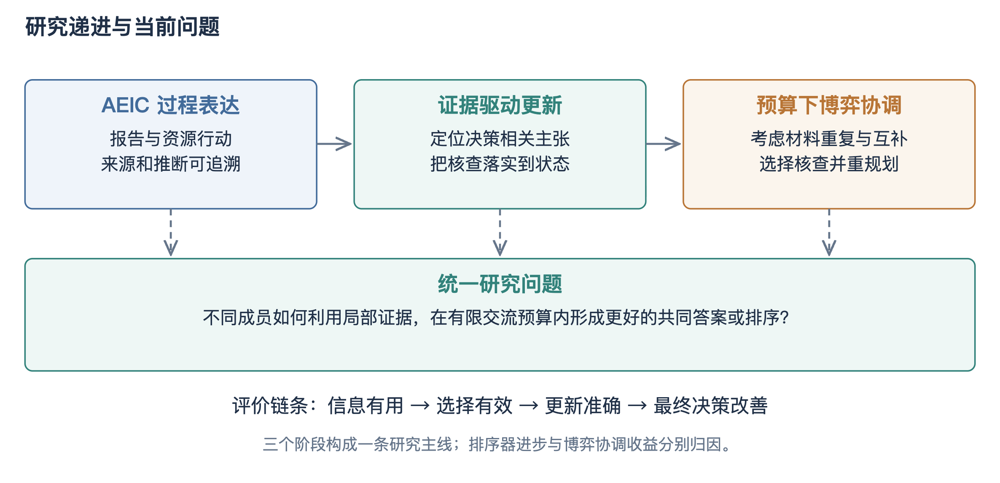

相关研究中的生成—判别共识博弈、讨论协议和资料组合归因为本课题提供了建模依据[18,17,19,30]。本课题的研究对象是实际核查行动及其对公共状态的影响，不能直接沿用其他博弈模型的效果或理论结论。研究重点在于明确行动、价值估计、可行偏离和最终任务评价之间的对应关系。

研究内容之间的接口是公共状态：过程报告产生可定位主张，核查产生可提交补丁，资源协调决定下一次核查。推荐系统接收同样的候选和来源对象，展示其执行轨迹。这个接口使前期AEIC不是被丢弃的独立方案，而是进入当前机制的过程表达基础。创新重点集中于证据更新与行动协调的闭环，系统开发则提供实际任务与可检查过程。

# 一、研究内容简介

## 3.1 关键技术与整体架构

系统首先固定任务、候选资料和信息访问权限。三个逻辑成员分别处理初始材料，提交原生任务答案及一条可定位的判断前提；公共状态保存活动主张、可见证据、当前决策、版本和修改历史。成员之间的区别来自实际材料与自身初始报告，不预设虚构的能力系数。整体架构如图2所示。

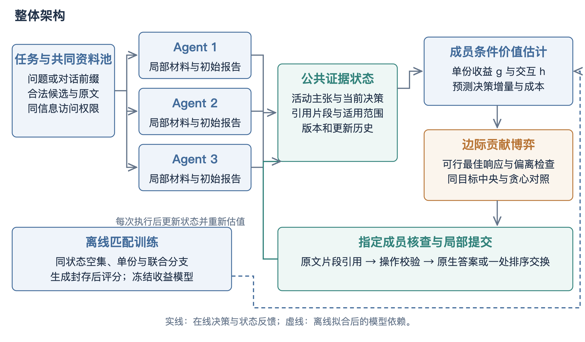

在线阶段围绕一个活动主张生成单份或两份联合核查行动，收益模型预测成员执行相应行动的增量；分配器在追加调用、资料数和预测费用限制下选择行动；执行器收到核查结果后，仅应用允许的局部修改。每次执行完成后重新构造状态与行动价值，直至预算耗尽或没有合法有价值的行动。

离线阶段采集匹配核查分支，在生成完整封存后读取评价标签，拟合单份收益与二阶交互模型。该训练针对小型收益预测器，不改变底层语言模型权重；测试阶段冻结估计器。离线拟合和在线执行分别保留输入、源码及模型版本，支持结果复核。

图中的三个成员可以使用同一语言模型，差异来自材料和自身初始判断。收益估计器不直接生成答案，只预测行动增量；分配器不直接修改结论，只选择可执行核查；执行器不读取测试标签，只检查合同并提交补丁。最终评分位于生成闭环之外。各模块分别保存输入和输出，既允许替换局部算法，也允许检查某次错误从哪里进入共同状态。

# 一、研究内容简介

## 3.2 任务、语义对象与公共状态

设任务为x，可用资料集合为E，成员集合为N。问答任务的决策空间是数据集原生答案选项，当前以是非判断为主；推荐任务的决策空间是固定合法候选池上的有序列表。两类任务共用资料、主张、行动与更新对象，最终读出与评分函数按任务分别实现。这种划分使机制可以跨任务复用，同时避免为了形式统一而把推荐质量强行变成一段自由文本的主观评分。

资料对象至少包含来源ID、原文、标题、类型、主体范围和可访问属性。不可变片段由服务端生成，片段ID指向确定原文；资料被引用后不在原位置静默改写。主张对象包含主张ID、作者、文本、关联决策、引用集合与活动状态。公共状态包含当前主张集合、已公开片段、共同决策、版本及历史事件；成员还保留自身初始报告与局部材料。状态版本用于检测核查是否针对旧状态，不能用一个旧目标的结果覆盖后来已经改变的决策。

开题中的语义图可以在这一对象层继续发展。主张与资料之间的支持边、主张之间的冲突边、补丁与决策之间的修改边，构成可追溯关系；但目前并未完成自动语义图推理。现有目标定位以词面与标题重合为透明启发式，适合建立稳定接口和对照。后续若加入嵌入相似度或自然语言推断模型，应在冻结数据上分别检验目标定位准确性、计算成本和端到端贡献，而不是把结构化JSON本身称为深层语义理解。

状态中还需要区分事实、预测和偏好。影片上映年份属于目录事实；检索分数属于预测；当前用户的显式排除条件属于需求；历史用户的兴趣只构成统计线索。四类对象可以共同影响排序，但允许的推断不同。将主体范围作为显式字段，是为了阻止历史兴趣被直接转述为当前事实，也让核查器能够指出一个判断究竟缺少事实支持，还是跨越了主体或时间边界。

对象之间的关联还决定了如何归因。某资料被公开但没有进入核查上下文，只能算可见而非已利用；某主张被标为反驳但没有合法决策补丁，最终答案可能保持不变；某次答案改变而引用不合法，则属于失败输出而非有效修订。因此，公共状态分别保存资料可见、主张状态与原生决策，不用单一的“已核查”布尔字段掩盖不同事件。

以“影片A适合当前用户”为例，主张可分成影片属性、用户条件和匹配判断三个部分。目录能够直接支持属性，当前话语能够支持条件，二者关系则需要推断。若历史对话只说明另一用户喜欢影片A，它最多提供预测依据，不能补足当前条件。保存这些关联后，反驳可以针对错误环节，避免将整份报告所有正确事实一起删除。

事件序列以状态版本串联。初始报告创建主张，资料公开增加可见集合，核查事件关联目标与片段，补丁事件改变原生决策。最终答案由末状态读出，历史文本用于追溯而不是继续作为活动事实聚合。该结构使同一次失败能够被定位为目标选择、来源使用、核验判断或提交操作的问题，也为系统回放提供直接数据。

# 一、研究内容简介

## 3.3 来源权限与分歧定位

多成员分工的前提是信息差异真实存在且可审计。初始阶段，每个成员读取分配的局部材料并形成独立报告；公共状态保存汇总所必需的结果，追加核查再按协议开放资料。对照方法具有同样的资料访问权限，单智能体也可以获得相同资料池和选择器，不能通过人为隐藏信息制造多智能体优势。资料池大小与实际阅读量分别记录，拥有访问权不等于已经把所有原文送入模型上下文。

针对具体疑点协商，首先需要确定一个可核查目标。当前实现从活动主张中选取与候选资料标题或任务表达相关的前提，再构造未读单份资料与两份组合。这种方式保留了可解释的候选生成规则，但也可能漏掉词面不相近的关键证据，或反复选择表面相关而无决策影响的前提。因此，目标选择本身是需要记录的中间变量，不能把后续失败全部归因于核查模型。

分歧至少包括答案分歧、事实分歧和适用范围分歧。两个成员对同一问题给出不同原生答案，是直接的决策冲突；推荐成员可能都选择某影片，却对其是否满足排除条件存在事实冲突；另一些情况则是资料真实但主体不适用。当前统一接口允许核查者对指定主张给出支持、反驳或证据不足，理由中保留冲突位置。它不强求所有差异都被消除，也不把“没有提出反对”当作所有成员已经证实。

在推荐任务中，优先核查决策边界具有实际意义：若某条判断只涉及排名很低且不会进入Top10的候选，即使被修正也未必改变评价；若判断影响Top10内外的交换，则可能直接改变命中。因此，研究将局部补丁限制在一处合法交换，观察核查怎样改变共同决策。当前收益预测尚未实现完善的反事实排序影响模型，这也是通过动作价值分支验证选择空间是否具有可利用差异的重要原因。

权限公平不要求各方法在任意时点拥有完全相同的内部记忆，否则无法比较分工与集中处理；它要求方法能够在相同规则和预算内获取同一信息。实验同时记录初始分配和追加阅读，使读者看到差异来自组织方式还是额外内容。强单智能体可以集中处理，而多成员保留私有初始报告，两者都必须遵守相同的未来信息隔离。

行动生成可以形式化为对未读集合枚举一元和二元子集。若当前有m份可追加资料，完整池包含m个单份与m(m−1)/2个联合候选，再与三个核查者组成成员条件选择。该规模随资料数二次增长，因此当前固定小资料池适合完整比较。未来扩展到大检索库时，应先做与标签无关的候选筛选，并把筛选召回率纳入评价。

目标定位与行动定位相互影响。一个主张选错后，再好的资料分配也可能无效；一份资料相关但目标没有决策影响，也可能得到正确而无用的核查。当前通过保存目标文本、候选行动与执行前状态，允许在动作诊断中分析这两种失败。后续若引入决策影响分数，应与现有透明启发式比较，而不是只替换实现却不解释收益来源。

# 一、研究内容简介

## 3.4 集合价值与边际贡献博弈

同一份材料可能被多个成员重复引用，两份材料也可能共同揭示单份无法说明的条件。因此，方法采用证据集合的预计价值，而不是把每次报告独立计分。训练在相同初始状态、目标、核查者和接口下采集空集、单份A、单份B与联合AB分支，避免把再次思考的收益全部归因于新增资料。图3给出了估值与协调关系。

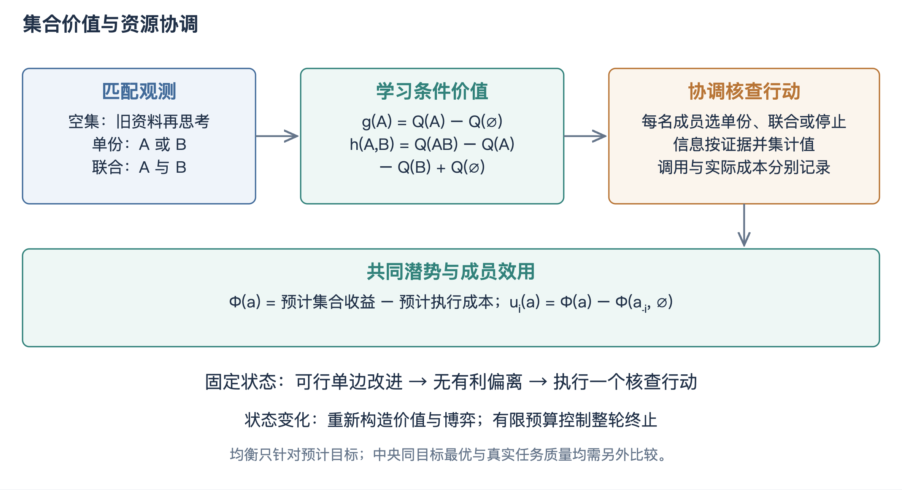

g_i(e | s) = Q(Y_e) − Q(Y_empty)

h_i(e,f | s) = Q(Y_ef) − Q(Y_e) − Q(Y_f) + Q(Y_empty)

u_i(a | s) = Φ(a | s) − Φ(a_-i, ∅ | s)

固定状态下，成员效用定义为其行动对共同代理目标的边际贡献。严格改善的可行单边更新使有限行动空间中的预计潜势增加，求解后显式检查最大可行偏离。共享约束下的局部稳定状态不等于中央全局最优，因此设置同目标中央枚举与集合贪心对照。

现有实现采用二阶近似：同一资料只计一次信息价值，实际重复调用仍扣成本；联合核查允许由一个成员完成。分别执行的资料组合采用代理交互假设，是否改善真实决策由端到端实验检验。状态更新后形成新博弈，固定状态的终止性质不被延伸为整轮质量单调改进保证。

设两份资料的预计单份增量分别为0.04和0.03，交互为0.08，则联合预计增量为0.15；若交互为−0.05，则联合只有0.02。这里的数值仅用于说明计算，不是实验结果。该例展示为什么只按单份排序可能错过互补，也可能选入有害组合。成本扣除后，停止可能比后者更优，因而负收益不能在预处理时全部截断为零。

# 一、研究内容简介

## 3.5 匹配四分支训练与标签构造

收益学习的核心不是让模型记忆哪些问题容易答对，而是估计同一状态下执行不同核查的增量。对一个训练任务，先固定初始成员报告、共同决策、核查目标及核查者，再以确定性hash选择资料对A和B。随后分别采集不增加资料的空集分支、只增加A的分支、只增加B的分支和同时增加AB的分支。四个分支使用相同接口与局部修改规则，避免把不同提示、不同初始答案或不同成员能力混入资料价值。

空集分支具有重要控制作用。核查者即使没有新增资料，也可能因为第二次思考改变答案；若直接用“读取资料后成绩减去初始成绩”作为资料贡献，就会把再次推理的收益全部归给资料。当前单份价值使用该分支相对于空集的任务质量差，交互使用联合质量减去两项单份质量再加回空集。正交互表示两份共同使用超出单份简单相加，负交互则可能来自重复、干扰或错误融合；这些是任务结果上的观测，并非资料文本本身天然具有固定价值。

训练标签在整批生成完成并封存后读取。问答使用原生正确率，推荐使用协议确定的排序质量；同一训练任务的分支必须进入同一数据分组，不允许把A分支放训练、AB分支放校准，以免共享初始状态造成泄漏。当前123个任务包含63个问答和60个推荐任务，用于训练及校准小型收益模型。分组划分以实际清单为准，报告不把分支请求数误写为独立样本数。

每题的三条初始报告加四条匹配核查构成基本采集结构。输出无效的分支保留原决策并记录失败，不能只保留能成功修正的样本。若在后续版本改变提示或资料切片，需要生成新的配置指纹，旧分支仍用于追溯而不能无条件与新分支拼接。这样，训练数据不仅包含正例，也包含无效、负收益和资料不足的真实后果，为后续校准和失败分析保留依据。

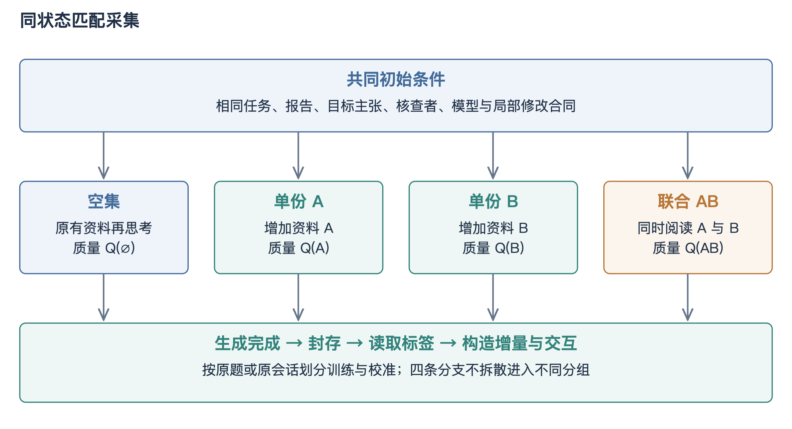

# 一、研究内容简介

## 3.6 收益特征、校准与泛化约束

当前价值估计采用两个带正则的线性Ridge模型，分别预测单份增量和二阶交互，正则参数固定为10。选择小模型是为了使有限训练样本下的特征和误差容易检查，而不是认为线性关系能够完整描述语言推理。执行前特征包括任务类型、来源类型与长度、检索分数、任务和标题重合、目标主张和材料重合、初始分歧、状态版本及已读比例；核查者的自身报告也参与成员条件特征。测试题答案、未来推荐目标和事后核查结论均不进入预测输入。

校准阶段在独立任务分组上估计预测偏置，再将冻结模型用于评价。单份和联合的标签分布可能不同，问答的二值质量又较为稀疏，因此除平均误差外，还应检查预测排序能否识别更优动作、正收益判断是否准确、联合项是否只是噪声。若两个动作预测几乎相同，求解器即便精确求解也无法带来实际区别。价值学习的中间结果因此需要与端到端结果一起报告，而不是只给出一个训练损失。

当前训练主要来自初始状态，在线执行后会形成新的活动主张和可见资料比例，这构成状态分布变化。重规划能够反映状态变化，但并不自动消除外推误差。实验通过固定状态诊断与完整轨迹分析，比较首次核查和后续核查的收益；如果后续状态预测明显失真，应在新的训练版本中加入相应状态，保留独立测试集，而不是看到某道测试题失败就针对该题补一条规则。

所谓通用机制，指任务适配器之外的状态、核查、局部更新和分配原则能够迁移，不是所有内容都无需建模。推荐依然需要合法候选与排序读出，问答依然需要原生选项。为降低拟合具体数据集的风险，当前特征不使用任务ID、影片ID或答案标签作为记忆键；训练、校准和评价按原题或原会话分离，并设置跨问答环境及第二模型检查。通用性最终表现为冻结机制在变化条件下仍可解释，而不是仅凭统一接口命名作出保证。

一个必要的诊断是将预测分成若干区间，比较各区间的实际平均增量。若模型总是预测正收益而真实结果接近零，成本阈值会失去作用；若均方误差不大但无法区分最高价值动作，协调仍不能利用机会。当前报告因此同时关注校准与排序，不用单一拟合分数决定模型是否可用。训练规模有限时，复杂模型扩展应先证明优于这一透明参照。

Ridge目标由平方损失与参数二范数惩罚组成，正则抑制小样本下特征系数过大。单份与交互分别建模，是因为前者描述新增资料本身，后者描述组合超额部分，二者标签尺度和稀疏程度不同。联合预计收益由两个单份预测加交互预测重建，校准偏置也按相同分解应用，使训练标签与在线价值函数保持一致。

预测误差可沿执行链分解：资料价值估错导致选错行动，核查者理解出错导致合法但错误的补丁，聚合或提交出错导致预期变化未落实。端到端差异不能直接告诉哪种误差主导，因此保存执行前特征和原始响应。对照中央与博弈时，两者共用同一估值；对照不同估值时，求解器保持固定，才能形成可解释比较。

# 一、研究内容简介

## 3.7 集合价值函数与共享资源约束

设成员i可以选择停止、单份核查或两份联合核查，联合行动a对应所有被选择资料的并集U。若同一资料被多个成员选择，信息价值只计一次，并在选择该资料的成员条件预测中取最大值；实际产生的重复调用仍计成本。两份资料由同一成员联合读取时，使用其预测交互；由不同成员分别读取时，采用实现中约定的跨成员代理项。后者是便于求解的近似，是否与真实共享后的质量相符需要通过实验检验。

共同潜势由预计集合收益减去预计执行成本组成。可行域同时限制追加调用数、唯一资料数和预测费用。两份联合核查消耗一次模型调用、两份资料额度，因此必须同时比较调用与阅读量，而不能用“相同轮数”替代所有资源公平性。当前预测费用采用调用项与文本长度近似，并配置共享费用上限；运行后实际金额另由服务返回的Token与配置价格计算。预测成本用于选择，实际成本用于报告，两者不能混成精确账单。

成员效用定义为完整分配的共同潜势减去删除其行动后的共同潜势。该定义让成员追求自身边际贡献，重复信息会降低其有效贡献，互补材料则可能提高联合行动吸引力。在固定其他成员动作且比较均可行的两个行动时，成员效用差等于共同潜势差。因此，成员按照效用改善进行调整与提高预计共同目标相一致。这个性质说明当前合作协调模型的结构，并不等同于对具有私有信息、谎报动机和外部利益的真实主体完成激励相容设计。

实现保留停止动作，允许预计收益不足时不继续核查；在共享约束下，成员不能选择令总体预算超限的动作。分配完成后，执行器按协议落实一个行动并更新状态，然后重新估值。这意味着分配解是当前状态下的下一步计划，并非承诺所有成员一次执行到结束。必须通过轨迹核对求解动作与实际调用一致，避免理论中选择了资料组合，代码却执行另一条普通审阅。

当同一资料被两个成员同时选择时，取最大成员条件值是一种乐观近似，可能高估实际执行者的效果；当两份资料由不同成员读取时，交互代理也可能忽略交流损耗。这些假设不是无关实现细节，而是潜势与真实质量之间的关键连接。实验保留成员归属和最终执行者，能够检查高估是否集中于重复或跨成员组合，并在后续估值修订中针对性校准。

式中V和C分别表示估计的集合价值与执行成本，M为预测费用上限；它们用于行动选择，真实质量与账单由执行后独立评价。

Φ(a | s) = V(U(a), a | s) − C(a | s)

A(s) = {a : calls(a) ≤ K, sources(a) ≤ B, C(a) ≤ M}

u_i(a_i,a_-i | s) = Φ(a_i,a_-i | s) − Φ(∅,a_-i | s)

# 一、研究内容简介

## 3.8 最佳响应求解与理论性质

固定状态s后，各成员的行动集有限。求解器从一个可行分配开始，依次枚举某成员在其他成员不变时的可行动作，选择能够使自身效用严格增加的动作；没有超过容差的改善则保持原动作。由于效用变化与潜势变化相同，每次实际接受的更新都提高潜势。有限分配空间不存在无限条严格改善且不重复的状态路径，因此在固定状态与精确比较条件下该过程终止。这是当前方法可说明的有限改进性质[28]。

终止后重新枚举所有成员的可行单边替代，计算最大改善幅度作为偏离检查。若该值不超过设定容差，则说明求解结果相对于当前预计目标达到相应的局部稳定。证书需要记录状态指纹、最终分配、潜势和最大偏离，才能与实际执行轨迹对应；只在日志中打印“均衡”不足以证明求解满足定义。浮点容差、行动去重和共享约束的实现均通过回归检查，防止求解器与证书使用不同可行域。

局部稳定仍可能不及中央最优。例如，两个互补行动必须同时替换才能获得收益，而任一成员单独改变会降低潜势，则单边改进可能停在较差分配。当前实现保留这种反例，并设置在相同代理目标和相同可行域上枚举的中央方法。若中央与博弈得到相同解，应如实说明该样本上没有求解差异；若博弈更省计算但质量相近，贡献可能体现在协调开销；若博弈明显落后，应分析局部陷阱与价值误差，而不能用“去中心化”回避强参照。

在线更新后状态变化，收益模型、活动主张与可行动作都可能改变。因此，上述证明仅针对一个固定状态的求解，不推出最终任务正确率单调增加，也不推出不同状态间具有统一潜势。整轮执行的终止由有限追加预算和合法停止条件保证。论文将理论性质限定在其假设内，再用真实任务检验预计目标与外部质量是否一致，避免形式推导与实际效果脱节。

计算复杂度随成员数与行动数增长。当前三个成员与有限资料池使中央枚举可作为真实参照，但不能据此推断大规模环境下同样可行。最佳响应每轮逐成员扫描自身可行动作，实际轮数和潜势评估次数需要记录；比较计算效率时应在相同实现环境报告，而不只讨论渐近符号。只有任务质量相近且协调开销确有下降，才适合提出扩展性方面的经验结论。

具体求解分为初始化、逐成员替代、潜势比较、终止和证书五步。初始化采用全停止分配；逐成员枚举停止及当前行动池；比较时拒绝不可行分配，严格改善才接受；一轮没有变化则终止；最后独立扫描所有可行单边替代。记录每次移动的成员、前后分配和潜势增量，可以重建求解过程，而不是只保存最终索引。

边际效用恒等式可直接由定义得到：比较aᵢ与aᵢ′时，删除成员i后的参考项完全相同，相减后抵消，剩余正是两个潜势之差。这一推导依赖其他成员与状态固定。若同时改变核查者模型、资料池或目标，参考项不再对应同一博弈，因此不应把跨版本的质量差也叫作成员偏离收益。

# 一、研究内容简介

## 3.9 与开题演化博弈及去中心化目标的关系

开题设想用复制者动态描述策略群体随收益变化的演化，并讨论核验与信誉是否能够促进合作。当前有限最佳响应与该设想具有共同的行动—收益—调整逻辑，但研究尺度不同：前者针对给定任务状态选择具体核查动作，后者关注长期策略分布和稳定性。不能因为两者都使用收益就把当前求解称为复制者动态，也不能由有限终止推导ESS。报告保留开题目标，同时明确当前完成的是可执行行动层的合作博弈。

后续若继续引入演化分析，首先需要明确策略类型，如核查、直接接受、自由改写或停止，并规定不同任务上的收益观测与策略更新周期。复制者方程中的收益应来自受控实验或合理生成模型，而非为得到理想稳定点而任意设置。诚实核验也不是简单二元策略：模型可能引用真实材料却作出错误推断，因此还需区分操纵行为与能力不足。当前真实核查数据和错误类型可以为这些定义提供依据，但尚不足以声称存在保证诚实的演化机制。

去中心化也应分层理解。算法层可以让成员依据公开状态和自身条件价值选择动作；协议层需要定义状态版本、冲突提交和预算预留；部署层则涉及多个进程或节点之间的通信、身份和故障处理。目前平台用统一执行器保障实验可复现，相当于保留受控的协议实现，尚未完成无中心节点的分布式服务。这样的实现适合先比较行动机制，但不能把统一调度器隐藏在“多Agent”名称后面。

因此，中期后的合理顺序是先验证动作空间和贡献估计，再比较协调求解，随后把稳定的行动契约接入应用，最后根据需要研究分布式提交或长期演化。该顺序没有改变开题的问题意识，而是把原先较宽的理论目标分解为能够逐项检验的技术对象。若最终论文对题目中的去中心化只能提供算法层解释，应与导师核对表述范围，并在摘要与结论中一致说明，避免题目、方法和系统实现分别承诺不同程度的去中心化。

在协议层进一步分散执行，需要处理并发核查针对同一旧版本的情况。可采用先声明目标与预算、再提交带版本结果的方式，冲突结果不直接覆盖，而进入重新评估。公共证据可以用内容指纹识别，状态事件保持可排序。以上是后续部署设计，不改变当前统一执行器的事实；其验收应包括重复消息、过期补丁和节点失败，而不仅是多个进程能启动。

长期信誉若被纳入演化支付，需要跨任务延迟反馈。可以在任务完成并得到独立评价后更新下一批任务的先验，避免本题标签影响本题；同时控制初始权重与衰减，防止少量偶然成功长期垄断话语权。当前研究保留这一路线，但优先完成无标签在线贡献预测，使未来信誉机制拥有可分离的基准，而不与所有组件一起改变。

# 一、研究内容简介

## 3.10 核查执行与状态重规划

核查流程以明确的目标主张和允许材料开始，避免让模型泛泛评价整份报告。当前目标定位采用活动主张与材料标题重合的透明启发式；行动池包括未读资料的单份与两份组合。图5展示了从初始分工到最终读出的执行过程。

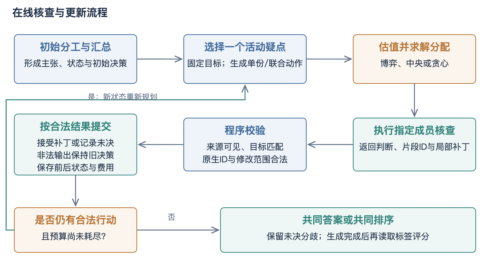

收益估计使用执行前可获得的资料类型、长度、检索分数、问题及目标重合、初始分歧和状态信息，不使用当前任务答案或事后核查结果。分配完成后选择一个行动执行，记录其成员、资料、请求、响应和前后状态，再依据新状态重新规划。停止也是合法选择，不要求每题都讨论固定轮数。

运行器采用先落盘原始响应、再进行解析与提交的方式。未知完成请求不会自动重发；成功请求仅在输入与参数完全一致时复用。无效输出保持原决策，并保留失败与实际资源消耗。该设计使中断恢复、费用核对和方法比较具有共同执行基础。

执行一个行动后，已读集合、活动主张与共同决策都可能变化，原计划中的其他行动未必仍有价值。例如，第一份资料已足以纠正目标，第二份近似资料便可能重复；也可能第一次核查暴露新的条件，使原先低价值资料变得重要。因此，每步重规划以新版本为起点，预算按实际消耗递减，旧行动不因曾被选中就必然执行。

# 一、研究内容简介

## 3.11 有依据的局部更新

核查输出包括目标ID、支持或反驳或证据不足判断、原文片段ID、理由以及可选局部补丁。原文片段由服务端从实际材料中生成，模型只选择不可变ID，避免重新抄写引文造成额外接口失败。执行器检查来源可见、主体范围、目标与修改类型。更新范围如图6所示。

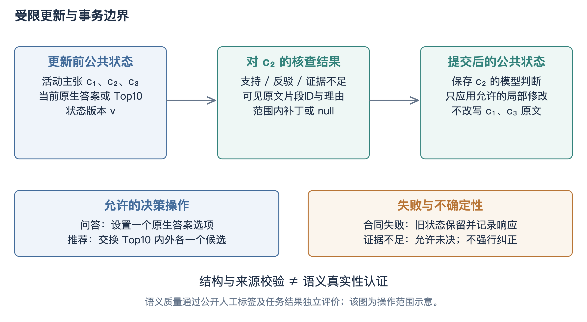

对于问答，补丁只设置一个原生答案选项；对于推荐，补丁只交换当前Top10与其外部各一个合法候选。被反驳主张的模型状态、原文和核查记录保留，无关主张不被整段改写。整份自由重写单独设置为消融，不能与默认局部更新混用。

来源范围尤其需要区分当前用户、历史用户、目录事实和模型预测。历史对话中的兴趣不能直接当作当前用户事实，预测分数也不是自然语言主张的真实性认证。程序合同保证操作合法，语义判断则通过公开人工标注关系及任务结果独立评价。

局部更新将“模型意见”和“程序操作”分开。支持或反驳是核查者的语义判断，补丁是系统允许的决策变化；两者同时记录，既可以出现支持但不改变排序，也可以因补丁非法而拒绝提交。程序不会从一句反驳理由自行猜测应删除哪部影片。这个边界减少隐式副作用，并让自由重写消融有清楚的对照对象。

# 一、研究内容简介

## 3.12 异常处理、中断恢复与预算记账

真实模型调用存在超时、限流、格式错误和完成状态未知等情况。运行器先保存原始请求与响应，再进行结构解析和状态提交，避免解析异常造成已付费结果丢失。每次请求由任务、状态、资料、成员、提示和模型参数共同形成指纹；只有完全相同的调用才能复用。程序重启后读取已落盘事件继续执行，不能仅根据输出文件存在就假定整题完成。

完成状态未知尤其需要单独处理。客户端没有收到响应，并不代表服务端没有执行或计费，因此当前默认不自动重发未知请求，保留意图和异常记录。用户授权补发时应产生新的尝试，并记录重复计费风险。解析失败也不能被静默替换成多次免费重试，否则某方法因输出更差而获得更多真实生成机会，费用与正确率比较都会偏离原协议。

状态提交采用局部事务语义。核查输出必须匹配目标与版本，引用必须来自允许片段，补丁必须符合任务操作范围；全部检查通过后才应用相应变化。非法结果保持原决策，失败事件进入日志，实际调用照常记账。该处理把“接口未能执行”与“合法执行但判断错误”区分开，便于分析工程失败是否在不同方法间不均衡，而不是只比较双方成功案例后忽略失败分母。

预算同时从逻辑和物理两层报告。逻辑层记录每种方法本应使用的初始调用、追加核查、唯一资料和可访问内容；物理层记录实际请求、缓存复用、Token、费用与未知完成。共享缓存可能减少真实付费次数，却不能让该方法看起来逻辑上少读了材料。研究主比较因此同时列出两类成本，并保留停止原因，使性能—预算分析能够区分机制节省与运行器复用。

断点恢复的最小单元是持久化请求与状态事件。已经收到原始响应但尚未解析的请求，可以重新解析；已经合法提交的补丁不能再次应用；只有评分缺失的封存案例，可以重新评分而无需再次生成。将这三种恢复动作分开，既减少重复费用，也防止同一局部交换执行两遍后回到旧排序。恢复检查因而同时验证事件身份与提交版本。

失败分类至少包括传输失败、完成未知、解析失败、引用非法、目标过期和补丁越界。前两类涉及服务执行状态，后四类涉及收到输出后的合同处理。分类统计能够发现某模型只是包装不稳定，还是语义核查经常引用不允许的资料。主表保留所有失败，诊断再按类别解释，不把工程失败过滤后剩余的少数案例当作总体方法质量。

成本审计从请求回执汇总输入与输出Token，并与阶段案例索引核对。复用结果的物理费用为零，但逻辑调用仍属于方法计算；未知请求只记录已知账单和未确认项，不填零掩盖风险。最终费用不是脚本上限，也不是模型标价乘一个估计长度，而是已完成回执的合计加上单列未知情况。

# 二、论文进展情况

## 1. 研究计划与实际进展

相关工作方面，已围绕多智能体投票与讨论、生成—判别博弈、证据充分性、引用质量和组合信息价值进行阶段调研，并形成与本课题的差异记录。调研结果推动研究从公开信用与报告形式，转向实际信息核查及其决策后果，保持多智能体博弈共识这一主线。

方法实现方面，已建立公共证据状态、原文片段引用、局部更新、匹配四分支采集、单份与交互收益拟合、成员条件分配博弈和状态重规划。统一入口可执行训练、主比较、动作价值诊断、消融、预算、干扰、模型迁移与报告汇总。

系统实现方面，已具备结构化请求、目录检索、冻结短名单、并行角色审议、确定性约束门控、共识排序和执行归档。本轮进一步增加影视检索与证据工作台及已封存研究案例回放，使候选、来源、角色判断与局部更新过程具有可查看的界面。

实验准备方面，已固定123个训练与校准任务，准备200道StrategyQA、200个ReDial独立会话、458道HotpotQA是非题以及180条人工标注证据关系。主要端到端评价与固定64题次要分析分开，避免将小批消融数量写成主结果规模。

工程验证方面，47项相关机制回归覆盖集合收益、成员分配、中央参照、局部更新、完整模拟生命周期和数据审计；本轮系统新增回放与原工作流相关测试17项通过。两类测试分别记录，不将程序测试通过率作为自然语言核验准确率。

最新已封存的论文批次接口检查包含4题：初始12条响应中11条合同有效，空集4条及单份/联合12条均有效，接口门通过。该批次存在1个完成状态未知的请求，保留记录且不自动补发。后续训练和主结果以完整封存后的输出为准，不读取中途成绩填入报告。

当前研究产物可按四类核对。设计产物包括主线计划、机制定义与数据统计协议；实现产物包括状态、行动、分配、执行、评分和系统接口；数据产物包括固定清单、原文、参考预测与人工关系；证据产物包括已封存历史结果、工程检查和回归记录。四类分别回答“要做什么、怎样做、用什么做、已证明什么”，共同构成中期进度。

阶段完成的判定也由单个脚本扩展为完整生命周期。准备阶段检查输入，生成阶段隐藏标签，封存阶段固定输出，评分阶段计算外部指标，汇总阶段审计方法与任务对应。该组织让后来接手者能够依据文件继续，而不是依赖助手聊天中对“跑完”的口头判断；中期报告据此呈现可复核产物。

# 二、论文进展情况

## 2. 前期探索的递进与阶段性修订

第一阶段围绕AEIC过程报告与资源行动展开，重点是把假设、证据、推断和结论记录下来，使输出不再只有最终答案。这一阶段建立了可追踪的表达基础，但过程写得完整并不代表推理真实，也不能保证交流带来独立采样之外的收益。因此，后续研究把报告格式与任务质量分开，保留AEIC作为过程表示，而不把其名称直接当作核验能力。

第二阶段把核查结果落实到公共状态。早期实现只检查字段和来源存在，反驳又可能不删除旧错误，整份替换还会改变无关内容。这些问题会使“核查成功”的日志与最终聚合器实际使用的信息不一致。修订后采用指定目标、不可变片段、三态判断与受限补丁，失败保留原状态，反驳记录与原文并存。该阶段的贡献是让交流成为可执行更新，而不是仅产生一段新的评论。

第三阶段面向推荐任务补齐强预测基础。训练侧邻居、知识信息和融合排序为共同决策提供更实际的材料，也暴露出一个重要事实：如果独立汇总已经利用了大部分有效信息，额外协调可能没有增量。于是实验从弱生成基线扩展为同信息强单Agent、独立汇总和中央分配，原生排序器收益单独报告。该修订提高了比较难度，也使研究问题更接近“协调是否必要”。

第四阶段进一步检查不同核查动作是否具有可利用的差异。旧动作面板存在较高合同失败且没有稳定正向联合信号，因而当前采用匹配空集、单份与联合分支学习集合价值，并加入去重、共享资源与重规划。该过程不是不断更换研究主题，而是沿着过程表达、可执行更新、有效信息基础和行动协调逐步补齐因果链。但每个版本的证据必须独立保留，不能把不同模型、不同资料和不同协议下的最好成绩拼成同一个方法的累计提升。

前期反复修改的根源可以归纳为对象没有完全对齐：用格式检查代表核验，用报告替换代表局部纠错，用更多资料代表协调收益，用小批胜负代表稳定改进。当前修订将这些关系拆开并重新连接，每一环设置可观察记录和强对照。复盘的价值在于确定必须控制的变量，而不是把所有旧版本都作为最终方法的一部分。

这些历史经验也决定了当前冻结原则。冻结的是承担评价的配置与清单，不是永久禁止研究新想法；新想法可以进入后续开发版本，但不覆盖当前输出。这样既保留探索能力，也避免方案、代码和实验始终处于不同时间点。论文中只用明确版本的证据支持明确结论，历史实验承担动机与诊断角色。

# 三、工作成果

## 研究内容一 多智能体博弈共识机制

（一）建立了可追溯的信息生产与核查执行基础。前期AEIC过程报告把假设、证据、推断和结论与资源行动连接起来，后续框架把核查目标、原文片段和局部补丁落实为可执行对象。该基础使错误定位不再仅依赖最终答案，也使普通审阅、核查更新及预算策略能够在共同运行器中比较。

（二）完成了原生推荐预测基础及较强对照。全ReDial验证数据的3010个目标上，监督排序器命中806个，强全排序融合命中730个，Recall@10由24.252%变为26.777%，提高2.525个百分点。该结果归属于排序器改进，说明已有预测信息可被进一步利用，不能直接写成博弈收益。

（三）获得了异质协作的开发信号。64个前缀、83个目标的开发实验中，异质独立汇总命中21个，中央核查与博弈均命中22个，同预算强单模型命中20个。该结果提示部分判断具有互补性，但中央与博弈一致，且小批配对区间不足以支持稳定优越的结论。

（四）完成了同状态动作诊断。旧8题面板比较空集、单份和两份组合，在该批次未观察到正向单份平均收益或稳定联合正收益；256条分支中85条合同无效。该诊断促使方法修订为原文片段选择、匹配四分支训练及集合价值分配，而不是继续增加无区别的讨论轮数。

（五）形成了当前集合价值方法与可归因实验协议。生产分配器支持成员条件的单份和联合价值、来源去重、共享预算、可行最佳响应、偏离检查及同目标中央求解。程序验证了边际效用与潜势变化的对应，同时保留局部均衡逊于中央的反例。新版本的实际收益由本轮固定实验评价。

# 三、工作成果

## 研究内容一：历史结果的归因与适用范围

已有结果首先证明了本地推荐预测基础可以改进。在3010个目标上，监督排序器相对于RRF全排序融合增加76个命中，对应Recall@10提高2.525个百分点。这是同一任务目标上的预测收益，说明已有训练信息和候选特征具有可利用信号；它不说明多成员交流优于同一排序器，也不能用来替代当前博弈方法的端到端比较。论文可以把它作为推荐基础与强参照的建立，而不是核心协调贡献的主结果。

64个会话前缀、83个推荐目标的异质开发实验中，异质独立汇总为21个命中，中央与博弈均为22个，同预算强单模型为20个。这个结果提供了有限互补信号，也明确限制了现有结论：样本小，中央与博弈没有目标命中差异，配对区间不能支持稳定领先。因此，它适合用于解释为什么继续研究核查选择，不适合直接写“博弈显著提升推荐”。同样，旧44个双方有效案例上的持平只对应特定成功子集，不能代表完整方法比较。

前期问答实验中，曾出现不同配置从306个正确变为370个正确的较大变化，但模型、资料或报告资源同时变化，无法单独归因于AEIC。另一个90题对比中，普通方法76个正确并有1个未决，AEIC为77个正确，Token约增加33.05%。后者提示过程结构可能改善部分样本，却不足以支持普遍优越。对这类历史数据，合理写法是报告配置与限制，并将其作为改进实验控制的依据。

当前论文批次通过接口门后才进入收益拟合和冻结评价。中期报告保留已封存的工程检查与历史结果，待新主比较完成后，分别回填问答、推荐和人工关系评价。回填时不改变任务清单、指标或主要参照，也不只选取有提升的模型或资料环境。如此，论文能够从真实已有成果出发，又为核心创新保留完整、可检验的证据位置。

历史结果应分层进入论文。预测基础可以作为实验设置和强参照建设，AEIC过程可以作为结构化表示的前期工作，异质小批可以作为信息互补动机，动作面板可以作为接口与估值修订依据。它们共同解释当前方法为何这样设计，但不能替代新方法在冻结任务上的主要结果。如此组织既保留过去工作价值，也避免论文像多个实验日志的拼接。

对小批新增命中还应检查损害。净增加一个目标可能由新增五个、损害四个组成，也可能由新增一个、没有损害组成，两者对可靠更新的解释不同。当前配对日志因此保留每个任务的前后变化，并按会话汇总。稳定改进应体现可重复的新增与可控损害，而不是只看总命中差的正负号。

# 三、工作成果

## 研究内容一的实验数据与评价设计

实验分别回答核查能否修正目标、预计价值能否选择更好的行动，以及完整协调是否改善最终任务结果。图7给出训练、冻结比较和次要分析之间的关系。问答正确率与推荐Recall分别报告，不将不同任务合并为一个总分。

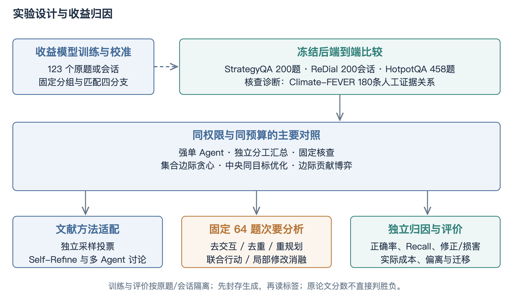

StrategyQA用于真实检索条件下的问答评价；HotpotQA采用公开验证集中全部458道原生是非题，保留官方上下文与人工支持句，核对支持句均存在。447题有10段上下文，其余11题只有2至9段，也全部保留，不补造材料或按难度删题。

ReDial固定200个独立会话，模型仅获得当前前缀和允许的历史或目录信息；未来推荐目标在生成封存后评分。Climate-FEVER采用180个原始claim的人工证据关系，用于支持、反驳和证据不足的三态评价，不能冒充完整事实核查榜单成绩。

实验顺序先确认接口合同可执行，再拟合收益模型并冻结，随后进行主比较和预定次要分析。接口门只决定工程是否可进入采集，不以小批成绩选择最优方法；主比较的任务和指标在观察结果之前确定。动作诊断使用更多反事实分支，承担机制解释而非部署成本证明。推荐原生排序和人工关系评价提供独立参照，避免所有结论都由同一模型裁判给出。

# 三、工作成果

## 实验一：数据集选择与质量保障

主比较采用StrategyQA与ReDial，分别对应隐式推理问答和会话推荐。StrategyQA的200个评价原题来自固定清单，检索侧为每题提供8份真实维基材料；材料经过检索与规范化处理，但词面覆盖不等于语义充分。ReDial的200个评价单位是相互独立的原会话，在固定推荐时点截取前缀；后续影片目标仅供评分。两类任务的训练和评价使用可观测原生ID排除交叉，不能进一步声称底层语言模型从未在预训练中见过相似内容[32,36]。

HotpotQA采用公开验证集distractor设置中的全部458道原生是非题，其中225题答案为是、233题为否。447题有10段上下文，另11题有2至9段，均保留；少数仅有两段初始材料的任务需要在三个逻辑成员间复用，而不是补造第三段。官方人工支持句均能在提供上下文中找到，支持句存在仍不等于有限预算下每个方法都实际读到。该任务是明确限定的“给定上下文是非子任务”，不能与完整开放域HotpotQA或官方测试榜单混称[33]。

核查关系评价借鉴事实核验任务的标签体系[34,35]，从Climate-FEVER固定180个原始主张，每个主张按确定规则选择一条人工标注证据关系，评价支持、反驳和证据不足。这里研究的是给定主张与材料的关系判断，不是从互联网检索并完成原始完整事实核查。若使用受控初始错误，错误是实验构造而非模型自然错误率，必须在结果中分别说明。

数据质量控制包括原文非空、原生实体合法、目标不进入生成输入、支持句位置核对、任务身份去重和资料版本固定。HotpotQA与Climate-FEVER记录上游版本指纹，ReDial同时固定训练侧检索与图谱来源。清洗只处理不可解析和协议不合法问题，不依据方法是否答对删除困难样本；存在的短上下文、资料不相关或候选覆盖不足作为任务属性保留，进入分层分析。

推荐数据的训练侧检索还需要限定时间边界。当前前缀中已出现的实体可以用于构建兴趣表示，训练集会话可以提供邻居统计，评价会话的未来话语则不能参与。若知识图谱包含影片之间的一般关联，需要披露其来源与构建范围。这样的知识不必全部排除，但必须让所有方法具有相同使用权限，并避免从目标标签反向挑选有利资料。

数据准备与评分金库分离。运行输入包含问题、合法候选、资料和任务身份，评价答案保存在独立对象中，生成阶段只使用前者；完整封存后再由评分模块关联标签。准备代码为构建金库读取标签是必要的数据处理，不等于生成模型可见标签，关键是运行路径是否把它送入提示或行动特征。审计应检查真实请求载荷而不只检查文件名称。

官方上下文环境还能够区分检索与利用。若支持句已经存在而方法没有读到，问题在资料选择；读到了却判断错误，问题在核验；核验正确但决策未变，问题在更新或读出。真实检索环境增加资料不充分因素，两者联合才能定位瓶颈。人工关系任务进一步去掉行动选择，提供较直接的核验能力观察。

# 三、工作成果

## 实验二：隔离、抽样与样本量

训练、校准和评价按原题或原会话分组。匹配分支共享同一初始状态，不能被当作独立题目随机拆分；同一ReDial会话的多个前缀也不应一部分用于拟合、一部分用于最终评价。当前训练校准总计123个任务，主比较为200道StrategyQA和200个ReDial会话，再加458道HotpotQA是非题。人工关系180条单独报告，不与任务正确率合成一个总体准确率。

次要分析采用采集前固定hash选出的64题，其中问答32题、推荐32题，覆盖动作价值、消融、预算、干扰和模型迁移。多种分析重复使用该子集有利于配对解释，也意味着这些结果并非多个独立大样本证据。不能把64题上十种配置产生的640次运行写成640道测试题。主要结论仍以预定主比较为依据，子集用于解释机制如何工作以及在哪些条件下失效。

样本量应与可检测差异联系。以二值配对差、方法间不一致率0.2、双侧显著性水平0.05和检验功效0.8作为粗略规划假设，200个独立单位约能检测8.9个百分点差异，458题约为5.9个百分点。若真实效应只有2.5个百分点，按同一近似需要约2509个独立单位。这一计算不适用于所有推荐指标或聚类结构，但说明小批中出现一两个新增命中不足以构成稳定优势。

数据规模因此不能只回答“够不够”而不说明用途。现有规模可以完成机制校准、较大效应检查和论文中的受控比较；小幅度优势需要更精确区间或额外独立复现。扩样应由预定精度需求、资源与数据合法性决定，在看到成绩后为了显著而反复追加会改变推断含义。当前先冻结既定清单，报告效应量与区间，再依据公开的精度不足制定新的独立批次，而不是把新旧题任意混合。

抽样清单的固定方式也属于复现材料。保存原生ID、排序规则、随机种子或hash规则，以及排除重叠的具体清单，可以让后续接手者重建任务集合。仅写“随机抽取200题”不足以复现，也无法核查是否在看到结果后替换样本。对于上游更新导致的缺失任务，应保留缺失记录，并按预先规则决定补位，而不是人工选择容易成功的替代题。

样本量规划使用独立单位，而不是请求数。一个任务四条匹配分支高度相关，三名成员初始回答也共享同一问题；它们提高任务内诊断精度，却不增加同等数量的独立问题。推荐的多个目标共享对话前缀与排序，也需要按会话处理相关性。报告列出任务、目标和请求三个数量，有助于避免规模被无意放大。

样本选择保持标签盲。确定hash和来源规则后，不根据yes/no比例以外的模型表现换题，也不删除所有方法都答错的题。若某题原始资料损坏，应依据输入质量规则处理，并保存排除理由；如果只是资料难以理解，则属于真实挑战。固定清单既保障公平，也使后续复现可以逐题核对。

# 三、工作成果

## 实验三：六种主要方法的公平比较

第一种方法是同信息强单智能体。它获得相同公共资料池、相同价值估计器和可行动作，保留自己的推理记忆，并在相同追加预算内执行核查。该参照回答“多成员组织是否必要”，不能人为限制其读取能力。第二种方法是独立分工汇总，成员处理初始局部材料并在预算内独立审阅，最后按共同读出聚合；它回答独立多样性已经能够提供多少收益。

第三种方法是固定核查，使用预先规定的行动顺序与可行域，不依据预计收益改变选择。它提供一种简单、透明且成本相同的交流策略，帮助判断复杂估计器是否优于常规执行。第四种方法是集合边际收益贪心，每次选择当前预计增量最大的可行动作。它和完整方法共用估值、去重及预算，区别集中在分配求解，避免把估值能力误归为博弈能力。

第五种方法是中央同目标优化，在相同可行分配空间枚举代理潜势的最优解。它是当前小规模设置中重要的强参照，能够区分局部求解损失和价值预测损失。若中央代理最优也不能提高真实结果，优先检查估值与行动质量；若中央好而博弈差，则需要分析单边协调的限制。第六种方法为完整边际贡献博弈，使用可行最佳响应和偏离检查，并按新状态重新规划。

六种方法统一初始调用数、后端模型、原生决策空间、资料权限、合法补丁和失败处理。主设置采用三个初始成员或相应等价生成预算，加两次追加调用，联合读取仍受唯一资料限制。方法可提前停止，因此相同上限不保证实际消耗完全相等；同时报告质量与实际成本，比强迫每种方法用满预算更能反映机制。所有比较保留原始任务分母，并对无效输出按照统一协议处理。

读出函数也必须一致。问答不能对完整方法使用更强裁判，对独立方法只作简单多数；推荐不能让完整方法自由新增候选而限制其他方法。当前采用任务原生读出和共同合法操作，把最终汇总作为公共组件。若要研究更复杂的聚合器，应另设消融，使分配机制和读出机制的收益可以分别辨认。

因果解释可以沿对照逐层展开。独立优于单Agent，可能来自分工或多样性；固定优于独立，提示交流本身有用；贪心优于固定，提示价值选择有用；中央优于贪心，提示组合优化有空间；博弈接近中央且开销更低，提示分散局部协调可作为有效求解。并非每一层都必须提高，实际结果决定哪些论点成立。

若博弈和中央长期产生同一行动，端到端结果自然可能相同。这时不能通过换随机种子刻意制造差异，而应报告行动一致率及求解成本，说明当前规模下两者关系。只有当成员条件、交互或资源竞争产生实际不同分配，才进一步分析哪类协调更有效。比较对象的强弱由统一目标和权限决定，而不是名称。

# 三、工作成果

## 实验四：文献方法与原生推荐基线

文献对照选择与当前研究问题直接相关、能够在同后端实现的基本机制。独立自一致性以多条独立推理样本聚合，当前使用相同基础模型、明确温度与总生成预算；Self-Refine保留初始回答、反馈和修订的顺序；普通多智能体讨论保留初始成员与轮流阅读同伴观点的过程[5,20,11]。这些适配版本应披露提示、聚合和预算，不把本地接口改写后得到的成绩称为原论文完整复现。

外部方法与六种主要方法分别解决不同问题。前者说明本方法相对于文献中常见推断流程的位置，后者严格分解信息权限、估值和分配的作用。若某文献方法原本需要更长上下文或多轮讨论，可同时给出同预算适配与原设定范围的说明，但不能拿自己的更多资源版本和对方被截断的版本直接宣称算法先进。原论文报告的数字可以用于背景综述，直接胜负必须建立在相同数据、划分、指标和资源定义上。

推荐侧保留Sparse、KBRD推荐部分和RRF60融合。Sparse使用训练侧统计与当前前缀，KBRD部分使用规定知识与推荐表示，RRF按各排序中的倒数名次融合[38,43]。预测在评价标签读取前生成并封存，原生候选和实体空间保持一致。完整KBRD对话生成、KGSF和UniCRS等尚未全部复现时，应明确范围，并把它们列为领域相关研究而非伪造已运行结果。

基线质量还需要通过自身审计保证。检查候选数量、原生影片ID、训练侧信息范围、空前缀处理与推荐目标覆盖，确认没有无意削弱参照。对于不同论文使用的不同候选全集或Recall定义，不做直接数值排序。论文的先进性论证应同时包含公平的本地强比较、与相关机制的技术差异，以及跨条件的稳健性，而不是只依靠“多Agent加博弈”这一组合名称。

先进性评价不是简单追求一个跨论文最高数值。不同方法可能在模型能力、训练数据、候选全集和生成任务上差异很大。论文应先证明本地配置的参照没有明显缺陷，再说明新增机制在哪个受控问题上解决了既有流程的不足。若尚未完成某个强领域模型的同条件运行，就把该项列为比较边界，避免用不一致的公开数字凑齐基线数量。

外部适配的输入也应可审计。自一致性不读取同伴输出，普通讨论读取指定同伴报告，Self-Refine读取自身反馈；三者都使用合法资料和原生决策空间。若额外工具或模型裁判改变资源，应列入逻辑预算。当前适配着重比较推断流程，不复现原论文所有训练和模型差异，正文按这一范围解释。

原生排序参照避免了仅与语言模型比较的偏差。对于推荐任务，历史共现或知识图谱可能已经给出强信号，多Agent只有在此基础上利用需求和证据才能体现价值。候选覆盖、全排序与Top10输出分别保留，便于判断损失来自召回还是排序截断。若强预测器已经超过协作结果，也应保留这一事实作为系统接入策略的重要依据。

# 三、工作成果

## 实验五：动作价值、核验与局部更新诊断

动作诊断固定同一初始状态，比较空集、单份和联合分支，首先检查是否存在可利用的行动差异。统计最佳可行动作相对于空集的潜在收益、随机或固定行动的平均收益、收益模型选中更优动作的比例及相应后悔值。若所有合法动作都几乎没有真实增量，继续优化分配求解器不太可能改变最终结果；若有明显机会但预测无法选中，缺口在价值估计；若预测正确而提交失败，则缺口在执行接口。

联合价值需要比单份收益更谨慎。两份资料可能提供互补事实，也可能只增加上下文噪声。匹配交互以相同目标、核查者和局部修改规则计算，检查正负交互分布及区间，并区分共同阅读与分别阅读。当前二阶代理不能代表任意高阶组合，因此实验不把“两份有用”扩展为“大联盟一定更好”。对观察到的正向组合，保留可复核的原文与状态变化，避免只展示一个漂亮案例。

核验准确性用人工证据关系三态评价，分别统计支持、反驳和证据不足的识别，不只给总体准确率。错误反驳会损害正确主张，错误支持会保留错误主张，二者对最终决策的影响不同；故进一步按初始决策正确性统计修正和损害。引用片段合法率、操作合同通过率作为工程指标独立报告，不能与语义关系判断混为同一项核验成功率。

局部更新评价观察目标主张是否被准确处理、无关内容是否被保留，以及决策变化是否来自允许补丁。自由重写消融允许模型重写整份输出，用来检验约束是否减少无关损害，同时也观察是否因过强限制错过必要的大范围修正。若局部操作只能交换一项而真实任务需要多项调整，应通过预算序列和操作覆盖分析解释，不将合同限制产生的上限归因于模型理解能力。

案例分析采用固定选择规则，例如分别展示新增、损害、合法但无变化及合同失败的代表轨迹。每例给出初始判断、允许资料、选定片段、核查意见与补丁结果，读者才能判断是材料互补还是模型偶然猜对。自然语言理由的流畅程度不作为选择优秀案例的依据；真正有解释力的是原文、目标和决策变化能相互对应。

动作后悔值可以定义为同状态候选中最佳真实增量减去被选动作真实增量，它只在完整采集反事实分支的诊断面板上计算。线上未执行动作没有真实结果，不能直接填后悔值。诊断面板因额外分支消耗更多调用，其费用单独报告，不能与正常部署成本混合。这一限定使“模型选得更好”具有明确观测基础。

人工关系任务同时给出宏F1和混淆矩阵。宏F1先分别计算各类精确率与召回率的调和平均，再对三类平均，能够减少多数类掩盖小类错误的风险。原始任务标签仍可能有噪声，因此案例分析关注明显的范围和引用错误，不把与人工标签不一致的每一条都断言为模型毫无道理。

# 三、工作成果

## 实验六：消融、预算与干扰环境

五项消融分别对应明确的机制假设。关闭交互项，检查联合互补估计是否必要；关闭来源去重，检查重复资料是否会虚增预计收益；关闭状态重规划，检查初始计划在更新后是否失效；关闭联合操作，检查一次共同阅读是否优于单份核查；允许自由重写，检查局部保护与修订灵活性的权衡。其他组件、数据和后端保持固定，不能在消融时同时改变提示或调用上限。

预算实验使用追加调用上限0、1、2、3，形成质量—成本曲线。零追加提供初始汇总基点，一次追加观察最有价值的单步选择，更多预算观察边际收益和可能的干扰累积。报告每个方法的实际停止比例、唯一来源、Token和费用；若方法提前停止，解释是价值预测不足、无合法行动还是预算冲突。对比同调用上限和同实际费用属于不同口径，分别呈现而不混用。

干扰环境包含材料缺失、重复与干扰文本。材料缺失检验信息不足时是否保留不确定性；重复环境检验资料去重和成本处理；干扰环境检验相关词面是否诱导错误核查。干扰构造应在生成前固定并保留来源，不根据某方法的失败点定制。若插入文本改变了原任务可回答性，应单独标注，避免把已改变标签含义的任务当作原题继续评分。

模型迁移在固定机制与任务子集上更换第二后端，检验收益是否完全依赖某个模型的输出习惯。便宜模型有利于扩大实验，但格式失败、上下文能力和价格均可能不同，因此需要单独报告合同有效、质量与费用。不能因为较弱模型提升空间大就声称机制普适；也不能因强模型接近上限而否定所有协调价值。结合预算与材料条件分析，才能说明适用范围。

资源曲线还可以揭示何时应停止。当新增调用主要重复已见信息，质量趋于饱和而Token持续增长，固定轮数方法会浪费预算；若停止策略误判关键疑点为低价值，则会过早终止。把停止前的预计收益与事后实际增量对照，可以区分合理节省与错失机会。这比仅报告完整方法平均少用几次请求更能解释预算协调的实际作用。

消融比较采用同题配对，分别观察去掉组件后的质量、成本与行动变化。若去交互没有差异，可能是当前联合信号弱，也可能是模型没有学到；若去重只增加费用而不改变答案，则贡献更多体现在资源效率。组件价值不必只通过正确率体现，但需要对应指标和重复证据，不在看到结果后随意改变原定作用解释。

干扰材料的作用可以通过资料选择频率与错误提交定位。某方法频繁选择干扰但拒绝修改，说明核验保护有效但浪费预算；频繁选择并错误改写，则同时涉及选择和核验；从不选择却仍下降，可能是初始上下文受到影响。保存完整事件比只比较末分更有利于解释这些差异，也为后续机制优化提供针对性依据。

# 三、工作成果

## 实验七：指标、统计与结论回填规则

问答主要报告原生答案正确率；推荐分别报告Recall@10与按目标平均的NDCG@10，并说明候选覆盖。排序指标借鉴折损累计增益的标准定义[44]，具体实现固定目标集合与排名折扣。不同任务的绝对数值不能相加，推荐的一个会话可能包含多个目标，统计单位和评分单位也不能混淆。正文同时给出分子、分母和方法间差值，使读者能够核对提升来自多少个实际目标。

配对分析对同一题或同一会话比较方法变化。问答统计双方都对、双方都错、新增和损害；推荐按原会话聚类重采样，防止同一会话多个目标被误当作独立样本。通过Bootstrap给出差异区间[45]，并报告预先指定的主要比较。若对多个次要假设作显著性声明，应说明检验族并采用Holm等校正[46]；探索性切片可以描述趋势，但不应在大量切片后只展示最有利的一组。

中间指标包括动作预测误差、选中正收益动作比例、交互符号准确性、合同有效率、三态核验、修正与损害、最大偏离及实际成本。中间指标能够解释机制，却不能替代最终质量。例如，偏离为零只说明代理目标局部稳定，引用合法率高只说明来源合同执行。主要结论需要中间行为与外部结果相互支持，尤其要排除增加资料、预算或强排序器本身带来的混杂。

回填按生成封存、标签评分、统计汇总、正文解释的顺序进行。新实验表格应保留未完成状态，不能预写理想数值；已有历史数字只放在其对应版本和用途下。若完整方法优于独立汇总但与中央相当，结论聚焦可执行协调及成本；若仅排序器改善，结论聚焦预测基础；若某个消融无差异，则收缩对该组件必要性的解释。客观回填不会削弱研究，反而使创新点具有可追溯边界。

结果封存后还需要进行一致性审计：原始案例数与汇总分母是否相符，失败是否按协议进入统计，Token合计是否等于请求记录，推荐目标是否重复计数，比较方法是否使用相同任务集合。审计产物随统计文件保存，正文引用其版本。这样，即使后续换人整理毕业论文，也能够从数据重新得到表格，而不是只能相信聊天中的一次总结。

推荐Recall@10以目标影片是否进入前十为基本命中，分母是协议定义的全部目标；NDCG@10考虑命中位置并按理想排序归一化。若同时报告按会话平均和按目标平均，必须明确口径，不能在方法之间切换。候选覆盖则表示目标是否进入可排序池，三项指标分别对应可达性、集合命中和位置质量。

配对置信区间通过对原题或原会话有放回抽样，重复计算方法差得到，随机种子与重复次数随统计配置保存。区间宽说明精度有限，不代表方法必然无效；区间不跨零也不自动证明机制归因，需要对照和数据隔离同时成立。统计、设计和执行三者共同决定结论可信度。

# 三、工作成果

## 研究内容二 影视搜索推荐系统

系统面向自然语言影视检索与推荐，支持输入需求、类型及年份等条件，输出真实目录候选和可查看的推荐依据。系统采用前后端分层设计，保留原React交互入口，并通过统一HTTP服务连接规划、召回、角色审议、约束门控与执行追踪。整体结构如图8所示。

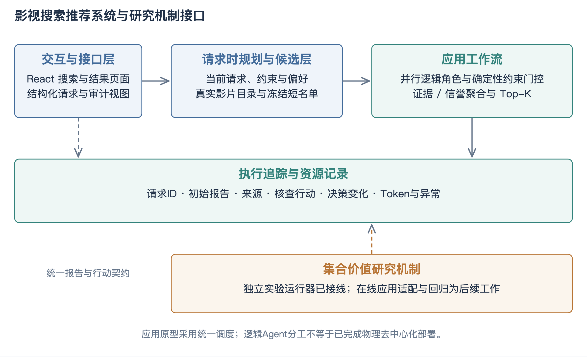

请求层将查询、偏好、必选与排除条件转为结构化对象；候选层使用真实影片目录进行检索，冻结进入评审的短名单；审议层组织多个逻辑角色处理同一候选；决策层先执行明确硬约束，再综合相关报告形成Top-K，并保留未解决分歧。

当前应用通过统一调度器组织逻辑Agent，而非物理分布式部署。集合价值研究运行器已经实现，但与在线服务的策略适配仍需在实验后完成。系统新增的实验回放支持查看封存研究轨迹，不把离线案例回放描述为已经部署的在线博弈推荐。

系统层次与研究对象逐项对应：请求给出任务与条件，目录给出合法候选和事实，角色产生局部主张，门控保护明确要求，聚合读出共同排序，追踪保存来源和变化。新的核查分配可作为审议与聚合之间的策略插槽接入，而无需改写整个前端。当前统一调度仍负责执行和异常处理，后续分布式协议需要在该契约基础上单独实现。

# 三、工作成果

## 研究内容二：需求分析与总体设计约束

影视搜索推荐系统承担论文的应用验证与成果展示，不应只是一张调用模型的页面。用户侧需要表达自然语言需求、设置硬条件、查看候选与推荐依据，并在结果不满足预期时理解系统处理了哪些信息。研究侧需要查看角色报告、引用、分歧、局部变化和资源记录。管理与开发侧则需要能够定位目录缺失、模型异常和协议失败，保证演示和实验对象相互对应。

功能需求据此分为任务输入、候选检索、角色分析、约束核验、共同排序与过程追踪。非功能需求包括接口稳定、输出实体合法、同候选覆盖一致、异常可降级、记录可重放及敏感配置隔离。系统首先执行可确定的硬约束，再在合法集合中排序；模型不应拥有绕过排除条件的权限。若没有合法结果，返回空结果及对应原因比编造新片名更符合应用目标。

开题中的Django、React、Swarm、LangChain及MCP属于当时的技术设想。当前系统保留React交互基础，研究应用由自定义HTTP工作流连接目录、规划、角色审议与共识模块；历史实现与新工作流分别记录，不能把开题列出的所有框架写成已部署依赖。技术选型服务于可复现的任务和行动合同，而不是以框架数量作为系统复杂度或创新性指标。

当前新增工作台把影视检索与研究回放分开：前者执行真实应用请求，后者读取已封存案例并解释其过程。两者使用清晰的任务身份和实体命名空间，避免将ReDial编号直接当成线上目录编号。系统截图来自实际本地确定性演示，后续真实模型演示单独记录资源与降级情况。该区分使界面既能体现现有功能，又不把离线轨迹包装成已经上线的自主博弈服务。

用户流程从输入需求开始，系统返回候选及依据，用户可以展开角色意见与未决分歧；研究流程从选择封存案例开始，按初始判断、资料核查和最终变化阅读。两条流程共用视觉与对象命名，但交互目的不同。将它们放在同一工作台的不同视图，能够体现系统与研究的联系，又保持真实在线请求和历史研究数据的边界。

需求优先级以完整主路径为核心。首先保证合法目录、条件执行和结果可解释，再完善异常、资源与回放，最后考虑多模态输入和更复杂工具。已有语音或上传入口不代表后端完成联合多模态语义推理，系统说明按实际处理链路描述，避免将输入形式数量当作完整能力数量。

# 三、工作成果

## 研究内容二：请求规范化与执行规划

请求对象包含查询文本、Top-K、偏好、必选类型、排除类型、排除影片ID、已喜欢影片ID、年份上下限与时延预算。规范化阶段检查类型、范围和枚举值，保留原始表达以便追溯；硬条件与软偏好分别传递，防止“最好是科幻”与“必须是科幻”被同样处理。对于缺少实体映射的片名，当前不把猜测结果当作确定ID，而应在候选检索或澄清阶段处理。

执行规划依据当前请求复杂度选择低、中、高路径。现有规则综合硬约束、偏好、查询长度、返回数量与时延限制，是透明的请求时启发式，不是训练得到的智能规划器。规则在输入阶段决定采用何种工作量，不能读取推荐结果或评价标签后反过来改变本题预算。计划对象记录选择原因与预算，使用户和开发者能够理解某次请求为何使用更多角色审议。

工作流按规划、召回、短名单冻结、角色处理、确定性门控、聚合和归档执行。短名单大小与Top-K及配置评审上限有关，冻结后各角色应覆盖同一候选集合，避免某个角色只看高分影片而另一个承担更多难例。角色并行可以降低墙钟时延，但总Token和调用数仍需完整计算；不能把并行执行描述为消耗更少模型资源。

应用中的请求规划与研究中的价值分配属于不同层级。前者选择处理路径与资源上限，后者在既定任务状态内选择具体核查。后续接入时，应让上层提供可用预算和合法资料，下层返回核查行动与可追溯补丁，而不是两套规划器各自修改条件。由统一任务和状态契约连接，可以逐步替换策略而保持应用接口稳定。

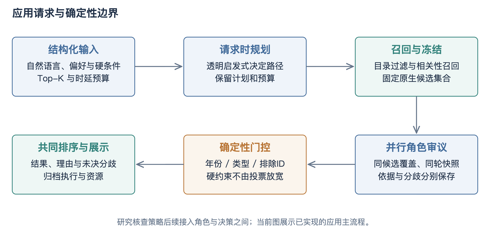

# 三、工作成果

## 研究内容二：目录召回、实体与候选冻结

目录层保存影片原生ID、名称、年份、类型及可用于解释的属性，配置可用时读取真实JSONL目录，否则使用明确标记的内存演示目录。演示数据用于展示流程与测试，不能作为推荐实验数据集。不同目录或数据集的ID需要命名空间和映射记录，即便片名相同，也不能假定编号可直接互换；年份版本、重名作品和别名都可能影响实体识别。

召回阶段使用当前查询与合法条件形成候选。先处理明确排除和范围条件，再按相关性获得足够的候选供后续排序。候选池限制会形成端到端性能上限：若真实目标根本未被召回，任何后续核查都无法把它放入最终Top-K。因此，评价必须同时报告候选覆盖和排序命中，并把召回遗漏与排序错误分开。当前研究协议禁止为了保证命中而把未来目标强行注入候选。

短名单冻结是公平审议的重要边界。角色报告针对同一原生ID集合，聚合器只接受集合内结果；模型输出新片名或非法ID时不扩展候选池。对每个候选保留基础分、目录属性和来源，角色判断则另行保存，防止模型推断覆盖确定事实。后续局部更新只在合法列表内交换，任何扩展候选的机制都需要另设动作与预算，不能偷偷通过自由文本增加搜索能力。

研究侧训练邻居、共同提及和知识信号可以为推荐提供互补信息，但必须标明它们是预测依据。历史用户喜欢一部影片，不意味着当前用户也喜欢；检索相似只是相关性线索，不是用户事实。系统通过来源范围和依据展示呈现这种区别，使核查能够检查“该证据是否适用于本次请求”，而不仅是检查影片名称是否出现在某段历史记录中。

候选快照同时承担复现作用。目录更新可能改变同一请求的合法集合或基础分，因此归档不能只保存最终片名，而应保存目录版本、候选ID及当时属性。后续回放使用快照解释历史结果，线上新请求则使用当前目录；二者不互相覆盖。对于推荐研究数据，快照还保存候选全集定义，确保Recall和覆盖能够按原协议重新计算。

目录访问可抽象为按条件召回与按ID读取两个基本操作。召回返回候选及基础分，按ID读取返回当时目录属性，角色报告只引用这些稳定对象。候选被过滤后，记录对应条件而不直接删除所有痕迹，以便解释为什么某影片没有进入结果。对用户而言，这比给出一组没有条件说明的片名更容易检查系统是否理解请求。

空结果需要分原因处理：目录无匹配、硬条件过严、实体未识别和模型阶段失败并非同一情况。确定性过滤造成的空集可以建议用户调整条件，但不能自动放宽；模型失败可以降级到合法基础排序，并标明执行模式。如此，系统在失败情况下仍遵守原始需求，不通过虚构候选维持表面完整。

# 三、工作成果

## 研究内容二：角色审议、约束门控与排序

应用角色围绕候选提出相关性、约束与解释方面的判断，各报告保存假设、依据、推断和结论。配置真实模型时，多个逻辑角色可以共享同一后端客户端；这构成提示与材料分工，不等于多种独立模型。缺少模型配置时使用确定性路径，响应应标明执行模式，避免把降级结果与真实模型调用混合展示或统计。

硬约束门控在聚合之前执行。年份、必选类型、排除类型和排除影片ID等能够由目录与请求确定的条件，不交给模型投票决定；不满足条件的候选直接排除并记录原因。模型主要处理软偏好与难以直接规则化的相关性。这样既保护用户明确要求，也让多智能体的作用集中于需要语义判断的部分，而不是重复完成确定性过滤。

共同排序综合基础相关性与角色报告，并保留信誉及分歧记录。现有实现使用同轮信誉快照和一致覆盖，防止一个角色因先提交而在同一轮内改变其他成员权重。信誉只是聚合辅助，不能未经独立评价就当作真实性概率。若角色对某候选存在未解决争议，系统应保留争议与依据，而不是删除反对意见后展示一个虚假的全体一致结论。

新的集合价值机制接入后，将把“进一步检查哪个候选或主张”从固定审议扩展为预算约束行动。应用适配需保证研究片段、线上目录证据、候选ID与局部交换完全对应，并提供停止和异常处理。当前回放已能展示研究轨迹，但在线决策仍需完成策略适配与回归后再切换。系统章据此分别说明现有排序流程、研究机制接口及后续接入步骤，使成果范围清楚。

角色意见的权重应与证据强度分开。一个角色置信度高，可能只是模型表达强烈；多个角色引用同一来源，也不能等价为多份独立支持。界面展示引用归属与未决分歧，为后续集合去重提供真实对象。应用默认聚合与研究机制接入之间，最重要的不是替换一个权重常数，而是保证新增核查确实改变被聚合的目标状态。

角色报告与聚合结果采用分离存储。报告表达各成员看法，聚合器生成共同排序；后续核查只改变目标状态或合法列表，不静默重写所有历史意见。界面因此能够展示“起初为何推荐、后来为何调整”，而不是只显示最后一段统一解释。该过程对象正是AEIC前期表达与当前局部更新在应用侧的衔接。

应用中的确定性门控也降低了不必要的模型负担。可由目录直接计算的年份条件无需反复调用模型验证，核查预算更适合用于语义匹配或证据冲突。将规则化部分和判断部分清楚分工，是资源协调能够发挥作用的前提；否则大量预算会消耗在已经有精确答案的程序条件上。

# 三、工作成果

## 研究内容二的功能模块与界面实现

系统功能按用户需求与研究追溯组织。检索模块保留合法原生影片ID和目录属性；审议模块展示各角色的假设、推断及支持或反对结论；证据模块展开具体来源与引用；异常模块保留空结果、结构错误、超时与降级事件。图10为本地确定性目录演示的实际界面。

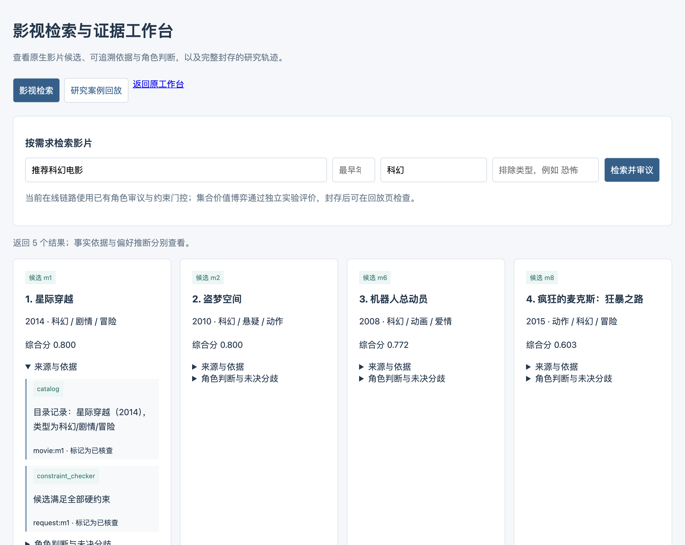

新增工作台提供两类视图。影视检索视图支持查询、最早年份、必选和排除类型，并按候选展开来源、角色判断及未决分歧。研究回放视图只读取完整封存的main或benchmark批次，检查任务身份与案例hash，展示初始/最终决策、核查片段、前后变化和分配偏离。

回放接口不读取评价标签、原始请求槽位或密钥文件，未封存批次不开放案例。不同数据集的影片ID保留各自命名空间，不能把研究中的ReDial编号直接当作线上目录编号。该设计为实验与系统之间提供真实、可复核的过程连接。

# 三、工作成果

## 研究内容二：接口、归档与安全边界

HTTP服务围绕搜索与研究回放提供接口。搜索请求进入统一工作流，响应包含候选、目录属性、角色意见、依据和执行信息；研究状态接口只返回固定结果根目录中的阶段完成情况，案例接口只读取允许阶段的已封存案例。路径、阶段和索引受到约束，不允许用户通过任意文件路径访问研究目录。回放数据不包含密钥、原始请求槽位或评价答案。

封存检查不仅检查文件存在，还核对案例与任务身份及内容指纹。未封存或身份不一致时拒绝展示，避免用户在实验中途看到不完整轨迹并误作结果。展示前对文本作HTML转义，资料原文作为内容呈现而非可执行页面。研究日志与应用日志分别保存，防止演示请求污染论文实验统计；同一案例的展示也不触发新的付费模型调用。

归档对象包括请求ID、规划、候选快照、报告、引用、核查行动、前后状态、异常及资源。记录需要足以解释一次决策，也要避免无必要复制敏感配置。对于大型原文可以保存不可变引用与内容指纹，界面按需展开。中断恢复由运行器事件与封存状态决定，界面只读这些记录，不自行推断一个缺失字段代表成功或失败。

权限边界同时服务于研究可信度。评价标签只在生成封存后由评分模块读取，在线服务和回放不使用它控制排序；历史证据遵守主体范围，模型响应遵守候选和补丁合同。系统因此形成输入、资料、执行、评分和展示五个层次的明确边界。后续若接入外部检索或多模态工具，仍需沿用同样的来源与版本契约，而不能绕过现有追踪直接向聚合器注入一段无来源内容。

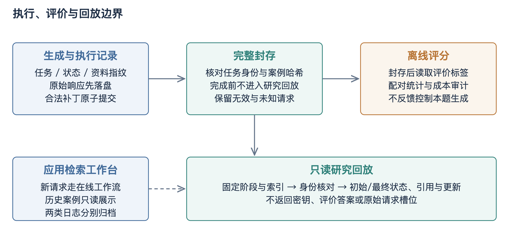

# 三、工作成果

## 研究内容二：测试、验收与应用评价

系统验收首先覆盖确定性行为。针对年份范围、必选与排除类型、已看影片与非法ID，检查输出是否满足明确条件；针对空目录、无合法候选和缺失模型配置，检查是否返回可理解状态；针对角色失败或结构错误，检查是否保留异常并按既定规则降级。当前相关工作流与新增回放测试共17项通过，这表明对应程序分支满足测试断言，不能据此计算推荐准确率。

其次检查过程一致性。冻结短名单是否被所有角色覆盖，同轮信誉是否使用相同快照，聚合器是否只接受原生候选，局部补丁是否与界面前后状态一致，封存案例是否在身份不符时被拒绝。这类检查把系统呈现与机制执行连接起来，避免出现日志说已反驳、最终结果却仍使用旧主张的错位。界面演示应选取完整轨迹，同时展示成功、未决与异常情况，而不是只保留一个顺利案例。

性能评价记录总时延、目录召回时延、角色并行阶段、模型Token及降级比例。并行能够缩短等待时间，但不减少所有调用成本；缓存能够减少物理请求，但应保留逻辑工作量。现阶段本地确定性演示已经验证基本交互，真实后端时延和质量需要在固定配置下另行采集。未开展的用户研究不写满意度结论，后续可围绕条件满足、解释有用性与选择意愿设计独立问卷或任务实验。

方法与系统最终形成两类互补成果。方法实验提供在公开数据与受控资源下的质量比较，系统验收提供应用流程可用和执行可追溯的证据；前者不能代替真实交互，后者也不能代替统计比较。论文保持一个创新点与一个系统的结构，系统负责承载和解释机制，而非为了增加篇幅再宣称一套独立创新算法。

验收材料可以按需求追踪到测试和界面：某项排除条件对应请求字段、过滤逻辑、失败场景和结果展示；某项回放能力对应封存检查、脱敏响应和案例页面。无需把每条单元测试都写入正文，但应保留能够重跑的入口与关键场景说明。系统规模以完整路径和稳定行为体现，避免用模块数量或界面截图数量替代实现质量。

系统演示应保存一次完整请求的输入、模式和输出，并明确目录来源。当前确定性演示可用于说明界面与工作流，真实模型演示则需要同时展示角色报告和资源记录。若发生降级，界面说明降级而不是仍宣称完整模型协作；这种透明性也有助于答辩时解释系统行为。

后续用户评价可以采用同请求的盲序对比，观察条件满足、结果相关性和解释帮助程度，但需要独立样本与知情安排。现有ReDial命中不能直接转化为用户满意度，系统测试也不能代替用户研究。毕业设计当前以公开任务质量与工程验收作为基本盘，扩展用户评价时另行定义问题和指标。

# 四、计划及进度安排

## 1. 后续工作顺序与验收产物

第一阶段完成固定论文协议下的收益训练、校准与主比较。输入为锁定任务清单、模型配置和源码指纹，输出为封存生成、评分、配对统计和可追溯轨迹。先检查各方法的合同失败与资源是否可比，再解释任务差异。若运行中断，按事件记录续跑；若需要修改接口，生成新版本并说明受影响范围，不覆盖旧批次。用户可通过统一脚本顺序执行，无需手工拼接不同实验入口。

第二阶段完成固定子集上的动作、消融、预算、干扰和迁移分析。动作分支判断是否存在协调机会，收益预测判断能否选中机会，完整轨迹判断局部更新是否落实，六种方法比较求解和组织是否带来增量。每组实验对应一个明确问题，避免仅增加配置数量。主要结果、机制解释与失败分析分别归档，形成可以直接回填论文的证据链。

第三阶段完成在线应用适配。先统一目录实体、来源范围和研究片段，再把核查行动映射为应用工作流，保留确定性约束门控和降级路径。接入前后采用相同目录与请求进行回归，比较结果变化、条件通过率、时延和Token。物理去中心化或复制者动态若继续开展，需要另设明确协议与验收，不作为现有接口工作的隐含完成项。

第四阶段完成论文与毕业设计材料。方法章给出对象、公式、求解及假设，实验章给出数据、强参照、指标和真实结果，系统章给出需求、架构、模块、接口和验收。根据导师审阅统一开题与中期表述，确认题目对去中心化的承诺范围，并整理可运行入口、环境依赖和示例轨迹。学校正式提交与答辩日期以实际通知为准，本报告不编造尚未确定的日程。

工作交接材料包括主线说明、冻结配置、数据清单、运行命令、阶段状态、已知问题和回填位置。实验运行与方法修改分离，新的开发假设先记录，在不影响当前冻结批的环境中验证。这样既能持续推进，也能避免每跑一小段就修改同一协议，导致所有结果都无法作为同一篇论文的证据。

# 五、问题及整改方案

## 1. 主要问题、原因与整改闭环

第一类问题是研究归因不清。前期曾把预测器改善、额外材料和协作收益放在相近叙述中，容易使读者无法判断创新发生在哪一层。整改以同信息强单Agent、独立汇总、贪心和中央参照建立分解比较，历史排序器收益单独列出。每个数字同时说明数据、分母、配置和用途，不跨版本累计最好成绩。验收标准是主要结论能对应唯一的受控比较，而不是只存在一个更高分数。

第二类问题是核查合同与状态行为脱节。来源存在并不证明支持关系，反驳未更新会使错误继续传播，整份改写会破坏无关正确内容。整改采用不可变片段、目标与版本检查、三态判断和受限补丁；合同有效、语义正确与最终质量分别评价。验收标准是每次状态变化能够追溯到合法核查，失败保留原状态且成本完整记录，语义关系具有独立标签参照。

第三类问题是价值空间和估计误差。若材料没有补充信息，或多个动作几乎等价，博弈无法凭空创造收益；若有机会但估值偏差大，求解精确也可能选择错误。整改采用匹配四分支和公开上下文环境，报告潜在机会、预测选择与实际结果三层指标。对于联合和跨成员代理假设，通过消融与轨迹检查，而不是把二阶公式本身当作有效性证明。

第四类问题是开题目标宽于当前实现。演化稳定、物理去中心化和完整多模态尚未形成对应成果。整改保持正式主线，明确当前有限合作博弈、统一执行平台及应用范围，按优先顺序补齐最关键缺口。中期报告的作用是完整展示已做工作、形成可检验后续路线，不是把所有开题设想改写成已经完成；这也使导师能够据真实进展判断后续取舍。

整改完成不以“代码已写”作为唯一标准，而以对象之间的一致性验收：设计中的行动能够被执行，执行后的状态能够被评分，评分结果能够回到预定比较，系统能够展示对应轨迹。四层任一缺口都可能形成虚假的进展。报告把这种闭环作为后续审查原则，确保新增工作持续累积到同一个研究问题。

# 五、问题及整改方案

## 2. 风险控制与最终成果组织

材料风险通过任务环境分层处理。真实检索保留覆盖不足，官方上下文保留支持句可达性，人工关系评价隔离检索与判断；三者分别解释，不用一个任务的高分掩盖另一个任务的材料问题。候选风险通过原生ID、未来目标隔离和覆盖指标控制。数据暴露风险通过任务分组与新清单控制，但无法证明底层模型的预训练完全未知，因此论文使用可观测隔离这一准确表述。

运行风险通过配置指纹、原始响应优先落盘、未知完成记录和封存评分控制。中断后接手者应先读取运行清单、阶段状态与恢复说明，再运行同一入口，不靠聊天记忆猜测下一步。生成成功、解析有效、案例封存和评分完成是不同状态，不能只看目录存在。跨模型运行保留模型名称、参数、提示版本与价格快照，避免后端变化造成无法解释的差异。

解释风险通过预定主比较和完整失败分母控制。某方法在双方有效子集上提高并不代表总体提高，某个干扰切片领先也不代表所有条件稳健。结果报告同时给出新增、损害、无效与未决，必要时用条件分析解释，但主要结论保持原分母。多次修改产生的开发批只作为设计依据，新冻结批承担评价用途，两者在论文中分开。

最终成果以一个连贯机制和一个系统组织：机制包含结构化证据、局部核查更新、贡献估计与预算协调；系统包含请求、目录、角色、门控、排序和追踪。前期AEIC提供过程表达，强排序器提供预测基础，动作诊断提供设计依据，当前比较负责验证协调贡献。这样的组织继承开题目标，同时让每项工作拥有清晰位置，避免将大量工程细节堆叠为彼此独立、缺乏共同问题的章节。

# 六、参考文献

[1] Talebirad Y, Nadiri A. Multi-Agent Collaboration: Harnessing the Power of Intelligent LLM Agents. arXiv:2306.03314, 2023. https://arxiv.org/abs/2306.03314

[2] Tran K T, et al. Multi-Agent Collaboration Mechanisms: A Survey of LLMs. arXiv:2501.06322, 2025. https://arxiv.org/abs/2501.06322

[3] Li X, Wang S, Zeng S, et al. A survey on LLM-based multi-agent systems: workflow, infrastructure, and challenges. Vicinagearth, 2024, 1: 9. https://doi.org/10.1007/s44336-024-00009-2

[4] Wei J, et al. Chain-of-Thought Prompting Elicits Reasoning in Large Language Models. NeurIPS, 2022. https://arxiv.org/abs/2201.11903

[5] Wang X, et al. Self-Consistency Improves Chain of Thought Reasoning in Language Models. ICLR, 2023. https://arxiv.org/abs/2203.11171

[6] Yao S, et al. ReAct: Synergizing Reasoning and Acting in Language Models. ICLR, 2023. https://arxiv.org/abs/2210.03629

[7] Yao S, et al. Tree of Thoughts: Deliberate Problem Solving with Large Language Models. NeurIPS, 2023. https://arxiv.org/abs/2305.10601

[8] Besta M, et al. Graph of Thoughts: Solving Elaborate Problems with Large Language Models. AAAI, 2024. https://arxiv.org/abs/2308.09687

[9] Chan C M, et al. ChatEval: Towards Better LLM-based Evaluators through Multi-Agent Debate. arXiv:2308.07201, 2023. https://arxiv.org/abs/2308.07201

[10] Liang T, et al. Encouraging Divergent Thinking in Large Language Models through Multi-Agent Debate. EMNLP, 2024. https://arxiv.org/abs/2305.19118

[11] Du Y, et al. Improving Factuality and Reasoning in Language Models through Multiagent Debate. ICML, 2024. https://arxiv.org/abs/2305.14325

[12] Li Y, et al. Improving Multi-Agent Debate with Sparse Communication Topology. arXiv:2406.11776, 2024. https://arxiv.org/abs/2406.11776

[13] Estornell A, Liu Y. Multi-LLM Debate: Framework, Principals, and Interventions. NeurIPS, 2024, 37: 28938–28964. https://papers.nips.cc/paper_files/paper/2024/hash/32e07a110c6c6acf1afbf2bf82b614ad-Abstract-Conference.html

[14] Liu T, et al. GroupDebate: Enhancing the Efficiency of Multi-Agent Debate Using Group Discussion. arXiv:2409.14051, 2024. https://arxiv.org/abs/2409.14051

[15] Liu Y, Cao J, Li Z, et al. Breaking Mental Set to Improve Reasoning through Diverse Multi-Agent Debate. ICLR, 2025. https://proceedings.iclr.cc/paper_files/paper/2025/hash/3de667dab3b3d812583abc0a786139a0-Abstract-Conference.html

[16] Chen J, Saha S, Bansal M. ReConcile: Round-Table Conference Improves Reasoning via Consensus among Diverse LLMs. ACL, 2024: 7066–7085. https://aclanthology.org/2024.acl-long.381/

# 六、参考文献

## 参考文献（续）

[17] Kaesberg L B, et al. Voting or Consensus? Decision-Making in Multi-Agent Debate. Findings of ACL, 2025. https://aclanthology.org/2025.findings-acl.606/

[18] Choi H K, Zhu X, Li S. Debate or Vote: Which Yields Better Decisions in Multi-Agent Large Language Models? NeurIPS, 2025. https://arxiv.org/abs/2508.17536

[19] Jacob A, Shen Y, Farina G, Andreas J. The Consensus Game: Language Model Generation via Equilibrium Search. ICLR, 2024. https://proceedings.iclr.cc/paper_files/paper/2024/hash/17a9bfda8be2301e24f232fb32f1e0fa-Abstract-Conference.html

[20] Madaan A, et al. Self-Refine: Iterative Refinement with Self-Feedback. NeurIPS, 2023. https://arxiv.org/abs/2303.17651

[21] Raj H, et al. Semantic Consistency for Assuring Reliability of Large Language Models. arXiv:2308.09138, 2023. https://arxiv.org/abs/2308.09138

[22] Gao T, et al. Enabling Large Language Models to Generate Text with Citations. EMNLP, 2023: 6465–6478. https://aclanthology.org/2023.emnlp-main.398/

[23] Min S, et al. FActScore: Fine-grained Atomic Evaluation of Factual Precision in Long Form Text Generation. EMNLP, 2023. https://aclanthology.org/2023.emnlp-main.741/

[24] Dhuliawala S, et al. Chain-of-Verification Reduces Hallucination in Large Language Models. Findings of ACL, 2024. https://aclanthology.org/2024.findings-acl.212/

[25] Jacovi A, et al. A Chain-of-Thought Is as Strong as Its Weakest Link: A Benchmark for Verifiers of Reasoning Chains. arXiv:2402.00559, 2024. https://arxiv.org/abs/2402.00559

[26] Huang J, et al. Large Language Models Cannot Self-Correct Reasoning Yet. ICLR, 2024. https://arxiv.org/abs/2310.01798

[27] Joren H, et al. Sufficient Context: A New Lens on Retrieval Augmented Generation Systems. ICLR, 2025. https://arxiv.org/abs/2411.06037

[28] Monderer D, Shapley L S. Potential Games. Games and Economic Behavior, 1996, 14: 124–143. https://doi.org/10.1006/game.1996.0044

[29] Han T A. Emergent behaviours in multi-agent systems with evolutionary game theory. AI Communications, 2022, 35(4): 327–337. https://doi.org/10.3233/AIC-220104

[30] Sundararajan M, Dhamdhere K, Agarwal A. The Shapley Taylor Interaction Index. ICML, 2020: 9259–9268. https://proceedings.mlr.press/v119/sundararajan20a.html

[31] Golovin D, Krause A. Adaptive Submodularity: Theory and Applications in Active Learning and Stochastic Optimization. Journal of Artificial Intelligence Research, 2011, 42: 427–486. https://arxiv.org/abs/1003.3967

[32] Geva M, et al. Did Aristotle Use a Laptop? A Question Answering Benchmark with Implicit Reasoning Strategies. TACL, 2021, 9: 346–361. https://aclanthology.org/2021.tacl-1.21/

# 六、参考文献

## 参考文献（续）

[33] Yang Z, et al. HotpotQA: A Dataset for Diverse, Explainable Multi-hop Question Answering. EMNLP, 2018: 2369–2380. https://aclanthology.org/D18-1259/

[34] Thorne J, et al. FEVER: A Large-scale Dataset for Fact Extraction and VERification. NAACL, 2018: 809–819. https://aclanthology.org/N18-1074/

[35] Diggelmann T, et al. CLIMATE-FEVER: A Dataset for Verification of Real-World Climate Claims. arXiv:2012.00614, 2020. https://arxiv.org/abs/2012.00614

[36] Li R, et al. Towards Deep Conversational Recommendations. NeurIPS, 2018. https://proceedings.neurips.cc/paper/2018/hash/800de15c79c8d840f4e78d3af937d4d4-Abstract.html

[37] Hayati S A, et al. INSPIRED: Toward Sociable Recommendation Dialog Systems. EMNLP, 2020: 8142–8152. https://aclanthology.org/2020.emnlp-main.654/

[38] Chen Q, et al. Towards Knowledge-Based Recommender Dialog System. EMNLP-IJCNLP, 2019: 1803–1813. https://aclanthology.org/D19-1189/

[39] Zhou K, et al. Improving Conversational Recommender Systems via Knowledge Graph based Semantic Fusion. KDD, 2020. https://arxiv.org/abs/2007.04032

[40] Wang X, Zhou K, Wen J R, Zhao W X. Towards Unified Conversational Recommender Systems via Knowledge-Enhanced Prompt Learning. KDD, 2022. https://arxiv.org/abs/2206.09363

[41] Zhou K, et al. CRSLab: An Open-Source Toolkit for Building Conversational Recommender System. ACL-IJCNLP System Demonstrations, 2021: 185–193. https://aclanthology.org/2021.acl-demo.22/

[42] Harper F M, Konstan J A. The MovieLens Datasets: History and Context. ACM Transactions on Interactive Intelligent Systems, 2015, 5(4): Article 19. https://files.grouplens.org/papers/harper-tiis2015.pdf

[43] Cormack G V, Clarke C L A, Buettcher S. Reciprocal Rank Fusion Outperforms Condorcet and Individual Rank Learning Methods. SIGIR, 2009: 758–759. https://plg.uwaterloo.ca/~gvcormac/cormacksigir09-rrf.pdf

[44] Järvelin K, Kekäläinen J. Cumulated Gain-based Evaluation of IR Techniques. ACM Transactions on Information Systems, 2002, 20(4): 422–446. https://doi.org/10.1145/582415.582418

[45] Efron B. Bootstrap Methods: Another Look at the Jackknife. The Annals of Statistics, 1979, 7(1): 1–26. https://doi.org/10.1214/aos/1176344552

[46] Holm S. A Simple Sequentially Rejective Multiple Test Procedure. Scandinavian Journal of Statistics, 1979, 6(2): 65–70. https://www.jstor.org/stable/4615733