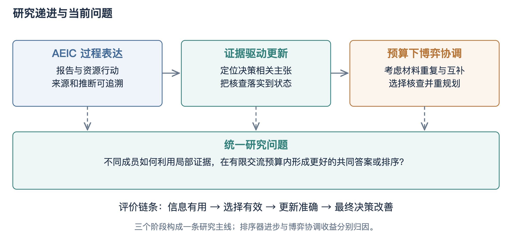
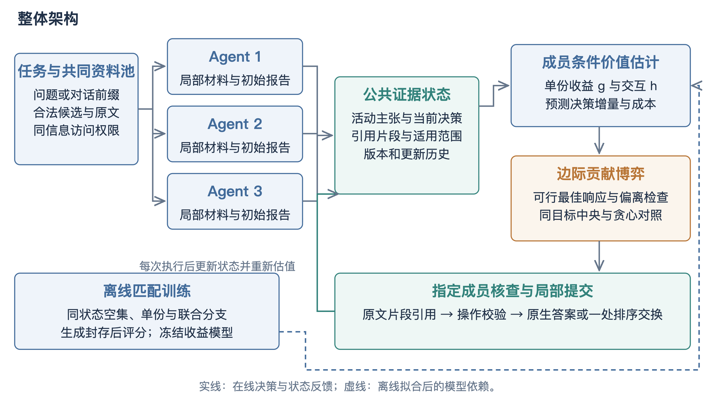
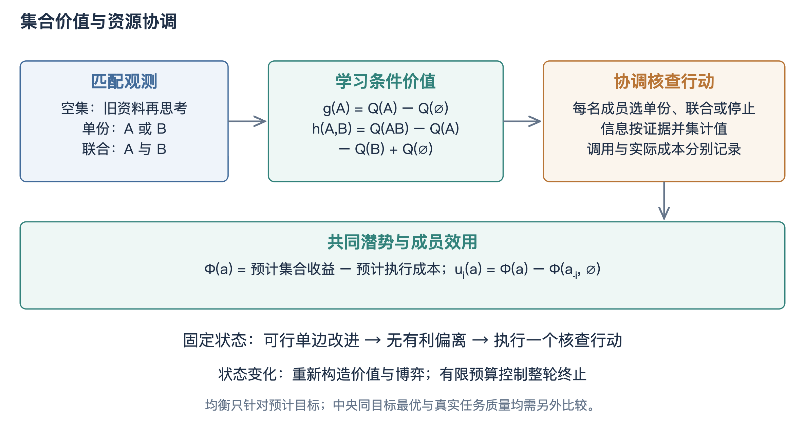
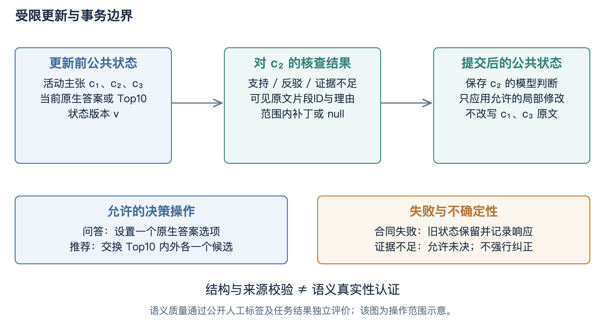
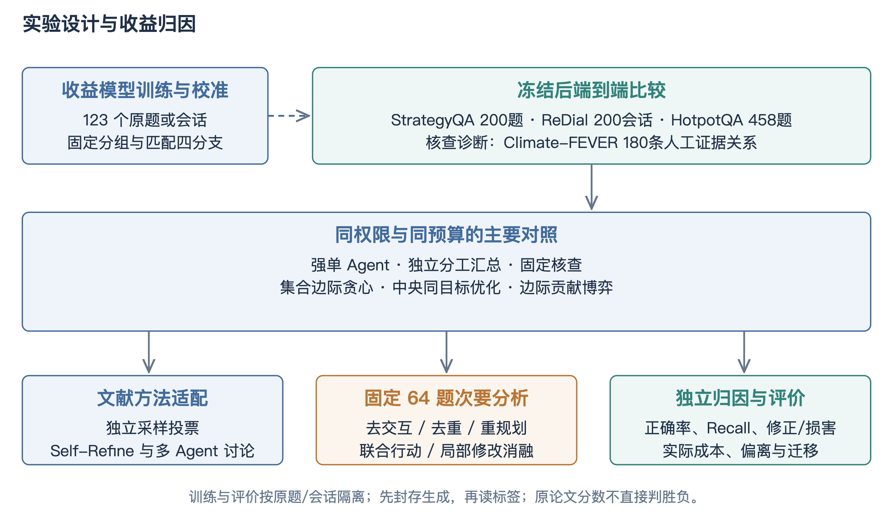
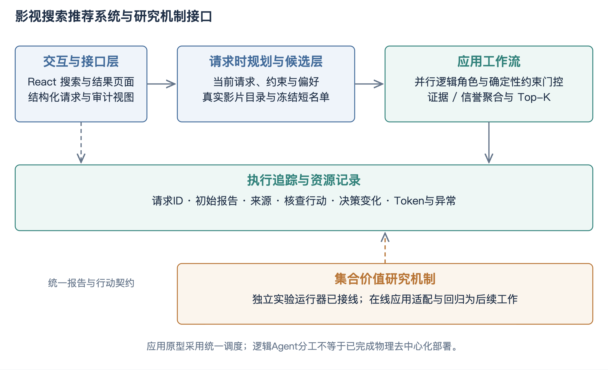
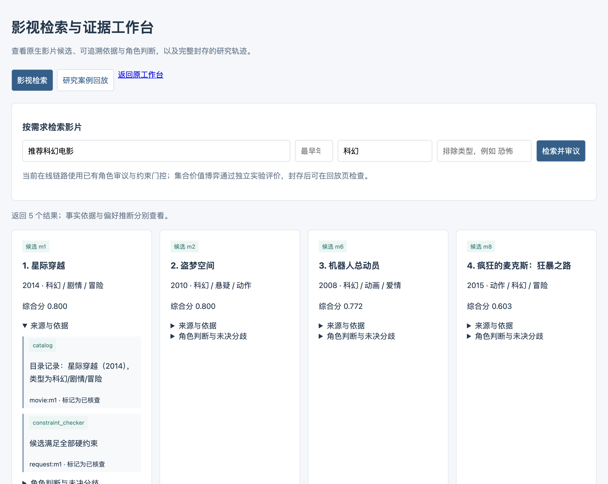

# 一、研究内容简介

## 1. 选题背景

大语言模型为信息分析、任务推理与自然语言交互提供了通用能力，多个智能体能够分别处理局部材料、保留不同的判断路径，再通过交流形成共同答案。影视搜索推荐中的用户需求往往同时包含偏好、上下文与明确约束，单次生成容易遗漏条件；多智能体协作为发现遗漏、核查依据与修订排序提供了实现途径。然而，增加成员或讨论轮数并不必然产生新的有效信息：多个成员可能重复同一依据，也可能在缺少材料时相互强化错误。已有研究对投票与讨论收益的分解表明，单纯多数投票可以解释相当部分被归于讨论的收益[3,4]；对模型自纠错的研究进一步指出，缺乏外部反馈的自我修正难以稳定改善输出[6]。因此，评价协作机制不能只观察一致率或轮数，而应检查信息是否增加、目标是否被正确修订以及最终任务质量是否改善。

证据驱动的多智能体方法还面临从材料到结论的传递问题。一个来源编号存在，并不意味着其内容支持当前主张；一份资料与问题相关，也不意味着核查它会改变错误决策；一次输出格式完整，更不意味着修改应被接受。检索增强研究已区分上下文不足与模型未能利用上下文两类失效[5]，引用生成研究将答案正确性与引用质量分别评价[12]；在多智能体预算协调的语境下，这些区分同样必要，否则协调机制的收益可能只是执行配置、模型能力或解析口径变化的混合体。

本课题围绕博弈驱动的多智能体语义共识开展研究，以有限预算内的证据核查作为实际协调行动，以共同答案或排序的任务原生质量作为外部评价对象。研究将可靠的证据更新与核查资源协调组织为一个整体机制：前者保证任何修改都有可追溯的依据，后者决定有限核查额度应当投向何处。两者互为条件——没有可靠更新，分配无从谈起；没有预算协调，更新沦为无差别的全文复读。影视搜索推荐系统承载候选检索、角色分析、依据查看与执行追踪，为机制提供可运行、可复核的应用载体。

目前已形成可复算的机制框架、统一的实验运行器与多批封存实验，完成了从执行配置收益、报告接口收益到排序收益的历史归因，并在论文批次上完成了同信息、同预算的完整对照。实验暴露出零更新退化现象，本课题没有回避该现象，而是通过受控扰动与逐例审计将其归因到动作选择与执行合同两个层面，并据此完成了机制的条件化重设计。现阶段工作按已审核的方案推进成员状态协调的诊断与验证，使方法研究与系统实现保持一致的技术对象。

# 一、研究内容简介

## 2. 研究内容

本课题包括两项相互衔接的研究内容。研究内容一为预算约束下基于证据贡献博弈的多智能体共识机制，是拟形成创新的主体：它定义证据状态、核查行动与质量函数的形式化对象，建立集合价值与成员条件贡献的估计方法，设计边际贡献博弈的求解与对照协议，并给出可执行的局部更新合同。研究内容二为影视搜索推荐系统的设计与实现，将结构化请求、真实目录、角色审议、约束核验与过程展示组织为可运行应用，作为机制的信息供给与评价载体。常规页面与接口开发作为系统成果，不另包装为算法创新。

前期AEIC工作为假设、证据、推断与结论提供了过程表达；后续工作把核查结果落实为局部状态变化；当前研究在此基础上考虑材料重复、联合价值、成员局部状态与有限核查预算。三者构成从可追溯表达、可执行更新到资源协调的递进关系，如图1所示。相关研究中的生成—判别共识博弈、讨论协议与组合信息归因为本课题提供了建模依据[3,5,7]；本课题的研究对象是实际核查行动及其对公共状态的影响，不能直接沿用其他博弈模型的效果结论，重点在于明确行动、价值估计、可行偏离与任务评价之间的对应关系。

两项内容通过统一的任务、资料、行动与补丁接口衔接：系统侧的真实目录检索与会话前缀为机制提供信息供给，机制的核查轨迹与局部更新又通过回放接口在系统中可视化。系统不使用研究评分控制在线排序，研究不依赖系统界面得出效果结论，两者在数据对象层面互操作、在评价层面相互独立。

# 一、研究内容简介

## 3. 关键技术

关键技术一为证据共识整体架构。系统固定任务、候选资料与信息访问权限，三个逻辑成员分别处理初始材料并提交原生判断与可定位前提；公共状态保存活动主张、可见证据、当前决策、版本与修改历史，任何修改都表现为对状态的版本化局部提交，全程可回放、可审计。成员之间的区别来自实际材料与已执行结果，不预设虚构的能力系数，整体架构如图2所示。

关键技术二为集合价值与成员条件贡献估计。同一份材料可能被多个成员重复引用，两份材料也可能共同揭示单份无法说明的条件，因此方法采用证据集合的预计价值而非独立计分：在相同初始状态下采集空集、单份与联合分支，拟合单份收益与二阶交互，再扩展为依赖成员已读状态与其他成员计划的成员条件估计，估计器的训练目标始终来自真实执行后的纠正、损害与成本。图3给出了估值与协调的关系。

关键技术三为边际贡献博弈与求解。成员效用定义为其行动对共同代理目标的边际贡献，严格改善的可行更新使有限行动空间中的势函数上升，求解后显式检查最大可行偏离；对互补行动导致的单边停滞，引入双成员联合提议的块更新。博弈与中央枚举共享可行域与预测目标，因此报告的是接近最优的差距与求解开销，而非越过同一目标的更优解。

关键技术四为有依据的局部更新与执行合同。核查请求不暴露当前共同答案与其他成员的结论性理由，验证者仅依据问题、未解关系与可见材料作独立判断；补丁只允许原生答案设置或Top10内外的单候选交换，引用来源逐句定位；修订依据按初始、指派与联合三类记录，合同用于归因而非否决合理修改。系统侧关键技术包括真实目录检索、约束门控与封存研究案例回放，如图4至图5所示。

上述技术形成一条完整的证据链路：机会从需求触发产生，价值由条件估计预测，行动由博弈在预算内分配，结果由合同约束的局部更新落实，最终由任务原生指标评价。每一环都有独立的失效模式与对应的诊断实验，这是本课题区别于单纯堆叠讨论轮数的方法论基础。

# 一、研究内容简介

## 4. 论文计划

2026.02-2026.03 完成文献综述与开题，确定证据贡献博弈主线；2026.03-2026.05 完成AEIC过程表达与历史批次归因；2026.05-2026.08 实现证据共识框架、匹配四分支采集与集合价值分配，完成统一运行器；2026.08-2026.10 执行论文批次全量对照与三层归因审计，完成引文合同修订与受控修复验证；2026.10-2026.12 完成成员状态协调的重设计、诊断与验证实验；2027.01-2027.03 撰写毕业论文初稿；2027.03-2027.05 修改定稿并准备答辩。具体节点以学校记录为准。

文献综述、机制框架、统一运行器、论文批次全量对照、归因审计、合同修订与受控验证均已完成并封存；成员状态协调重设计已通过双代理交叉审核，机会诊断批次已完成两轮（读出合同修复前后），动作价值信号在修复后透传，多跳域主表已封存回填。剩余目标为：完成稀缺构造下的协调验证实验，在其成立条件下完成正式对照；完成系统在线适配与验收；撰写并定稿毕业论文。核心指标为同预算下相对强非博弈基线的质量增量及其归因证据。

# 二、论文进展情况

## 1. 研究计划与实际进展

第一阶段（文献与历史归因）已完成。围绕多智能体投票与讨论、生成—判别博弈、证据充分性、引用质量与组合信息价值进行了系统调研，并对历史开发批次逐项复算：450题整体配置由306题正确提高到370题的收益被收紧到实际执行路径，90题接口复核表明四字段报告相对普通结构的优势未确立，公开ReDial验证集3010个目标上监督排序相对固定强融合新增76个目标（+2.525个百分点，会话聚类重采样区间[1.646,3.396]），该收益属于排序器改进而非博弈。这一阶段的结论是：历史正结果各有明确归属，不能直接充当新机制的效果证据。

第二阶段（框架与运行器）已完成。建立了公共证据状态、原文片段引用、局部更新合同、匹配四分支采集、单份与交互收益拟合、成员条件分配博弈与状态重规划的完整实现；统一入口可执行训练、主比较、动作价值诊断、消融、预算、干扰、模型迁移与报告汇总，全部批次先落盘原始回执再解析提交，未知请求不自动重发，中断后以精确回执复用续跑。工程回归覆盖集合收益、成员分配、中央参照、局部更新与完整模拟生命周期。

第三阶段（论文批次与归因）已完成主体执行。主比较400题九方法、预算扫描、三类证据扰动、五组件消融、模型迁移、价值诊断、公开关系核查与组件级贡献诊断均已封存评分；HotpotQA 458题多跳批次已封存评分，三种动态协调方法对独立汇总的配对区间首次排除零（详见主结果节）。主批曾因服务账户欠费中断，以新版本目录精确复用9512个已确认回执完成续跑，中断批保留为历史记录。对照结果显示四种协调方法逐指标完全一致且零接受更新，本课题据此开展了三层归因审计与受控扰动实验，将成因定位到动作选择与执行合同，并完成了引文合同的修订验证。

第四阶段（机制重设计与诊断）正在进行。经双代理交叉审核的修订方案将协调对象从资料排序改为成员核查任务分工：成员具有真实局部状态差异，行动定义为待核查关系、资料与操作的组合，联合配置整轮执行。P0离线骨架与21项测试已通过独立复核，12题×2重复的诊断批次已完成两轮封存：第一轮在旧读出合同下动作价值全零且跨重复符号翻转（瓶颈定位到读出层的整句作答与拒答）；读出合同改为强制抽取式短答案后重跑，联合与跨成员分支对空集的配对差转正至约+12.5个百分点（区间下界擦零），动作价值出现"不读、读一份、读两份"的单调分层。其后的阶段推进已完成：160条自然主张的训练与校准通过预登记门（留出AUC 0.617）、60题冻结对照矩阵与全上下文锚点已封存（结果见主成果节）、200题加功率批与两模型异质成员面板正在采集。系统侧新增的检索证据工作台与封存研究案例回放已通过17项相关测试，作为中期演示载体。

各阶段成果均有可复算的封存产物：历史批次的原始回执与审计报告、论文批次的计划哈希与逐例案例、归因审计的独立复算记录、扰动实验的两轮封存对照，以及诊断批次的预登记分析协议。全部表格数字可追溯到对应summary文件与输入哈希，中断-续跑的回执复用与未知请求处置均有交接记录。这种留痕方式保证了本报告的每个结论都能被第三方重新计算，也是后续毕业论文实验章节的直接数据来源。

# 三、工作成果

## 研究内容一 证据共识框架的形式化定义

（一）任务与状态。给定任务q，原始资料池记为D_q，初始公共状态S_q^0，成员集合N={1,2,3}。状态S包含当前决策、原子主张集合、已读取资料账本、评估历史与版本号；每个主张c∈C携带文本、所属成员、状态标记与原文引用位置。质量函数采用任务原生评价：问答为答案是否正确，推荐为目标影片的Top10命中份额，分别记为Q_q。预算化目标是在追加核查成本不超过上限的条件下最大化期望质量，即

其中A为可行动作组合，C为其实际调用与资料成本。该目标显式承认质量与成本的交换关系：任何不计成本的核查扩张都不能称为预算约束方法。

（二）行动与成员状态。核查行动定义为三元组a_i=(r, M, o)，其中r为待核查关系，M为资料集合，o为核查操作；成员i执行a_i时，其可见材料由成员已读账本、公共证据与行动资料共同决定。成员状态S_i记录该成员已读取的材料与已产出的判断，是成员条件贡献估计的直接输入。行动池来自两个渠道：问题分解出的未解决关系（需求触发），以及成员初始判断之间的分歧项；全部一致时允许任务池为空，不强行制造反对意见。

（三）核查请求的独立性约束。验证请求只包含问题、待核查关系与该成员可见材料，不包含当前共同答案或其他成员的结论性理由。该约束来自一个受控实验发现：当决策被人为破坏时，能够看到当前决策理由的核查者会复述记忆中的旧排序而非读取实际状态，形成感知层自证；分离验证请求后，问答侧判断能够正确识别矛盾并给出修复。约束的代价是丧失跨成员理由复用，其收益与代价在组件诊断中分别测量。

(1)  E[Q_q(A)] − λ·C(A)

# 三、工作成果

## 研究内容一 集合价值与贡献估计

（四）单份与联合价值。同一初始状态、同一目标与同一核查合同下，采集空集、单份A、单份B与联合AB四个匹配分支，记第r次响应的质量为Q_r(·)，定义单份增量与二阶交互差分：

g与h分别是行动价值的一阶与二阶刻画：g>0表示该资料在当前状态下的边际收益为正，h≠0表示两份资料存在超出各自独立贡献的组合效应。空集分支允许基于已有材料重新思考，因此g已经扣除了"再次作答"本身的收益，避免把模型的随机波动计入资料价值。该定义与Shapley-Taylor交互指数[7]在形式上对应，但本课题只取局部二阶差分而非完整Shapley估计，原因在于完整估计的采集成本随行动数指数增长，与预算约束的研究目标相悖。

（五）成员条件贡献。早期实现将同一资料分数复制给三个成员，使成员事实上可互换；这可以验证资料选择，却不足以验证多智能体的能力协调。重设计后的估计目标为成员条件价值：

# 三、工作成果

## 研究内容一 贡献估计（续）

该估计依赖四类输入：该成员已经读过什么、公共状态仍缺哪条关系、其他成员计划核查什么、本行动是重复、补充还是可能引入冲突。预测目标区分为纠正、损害与有效性三个通道：无效响应不再充当零收益训练样本，而是单独建模为缺失；训练语义结果模型时将无效标记为缺失，另训练有效性模型，避免把合同错误当作有效零收益。成本系数只在训练与校准侧确定，预算曲线另行报告，不凭测试最佳点选择主结果。

（六）估计器的实证表现。在24条自然人工标注主张、受控临时决策的组件诊断中，条件贡献估计驱动的核查以24次调用达到总体均值策略47次调用的同等质量，节省约一半核查成本；同数据Ridge需要30次，随机选择38次。历史贡献模型在同一设置下预测全部为负、零次核查，导致零行动退化，这正是估计器质量决定行动可行性的直接证据。组件诊断同时表明：更新链路本身可以工作（24条中7至8次真实纠正），说明论文批次零更新的成因不在链路而在动作供给。

（七）效用与势函数。固定状态下，成员效用定义为其行动对共同代理目标的边际贡献，代理目标为预测的组合价值减成本：

其中stopᵢ表示成员i停止、其余保持的行动组合。单边可行偏离下uᵢ的变化等于Φ的变化，因此严格提升的更新序列使势函数单调上升，有限配置空间保证求解终止；共享预算使可行偏离依赖其他成员的选择，稳定性应报告为可行偏离意义下的广义Nash，而非独立策略空间的普通Nash。

（八）互补停滞与块更新。当A与B必须共同执行才有价值时，从全停止状态出发，任何单边偏离都不改善，最优响应求解陷入停滞。为此引入双成员联合提议：两个成员同时改变行动，要求整体严格改善且每个参与成员不受损、至少一方严格改善。若只检查整体改善，应称为块坐标协调而非自愿联盟博弈，两种口径不能在结果出来后互换。构造实例中存在单边停滞而双成员互利改善的情形，验证了该机制的必要性。

（九）与中央参照的关系。中央枚举与博弈共享可行域与预测目标，因此预测目标上恒有博弈不超过中央，这是集合最大值的直接结果，不构成博弈的失败；报告口径是博弈相对中央的最优差距、求解与通信开销，以及相对非协调规则的实际质量差。求解器输出附可行偏离残差证书，用于解释终止状态，证书不代替任务正确性。

(2)  Δ̂ᵢ(aᵢ | S, a₋ᵢ)

(3)  gᵢ(e | s) = Q(Yₑ) − Q(Y∅)

(4)  hᵢ(e,f | s) = Q(Yₑf) − Q(Yₑ) − Q(Yf) + Q(Y∅)

(5)  F̂(S, a) = Ê[ΔQ | S, a] − λ·Ĉ(S, a)

(6)  uᵢ(aᵢ, a₋ᵢ; S) = F̂(S, aᵢ, a₋ᵢ) − F̂(S, stopᵢ, a₋ᵢ)

(7)  Φ(a) = Σᵢ F̂(S, a)

# 三、工作成果

## 研究内容一 误差传递与适用边界

（十）估计误差到分配质量的传递。若对固定状态的全部可行组合存在统一估计误差界|F̂(a)−F(a)|≤δ，而求解结果在预测目标上的单边改进空间不超过ε，则真实目标上的单边改进空间至多为ε+2δ。该命题说明均衡质量以贡献估计的可靠性为前提：估计不可靠时，任何协调规则都可能在错误的目标上求解。现有资源分配文献中的次模性、覆盖性等假设不能直接套用于可能存在负收益与互补性的语言模型核查，因此本课题不引用其近似保证，而是在实验中分别测量估计误差与分配质量。

（十一）理论上的适用边界。无稀缺且收益边际递减时，简单贪心已具近似最优性质，协调机制没有优势空间；反之，当预算低于检查全部提议的成本、行动之间存在超加性组合、且成员具有真实的状态或能力差异时，分配问题才具备信息结构。论文批次的恒等结果正是前一种情形的实证；重设计的实验协议据此将稀缺、交互与异质作为受控条件纳入设计，而不是寄望于在空输入上区分求解器。

# 三、工作成果

## 研究内容一 执行合同与有依据局部更新

（十二）核查合同。核查输出包含观察列表、引用来源ID与可选的三态判断；引用ID必须指向请求中实际可见的来源，观察与引用一一绑定。合同的设计原则是记录而非否决：修订依据按初始、指派与联合三类标注，允许核查者基于初始证据提出修改，只要依据被如实记录。该原则来自一个代价明确的教训——旧合同要求补丁必须引用全部指派新证据，结果主批十个真实修改意图全部被拒，其中六个为真实改值；受控扰动实验中三个正确的修复补丁同样被拒。合同修订后，问答侧在被破坏决策上三例全部实现全链路修复。

（十三）局部更新与合并读出。对于问答，补丁只设置一个原生答案选项；对于推荐，补丁只交换当前Top10与其外部各一个合法候选，被反驳主张的原文与核查记录保留，无关主张不被整段改写。整份自由重写单独设置为消融，不与默认局部更新混用。每轮核查结果先合并为证据与支持、冲突、未决三类关系，再由固定的共同读出器产生原生答案；读出器调用计入预算，所有方法的读出器完全相同，避免把读出差异误记为协调差异。

（十四）失败与中断的处置。无效输出保持原状态，其零执行收益计入端到端表现；原始回执先落盘再解析，未知完成请求不自动重发；同一请求仅在输入与参数完全一致时复用，中断后以新版本目录精确复用已确认回执续跑。这些约束使中断恢复、费用核对与方法比较共享同一执行基础，也是全部封存结果可复算的前提。

来源范围在合同中显式区分：历史对话中的兴趣不能当作当前用户事实，预测分数不是主张真实性的认证。程序合同保证操作合法，语义判断通过公开人工标注关系及任务结果独立评价，两者不互相替代。

# 三、工作成果

## 研究内容一 实验设计与数据

（十五）数据与任务。问答侧采用StrategyQA 200题（隐含多步推理的二选一）与HotpotQA公开验证集全部458道多跳是非题；推荐侧采用ReDial 200个独立会话、263个原生目标；关系核查采用ClimateFEVER 180条人工标注证据关系；贡献估计训练于123个组级隔离的训练分区任务。次要分析固定64题（32问答、32推荐），采集前哈希锁定。所有数据集不按难度、答案或实验收益筛题，多跳题保留官方全部上下文段落。

（十六）对照设计。主比较包含同信息同选择器强单Agent、独立汇总、固定核查、集合贪心、同目标中央优化与边际贡献博弈六种内部方法，以及自一致性、Self-Refine与多智能体讨论三种文献方法的同预算适配版本；推荐侧另设同批Sparse、KBRD与RRF60融合排序基线，预测在读取评价标签之前落盘。五项消融分别关闭交互项、集合去重、状态重规划、联合操作或允许自由重写。统计分析按原题或原会话配对，保留失败与原分母，报告聚类重采样区间；以配对不一致率0.2作规划假设时，200个独立单位约可检出8.9个百分点差异，458题约5.9个百分点。图6给出训练、冻结比较与次要分析之间的关系。

实验的预登记纪律贯穿始终：任务清单、主指标与方法配置在采集前冻结，小批只作开发依据，不按答对与否筛题，不在看到成绩后追加至显著；运行器按子批设置硬费用上限，账户异常时整批停止而非将拒绝记录为普通失败。

# 三、工作成果

## 研究内容一 主实验结果与对比分析

（十七）主比较结果。400题批次上，固定核查、集合贪心、中央优化与边际贡献博弈四种协调方法逐指标完全一致：问答正确均为116/200（58.0%），推荐命中均为51/263（Recall@10为19.4%），接受决策更新均为零，博弈相对中央的配对差值为零且区间为[0,0]。批内全部正向移动来自直接重答路径：同选择器强单Agent问答122/200（61.0%），其逐题转移显示该优势全部来自更强的初始作答——整个批次只发生一次修改且为损害；自一致性汇总取得批内最优推荐Recall@10（22.4%）；文献适配的MAD与Self-Refine分别为119与118。全部配对区间含零或退化为零，与预登记功效边界一致。

（十七之续）多跳域主表。HotpotQA 458道多跳是非题（官方全部上下文、同模型同预算）上：独立汇总283/458（61.8%）、固定核查284/458（62.0%）、集合贪心299/458（65.3%）、中央同目标304/458（66.4%）、博弈297/458（64.9%），强单Agent 339/458（74.0%）、自一致性342/458（74.7%）、Self-Refine 325/458（71.0%）、MAD 311/458（67.9%）。题级聚类配对区间：贪心、中央、博弈对独立汇总分别+3.5、+4.6、+3.1个百分点且区间排除零，固定核查+0.2个百分点含零；博弈相对中央-1.5、相对贪心-0.4个百分点均含零。与400题批次的恒等结果对照构成域依赖证据：协调层的可测增益出现在联合证据为作答前提的多跳域，且增益来自动态选择核查对象而非核查次数——固定核查消耗更多token仍无增益。批内最强仍为直接重答路径（自一致性74.7%），与主批一致；无效响应含续跑时按不重发纪律保留的71个未确认意图事件与5个事件级预算拒绝，458题全部完成封存。全部区间为探索性、未做多重校正。

（十七之三）预算稀缺下的冻结对照、加功率裁决与全上下文锚点。60题未开发冻结队列上执行九方法对照矩阵（每队同预算两次资料读取）：单Agent集中阅读F1最高（0.414，对随机+3.6个百分点含零）；估计器驱动方法对选择盲+2.2个百分点点估计；博弈、中央、贪心与CBBA在共享估计器和三选二动作空间下如预登记预期彼此持平，序贯自适应再估计未产生增益。随后的200题加功率批给出裁决：点估计洗净并反转——估计器方法0.433对选择盲0.456（-2.2个百分点）、集中阅读对随机仅+0.1个百分点、全部区间含零；60题上的弱正信号为噪声，冷迁移估计器（自然主张上留出AUC 0.617）在问题选源上无可测增益。贡献估计器在160条自然主张上通过预登记门（留出校准AUC 0.617、选择增益为正；不确定先验的成员探针最有价值、已反驳先验最低）。关键锚点：同批问题全上下文单请求F1为0.668——读全部资料比任何两读选择高约28个百分点。结论分三层：其一，在上下文便宜的域，预算稀缺协调所应对的约束并不真实存在，一次请求即可读完全部；其二，选源估计在当前特征下无增益，随机选择即是最强基线之一；其三，两模型异质成员面板（qwen/glm/qwen对全qwen同题同分支）显示异质性提升绝对质量（空集分支约+8个百分点）但分工价值仍为零、动作价值被更强的初始读取吸收——异质性是集成收益而非协调收益。对照矩阵与功率批有效率均在98.9%以上、标签泄漏为零，预算违规均为网络传输丢失按不重发纪律对账。

（十八）外部基线对比。同批检索基线Sparse、RRF60与KBRD的Recall@10分别为17.1%、16.7%与16.4%，均低于语言模型方法，说明多智能体流程相对经典检索融合在推荐命中上具有整体优势；但该优势反映的是语言理解与生成流程的差异，同批四种协调方法彼此持平，不能将差距归因于博弈协调。历史批次上，监督排序相对固定强融合排序在3010个目标上新增76个目标（+2.525个百分点，区间[1.646,3.396]），该收益属于排序器改进；450题整体配置从306提高到370的收益属于执行配置。三个正结果各有明确归属，与博弈零增量共同构成完整的归因图景。

（十九）信息供给层。同状态诊断面板（8题×空集、5单份、10两份组合×2重复）的全部256个分支质量增益为零，推荐侧105个合法分支全部选择保持；当目标无可换入空间或检索目录不含所需推理材料时，保持原决策是正确行为而非缺陷。错误初始的问答任务中，检索目录主题匹配但推理空白的比例很高，说明该层瓶颈是信息获取而非核查接口。

（二十）动作选择层。在经机械验证存在真实机会的任务上（目标在候选池内、Top10之外、对话含偏好证据），决策相关核查接口合同全部合法但全部选择保持，理由均为当前排名被用户陈述支持的自证式确认；被审查的主张来自模型初始自拟且用于支撑当前决策，动作空间从不指向未排入候选或未验证前提等盲区。自由重排臂修改了全部六个排名却零提升一损害，说明无目标的变动只是噪声。三层中，该层是重设计的主要对象：机会引擎与需求触发由此成为新方案的前置模块。

（二十一）执行合同层。决策扰动受控实验把确定性破坏注入已验证正确的初始决策：第一轮判断层三次正确识别矛盾并给出正确修复补丁，全部被引文合同拒绝；修订合同后问答侧三例全部实现检测、修订、补丁到决策复原的全链路恢复，推荐侧则表现为核查理由错述当前排名的感知自证，与合同无关。合同修复的受控验证说明：更新链路在可见矛盾下能够工作，但自然任务上零更新的成因主要是动作供给而非链路阻断，两层需分别对待、分别验证。

# 三、工作成果

## 研究内容一 预算、消融与迁移的稳健性

（二十二）预算与干扰。核查预算从0到3与三类证据扰动（干扰源、缺失源、冗余源）共21个条件组合下，质量、提升与接受更新完全不变，唯一变化是成本随预算线性增长（每方法0.12至0.38元）。在零接受更新下预算协调退化为常数函数，与主比较的归因一致；这一结果同时验证了费用控制与失败留存的有效性——恒等不是运行故障，而是可复算的封存事实。

（二十三）消融与迁移。五个组件消融与完整方法逐指标一致，仅自由重写放行一次更新且不改变质量；对零吞吐机制做消融无从产生差异，结果如实报告为零差异，不据此主张任何组件有效或无效。第二模型glm_flash在同64题子集上复现同一退化：三方法恒等、零接受更新、博弈减中央为零；迁移模型仅改变基线质量（28.1%对65.6%）与合同依从性，不改变机制结论。跨模型复现说明零更新退化不是特定模型的伪象。

（二十四）组件级证据的合并图景。24条自然主张的组件诊断显示更新链路可通（7至8次纠正）且条件贡献估计节省约一半核查成本；成员初始材料不同的稀缺小批上，协调族与单Agent的差距在一题以内；实现层面还存在成员价值复制、联合配置不整执行与同目标比较三项相关事实，已逐条核实并修正——它们不蕴含分配器全等价，但确实压缩了协调的可观察空间。合并图景是：链路可用、估计有效、协调的输入条件从未同时成立，这构成机制修订的全部依据。

（二十五）修订后的验证路径。重设计以新包实现成员局部状态、多关系任务池、跨成员联合执行与整轮配置执行，对照矩阵包含同预算单Agent集中阅读、独立多Agent、固定与轮转分工、同估计器贪心与中央搜索、CBBA适配与博弈协调，并以估计器与协调方式的交叉消融分离两者收益。验收采用预登记的双重条件：同预算下相对强非博弈基线的质量增量，以及改善伴随可测的重复减少或互补完成。首读12题×2重复的诊断批次已完成：四道科学门中合同有效率97.1%与标签泄漏为零通过，预算违规11次均为网络传输丢失按不重发纪律对账（非越界派发），跨重复符号稳定性弱；归因将信号截断定位到读出合同，修复重跑后联合与跨成员分支配对差转正并出现单调分层。训练校准门已过（留出AUC 0.617），60题冻结对照按预登记失败分支处置：估计器对选择盲为弱正信号，分工与求解器无增益，全上下文锚点把稀缺代价量化为约28个百分点——机制适用边界由此闭合。

# 三、工作成果

## 研究内容二 影视搜索推荐系统的设计

（二十六）系统定位与总体架构。系统面向自然语言影视检索与推荐，支持输入需求、类型与年份等条件，输出真实目录候选和可查看的推荐依据。研究内容二承担双重角色：作为机制的信息供给与评价载体，同时作为可独立运行的应用成果。系统采用前后端分层设计：请求层将查询、偏好、必选与排除条件转为结构化对象；候选层使用真实影片目录检索并冻结评审短名单；审议层组织多个逻辑角色处理同一候选；决策层先执行硬约束门控，再综合角色报告形成Top-K并保留未决分歧；追踪层归档每一步的请求、响应与状态变化。整体结构如图7所示。

（二十七）检索与约束执行。检索模块保留合法原生影片ID与目录属性，避免虚构候选进入评审；约束门控在排序之前执行明确条件（年份区间、必选与排除类型、已看排除），违反硬约束的候选不进入最终列表。空结果、结构错误、超时与降级事件全部记录在异常模块中，作为后续工程验收的输入。系统通过统一调度器组织逻辑Agent，当前以确定性目录模式运行，在线模型演示需记录真实调用与降级比例。

应用当前通过统一HTTP服务连接规划、召回、角色审议、约束门控与执行追踪，保留原React交互入口；新前端以工作台形态组织检索、证据与回放三类视图。系统测试覆盖约束执行、异常记录、会话一致性与接口契约，现有工作流与本轮新增回放测试共17项通过。

# 三、工作成果

## 研究内容二 工作台与封存案例回放

（二十八）检索证据工作台。工作台的影视检索视图支持查询、最早年份、必选与排除类型，按候选展开来源、角色判断与未决分歧；每个候选的证据卡片显示引用的目录字段与角色结论，用户可以逐层核对推荐依据，如图8所示。该视图以本地确定性目录完成搜索与证据展开检查，不调用付费模型，能够作为中期演示；其设计目标是把推荐过程从黑箱输出变为可检查的推理链。

（二十九）研究回放视图。回放视图只读取完整封存的主批或基准批次，校验任务身份与案例哈希后，展示初始与最终决策、核查片段、前后变化与分配偏离；未封存批次不开放案例，回放接口不读取评价标签、原始请求槽位或密钥文件。该设计为实验与系统之间提供真实、可复核的过程连接：论文批次的每一个数字都可以在系统中找到对应的核查轨迹，而不只是表格中的一个值。

不同数据集的影片ID保留各自命名空间，研究中的ReDial编号不直接当作线上目录编号。回放不把离线案例称为已部署的在线博弈推荐，两者在文档与界面中均有明确区分。

# 三、工作成果

## 研究内容二 机制衔接与系统验收

（三十）机制与系统的衔接。衔接通过统一任务、资料、行动与补丁接口完成：先对齐线上与研究侧的实体ID及来源范围，再接入有限预算下的核查选择，最后比较接入前后的结果质量、约束通过率、Token与时延。系统接口不读取未来推荐标签，不使用研究评分控制在线排序；机制的候选池、成员分工与核查轨迹在系统中以回放形态呈现。衔接计划与机制的验证阶段同步推进，避免在机制未定型时冻结系统接口。

（三十一）系统评价口径。应用评价区分检索能力、推荐能力与工程可用性三类：ReDial未来目标评价会话推荐命中与排序，检索与排序基线用于检查候选与预测基础；自然语言检索的目录约束与交互路径另行检查；工程可用性以约束执行、故障降级、时延与一致性测试衡量。三类指标不互相冒充：推荐命中不证明检索条件满足，测试通过率不冒充自然语言核验准确率。论文将方法与系统分别成章，通过可执行对象与真实轨迹连接。

（三十二）当前系统成效。系统已完成检索、审议、约束、排序与追踪的全链路实现，并通过工作台把候选来源、角色判断与证据链可视化；确定性目录模式下的搜索与证据展开检查全部通过，封存回放视图已接入论文批次案例。对照应用评价口径，检索与工程可用性两类指标已有可运行的检查结果，推荐能力的在线对照待机制验证阶段完成后接入。系统的价值不在于界面数量，而在于它使机制的每个主张都对应可查看的数据对象：候选、来源、判断、修改与费用均有落点。

# 四、计划及进度安排

## 1. 下一步工作计划

第一阶段的协调机会诊断已完成：旧读出合同下全零信号定位了读出层瓶颈，抽取式读出合同修复后动作价值信号透传（联合与跨成员分支约+12.5个百分点、单调分层出现）；HotpotQA多跳域458题上动态协调对独立汇总的配对区间首次排除零。第二阶段的训练与校准已完成并通过预登记门（留出AUC 0.617、选择增益为正）；第三阶段的60题冻结对照矩阵已封存：估计器对选择盲+2.2个百分点点估计（未过显著线）、分工与博弈求解器无增益、单Agent集中阅读在预算约束下最优、全上下文锚点显示稀缺代价约28个百分点而机制间差异仅2至4个百分点——按预登记失败分支处置，不追加同类样本，加功率批与异质面板作为边界刻画的补充验证正在采集。第二阶段完成成员条件贡献估计与协调机制的训练校准，随后冻结小批对照：对照矩阵包含同预算单Agent集中阅读、独立多Agent、固定与轮转分工、同估计器贪心与中央搜索、CBBA适配与博弈协调，以交叉消融分离估计器与协调收益。第三阶段通过正式检验后完善系统在线适配与验收，补齐研究行动到线上实体与证据状态的映射，开展约束、故障降级与时延检查。第四阶段根据封存结果回填论文全部表格、正文与结论，完成导师审阅与答辩演示。具体考核节点以学校记录为准。

2026.10-2026.11：完成协调机会诊断批次与四道科学门判定；2026.11-2026.12：完成训练校准与冻结小批对照，出具交叉消融结果；2026.12-2027.01：正式检验与系统在线适配；2027.01-2027.03：毕业论文初稿撰写；2027.03-2027.05：修改定稿，准备答辩；2027.05-2027.06：论文送审与答辩。HotpotQA 458题批次已封存，多跳列已回填主表。

# 五、问题及整改方案

## 1. 存在的困难与问题

第一，协调的输入条件问题。论文批次的零更新退化源于动作供给、机会稀缺与执行合同的历史叠加，修订后合同与链路已验证；机会诊断批次修复轮给出肯定信号（联合与跨成员分支约+12.5个百分点），训练校准门已过（AUC 0.617），但冻结对照显示估计器增益为弱信号、分工与求解器无增益、该域稀缺代价本身约28个百分点——机制适用边界已闭合，加功率批与异质面板检验其稳健性。第二，自然任务的机会率问题。错误初始的问答任务检索目录推理空白，推荐侧机械可换入机会有限；即使修通全链路，自然域增益幅度可能受限，多跳与受控机会域是价值展示的主战场。第三，样本与暴露问题。历史批次存在开发暴露，公开验证集用于开发诊断，未接触确认集需要在新分区上重建；小样本批次的区间较宽，方向性结论不能只凭十几题的胜负。

针对输入条件问题，采用先诊断后建设的顺序：P0离线证明与四道科学门在前，完整机制与正式对照在后，每阶段不达标即停止并记录，不换名称、不调奖励、不重复小样本。针对机会率问题，机会引擎与需求触发作为重设计的前置模块，仅在分歧、未解关系与检索错配处提议，无信号不动作；多跳域与受控扰动域承担机制价值的展示。针对样本与暴露问题，坚持预登记纪律：任务与指标采集前冻结，不按结果筛题或扩样，暴露审计逐条记录，未接触确认集在正式检验前重建。最终目标是在一个完整创新机制与一个可运行影视系统的基础上，形成方法、实现、数据与评价相互对应的毕业设计成果。

# 一、研究内容简介

## 3. 关键技术（续一）

关键技术一之深入：证据共识架构的状态设计。公共状态被组织为六类字段——当前决策（问答为原生选项、推荐为完整排序）、原子主张集合（每条主张携带文本、所有者、状态标记与原文引用位置）、已读资料账本（区分公共初始材料与成员私有读取）、评估历史（每次核查的结论、依据与成本）、版本号（每次修改递增，作为补丁的预期版本）与费用账本。任何修改必须声明预期版本并在提交时校验，并发写入因版本不匹配而被拒绝，这保证了逐例回放与状态哈希校验的可行性。该设计的直接收益是：任何案例的最终决策都可以还原为一条有序的修改链，每一步都能定位到具体的核查证据。

关键技术二之深入：贡献估计的训练协议。训练数据在冻结的轮初状态上采集四种匹配分支——空核查、单成员单资料、同成员联合阅读与跨成员分工核查，各分支使用同一读出规则，空核查仍执行读出以扣除重新思考的作用。联合标签来自实际联合执行与合并，而不由"同一核查者读取AB"的结果代替，因为两者在信息结构上不可互换：前者测量成员间分工的互补性，后者测量单请求内的上下文互补性。采集采用标签不可见的均衡探索，不只采当前模型认为有利的动作，并记录采样概率以支持后续重加权。

关键技术三之深入：求解流程与终止性质。求解的每一轮从当前配置出发，枚举每个成员的可行单边偏离与双成员联合提议，选取使势函数严格改善的最大增益更新；无可行改善或预算耗尽时停止，停止本身是合法选择。固定状态、有限配置与严格提升保证终止；共享预算使可行集依赖他人选择，因此均衡按可行偏离意义报告。求解器同时输出可行偏离残差证书：终止时不存在任何未被检查的改善偏离，该证书可用于解释终止状态，但不能替代任务正确性评价。

关键技术四之深入：机会引擎与需求触发。动作池的生成遵循"无信号不动作"原则：触发条件包括成员初始判断之间的分歧项、问题分解后仍未建立证据的必要关系、以及候选与对话关联度错配（未排入但与当前请求高关联，或已排入但支持薄弱）。全部一致且必要关系齐备时任务池为空，系统保持当前决策并显式记录停止理由。该设计来自三层归因的直接教训：自拟主张的自证循环使旧动作空间从不指向盲区，机会引擎的任务是把"模型可能错在哪里"变成显式候选，而不是把"模型已经相信什么"再核查一遍。

# 三、工作成果

## 研究内容一 匹配分支采集与训练细节

（甲）采集协议的公平性约束。匹配四分支的设计目标是在同一初始状态、同一目标与同一核查合同下隔离单一变量：空集分支扣除再次作答的收益，单份分支隔离单资料边际，联合分支测量组合效应，跨成员分支测量分工效应。每个分支的核查输出独立调用、同轮绑定同一状态快照，任何分支失败不替换题目或材料，如实记录为无效。该协议的统计含义是：分支间差异只能来自被操纵的变量本身，而不来自任务选择、提示差异或状态漂移。

（乙）重复与独立性的处理。同题两次重复分别生成，不从缓存取同一响应充当独立重复；重复间的一致性作为动作价值可靠性的直接诊断——若同一分支两次重复的方向不一致，其均值不应解释为稳定的行动属性。分析层面先报告重复方向一致率，再报告均值与区间，两者分离呈现。这种保守处理牺牲了名义样本量，换取了每个数字的可解释性。

（丙）训练与校准的划分。贡献估计的训练集与校准集按题组隔离，校准集只用于确定成本系数与偏差校正，不参与拟合；部署阶段估计器完全冻结。训练目标的构造严格区分三个通道：纠正（质量提升幅度）、损害（质量下降幅度）与有效性（响应合法概率），无效响应标为缺失而非零收益。历史贡献模型在同一协议下预测全部为负、产生零行动，这一对照直接说明：估计器不是博弈的附件，而是行动可行性的先决条件。

（丁）配对设计与区间估计。所有方法对照按原题或原会话配对，保留失败样本与原分母；区间采用题级配对的自助重采样，推荐按会话聚类以尊重会话内相关性。多重比较采用Holm校正，主比较预先指定为完整方法对同估计器中央搜索，其他对照作为次要分析呈现，不允许事后择优。以配对不一致率0.2作规划假设：200个独立单位约可检出8.9个百分点差异，458题约5.9个百分点——该功效边界在实验设计阶段即写入协议，用于约束对微小差异的过度解释。

（戊）成本核算的统一口径。所有方法共享同一预算会计：初始报告、协调消息、核查调用与最终读出全部计入，协调消息按字节折算，求解时间与端到端时间分别记录；训练与面板采集的费用不隐藏在推理成本之外，在论文中单独列表。相同调用上限不称为相同Token——上下文长度差异导致的费用差在同一表中如实呈现。该口径的动机是防止"提准"与"省资源"成为任意择优的双出口：主目标固定为同预算下的质量增量，资源节约作为次要指标另行报告。

（己）泄漏与暴露的控制。评价标签在生成完整封存后才读取；公开数据集的官方支持句只用于训练监督与离线评分，不进入测试提示或资料分配；历史开发暴露逐条记录于暴露审计，正式检验使用重建的未接触分区。自然语言核查的语义准确性采用独立人工标注关系评价，运行时模型判断不充当金标准。这些控制共同保证：报告中的每个数字要么来自可复算的封存产物，要么明确标注其开发诊断性质。

# 三、工作成果

## 研究内容一 逐数据集的论证与结果

（庚）StrategyQA：隐含推理的问答域。该数据集的每道题需要未被明说的多步推理，答案为二选一；其价值在于答案完全可判、题面简短，适合作为机制的主问答域。200题的结果显示：四种协调方法完全一致（58.0%），强单Agent为61.0%但其优势全部来自初始作答路径，自一致性与MAD分别为59.0%与59.5%。该域的结论是：无机会时正确维持是主行为，重答路径贡献了全部正向移动；这为同状态诊断提供了直接的动机——需要知道单份与联合资料在该域是否存在可利用价值，面板实验给出了否定答案，将瓶颈定位到检索供给。

（辛）ReDial：会话推荐的找回域。200个独立会话、263个原生目标；推荐任务的评价对象是下一轮被实际提及的影片是否进入Top10。该域的独特价值是存在三种外部对照：同批检索基线（Sparse 17.1%、RRF60 16.7%、KBRD 16.4%）、文献重答方法（自一致性22.4%为批内最优）与历史监督排序（全验证集+2.525个百分点）。三者来自不同层面——检索融合、独立采样与监督学习——与协调方法的19.4%共同构成推荐侧的完整参照系。该域的结论：语言模型方法整体优于检索基线，但协调无独立贡献；监督排序的收益属于预测基础而非博弈。

（壬）ClimateFEVER：公开证据关系域。180条人工标注的支持、反驳与证据不足三态关系，用于评价核查判断本身的可靠性，而非最终答案。三臂对照中，直接判定的宏F1为0.606、普通修订0.553，而有依据局部修订的合同有效率仅8.9%——引文与格式合同在短段落关系判定上全面失配，其名义低损害是有效样本枯竭的伪象。该域的结论直接推动了合同从否决到记录的修订：合同应当服务归因，而非以格式理由否决语义上合理的修改。

（癸）决策扰动恢复实验。取已验证正确的初始决策，注入确定性破坏——问答翻转答案、推荐将Top10头部换至第11位——然后在修复前与修复后两种合同下测核查能否发现并恢复。设计要点有二：其一，扰动是无标签的确定性操作，恢复以扰动前决策为参照，运行时不接触评价标签；其二，自由重答臂作为对照，用于区分"重答可平凡修复"与"核查路径可修复"。结果：修复前判断层三次正确识别矛盾并给出正确补丁、全部被旧合同拒绝；修复后问答侧三例全链路恢复，推荐侧表现为感知层自证（核查理由错述被扰动后的排名）。该实验把"合同是否阻断合理修改"从推测变成了受控事实。

（子）协调机会诊断批次的分支设计。12题×2重复×16分支：空集1个（扣除再次作答）、单成员单资料9个（3成员×3资料，隔离"谁读什么"的成员条件效应）、同成员双资料3个（单请求内联合阅读，测量上下文互补）、跨成员分工3个（两成员各读一份再合并，测量分工互补）。关键对照是后两者的差：同材料集、同预算、同读出，唯一差异是"一人读两份"还是"两人各读一份后合并"——这正是分工协调的核心问题。预登记分析在采集前冻结：配对差、交互项、跨对同差、重复一致性，不因结果调整口径。该批次已完成两轮：旧读出合同下信号全零，合同修复后联合与跨成员分支配对差转正（约+12.5个百分点，区间下界擦零）——读出层是动作价值透传的前置条件，重设计据此进入完整对照的稀缺构造阶段。

# 三、工作成果

## 研究内容一 三层归因的审计方法论

（丑）归因审计作为方法学贡献。零更新现象本身不构成结论——任何复杂系统都能在事后给出解释；本课题的方法学贡献在于把解释变成可复算的分层审计。第一层问机会是否存在：同状态面板给出分支级的质量增益；第二层问动作是否指向机会：机会注入小批给出"有机会时是否行动"的直接答案；第三层问执行是否阻断行动：扰动实验分离判断与管线。每层只回答一个问题，层间不互相替代，全部审计工具独立复算并与批次封存数据交叉核对。该方法论的价值在负结果场景下尤为明确：它把"机制没有效果"细化为"机制在哪一层、因为什么没有效果"，为修订提供可执行的依据而非笼统的失败标签。

（寅）审计的纪律约束。审计本身遵循与实验相同的纪律：只读封存数据、不重发未知请求、机械代理指标明确标注、语义裁决如实记录为代理判断；审计结论写入交接文件并接受另一代理的交叉复核，复核中发现过强结论即发布勘误——本文关于成员可互换性的原始表述即在交叉复核中被反例修正。双代理交叉审核因此不是流程装饰，而是实际纠正过错误的机制。

（二十六之深入）引擎契约的设计。系统与研究机制之间通过显式的引擎契约解耦：请求对象携带当前需求、已解析约束、用户偏好快照、固定候选与来源、方法、模型与预算；执行过程通过阶段化事件流向前端推送即时进度、成员意见、预算分配、局部修改与停止信号；回执通过检查点接口读写，发送前写意图、成功后写完成、服务拒绝写拒绝，取消时已发出的请求等待返回并保存回执后停止。该契约的意义是：研究侧的任何实现变动只要保持契约兼容即可热替换，而界面无需导入研究模块——引擎能力决定界面可用方法，机制迭代不冻结产品接口。

（二十七之深入）目录与检索的工程实现。目录采用18,430条现有MovieLens记录，支持关键词、主题标签、偏好与基于原片标签的相似推荐；必选、排除与年份作为硬过滤在排序前执行，偏好作为软加分参与排序。中文常用片名通过本地别名表映射，保证中文查询能命中英文目录。真实目录评分、标签与外部链接按候选展开，无海报与无简介的字段以明确标识呈现，不虚构补充信息。目录版本写入任务记录，恢复时使用原候选快照，避免目录更新导致的复现偏差。

（二十八之深入）持久会话与任务恢复。系统维护持久会话：约束继承、短追问、换一批、清除条件、用户反馈、收藏与已看排除均作用于会话状态，刷新页面后历史与收藏可恢复。任务执行支持进度展示、取消、回执恢复与导出：取消时已发出的请求等待返回并保存回执，不产生未知请求的静默丢失；重启后正在执行的任务标记为中断，未知请求不自动重发——与实验侧同一套失败处置纪律。多端协同通过15分钟、限单会话的扫码访问令牌实现，手机与桌面通过同一会话同步，避免全局状态的竞态；语音输入依赖浏览器能力，图片检索通过macOS本地视觉框架提取海报或截图文字后由用户修正，不声称通用画面识别。

（二十九之深入）方法比较与预算控制。系统提供最多4部影片的横向比较与方法对比：方法对比固定原任务候选、偏好、模型与预算快照，只改变分配方法，其博弈与中央使用同一可行域与势函数——界面比较是系统方法展示，不是论文效果评测，两者在文档与界面均明确区分。预算控制默认3次核查、0.1元上限，每次会话可调整；费用为估算值并实时显示。应用层不依赖贡献模型特征、博弈求解器内部变量或实验标签，保证产品行为与研究迭代相互独立。

# 三、工作成果

## 研究内容二 存储与验收

（三十之深入）存储与数据边界。会话、任务与用户档案存储于本地SQLite（WAL模式），原始模型回执只保存在服务端，浏览器不接收密钥或原始响应；目录导入写入独立副本，不修改实验输入；匿名工作空间令牌保存在浏览器本地。该系统定位为本地与局域网的毕业设计应用，未设计公网账号服务，边界在文档中如实声明。

（三十一之深入）验收清单与结果。验收按场景组织：约束执行（明确年份与类型条件是否被严格执行、排除已看与非法候选是否生效）、异常处置（材料不足、空结果、模型错误的记录）、会话一致性（刷新后历史与收藏恢复、多端同步）、接口契约（研究引擎热替换后界面方法列表正确）。现有工作流与本轮新增测试共17项通过；确定性目录模式下的搜索与证据展开检查作为中期演示，在线模型演示需记录真实调用与降级比例，不用静态截图替代。验收顺序覆盖从自然语言约束到故障降级的完整用户路径，具体清单随系统文档维护。

（三十二之深入）成效小结。系统当前完成度：检索、审议、约束、排序与追踪全链路可用；工作台把候选来源、角色判断与证据链可视化；封存回放已接入论文批次案例，回放校验任务身份与案例哈希、不读取标签与密钥。系统的应用成效以三类口径分别衡量：检索与工程可用性已有可运行检查结果；推荐能力的在线对照待机制验证完成后接入；过程透明性——每个推荐可展开到候选、来源、判断与修改——是当前最有区分度的成效。机制衔接的下一步在统一实体与来源映射完成后接入预算化核查选择，比较接入前后的结果质量、约束通过率与时延。

（卯）方法借鉴的对应关系。本课题的设计决策每一条都有文献依据与实验依据的双重锚点：验证请求不暴露当前决策理由，对应链式验证方法中"分解独立作答再条件修订"的核心理念，其直接动机来自推荐侧感知自证的受控发现；仅在分歧与未解关系处触发核查，对应主动检索在低置信处取外部信息的思路，其边界来自无机会域正确维持的面板证据；自然主张池优先于模型自拟主张，对应事实核查中原子主张分解独立核验的范式，其证据来自自然主张7至8/24纠正对自拟主张零行动的对照；合同记录而非否决，对应引用评价研究中答案质量与引用质量分离的原则，其代价来自十个真实修改意图被旧合同拒绝的教训。

（辰）不移植的部分与原因。生成—判别共识博弈将均衡搜索作为解码正则，其评分接口与行动语义和本课题的资料核查行动不同，不移植其效果结论；可学习协调研究依赖信念网络与任务反馈训练，其假设在无训练权重的API系统上不成立，只借鉴"成员条件策略"的概念框架；分布式任务分配的收敛与近似保证依赖收益递减等结构条件，语言模型核查可能存在负收益与互补性，保证不直接继承，作为适配基线参与比较。明确不移植的边界与明确借鉴的部分同等重要——它防止把文献结论当作自己方法的效果证据。

（巳）与自纠错和自一致性研究的关系。无外部反馈的自纠错难以稳定改善，这与本课题"只反思不读资料"臂9/24最差的结果一致；自一致性通过独立采样与聚合取得批内最优推荐召回，说明采样多样性是零协调成本的强基线——本课题的所有协调对照都以它为上界参照而非弱基线。多轮讨论文献中投票解释大部分讨论收益的发现，对应本课题同信息评审恒等的结果。这些一致性说明：本课题的负结果不是孤立的失败，而是该领域若干独立发现在同一框架下的收敛。

# 三、工作成果

## 研究内容一 机制演进的历史脉络

（午）从过程表达到资源协调。课题的机制经历三个递进版本：第一版建立AEIC过程表达，把假设、证据、推断与结论组织为可追溯报告，历史批次归因表明它提高了执行配置的总体表现但接口优势未确立；第二版把核查结果落实为版本化局部更新，建立匹配四分支采集与集合价值分配，消融与预算实验显示了框架的工程完整性；第三版即当前的重设计，针对归因审计定位的动作供给与合同问题，引入成员局部状态、条件贡献与独立验证。每一版的修订依据都来自上一版的封存实验而非直觉，这使机制演进本身构成一条可审计的研究路径。

（未）历史批次的完整归因。450题执行配置从306到370的收益属于执行投入与路径变化；监督排序在3010个目标上+2.525个百分点属于预测基础；异质协作开发批次中博弈与中央一致的22/83提示部分判断互补但无博弈独有优势；37题证据更新对照暴露了资料选择退化与提示复用问题并推动了合同修订。这些历史结果在论文中不与新批次混写，但作为机制演进的证据链完整保留——它们的共同作用是把"什么是可能的收益"收敛到"协调本身何时可能有收益"这一个问题上。

（申）E0同状态面板。八题面板在完全相同的初始状态、目标与核查者下比较空集、五个单份与十个两份组合各两次重复：256个分支的执行质量增益全部为零，171个合法分支中160个显式弃权，推荐侧无一例换入补丁。唯一发生决策变化的任务是道问答，其空集控制分支同样翻转，说明该变化不能归因于资料。无效分支85个，其中引文不在可见原文55个、证据角色或理由缺失23个。面板的结论有三层：该数据域无可利用的单份或联合行动价值；弃权是面对无机会的正确行为；引文保真是独立的工程瓶颈。

（酉）E2价值诊断与预算恒等的合并解释。64题四分支的价值诊断中，全部执行奖励恰好为零，学习估计的选择分布与均匀选择无差别；预算扫描从零到三与三类证据扰动共21个条件组合下质量与更新数恒等，成本随预算线性增长。两者合并的解释是：在行动奖励恒为零的前提下，任何价值估计与分配策略都作用于同一个空集合，预算协调退化为常数函数。这组结果与组件诊断（自然主张上7至8次纠正、条件估计节省一半核查）形成关键对照：同一框架在不同任务域的表现差异来自机会结构，而非实现质量。

（戌）HotpotQA多跳域的定位。458道多跳是非题保留官方全部上下文与支持句，其中双文档必要支持使联合证据成为作答前提——该域天然具备交互价值的结构条件，是集合价值与交互分配假设最贴切的检验场。批次已封存评分：独立汇总61.8%、固定核查62.0%、集合贪心65.3%、中央同目标66.4%、博弈64.9%、强单Agent 74.0%、自一致性74.7%；三种动态协调对独立汇总的配对区间排除零而固定核查含零——增益来自动态选择核查对象而非核查次数（固定核查消耗更多token仍无增益），博弈相对中央与贪心含零未分离，直接重答路径仍最强。方法层与分支层在该域相互印证：多跳的联合证据结构确实是协调产生可测增益的机会域，与重设计对机会结构的预判一致。

（亥）正式检验的预登记框架。若诊断批次给出协调空间存在的信号，正式检验将按已冻结的协议执行：独立重建的未接触分区、预登记的双重验收（同预算质量增量与归因条件）、Holm校正的配对区间、完整的成本分账；若诊断无信号，重设计的适用边界作为机制学结论写入论文，不追加同类小样本追求显著。两条路径的出口都已在采集前写定，这是本课题对"事后换口径"问题的制度性回答。

# 一、研究内容简介

## 1. 选题背景（续）

从研究现状看，多智能体语言模型协作存在三类互补的路线：以讨论与投票组织多轮交互的路线，其收益分解研究表明投票成分占主导，讨论的净贡献需要在与同预算投票的对照中检验；以验证与分解组织核实的路线，包括链式验证的事后问题规划、原子主张逐条核查与引用质量分离评价，其共同前提是验证请求不被待验证内容污染；以资源分配组织多智能体行动的路线，涵盖分布式任务分配、自适应次模优化与可学习协调策略，其适用条件依赖任务结构与信息分布。本课题处于三类路线的交点：用第二类路线的验证纪律约束行动语义，用第三类路线的分配理论研究预算协调，并以第一类路线的分解结论为对照基线。

预算约束是本课题区别于一般多智能体讨论的关键变量。无预算约束的协作倾向于穷举材料或堆叠轮数，其收益与成本的关系无从考察；引入预算后，"读哪份材料、由谁读、何时停"成为真实的决策问题，协调机制的价值假设——在稀缺、交互与异质的交集内优于简单规则——才有明确的检验对象。影视搜索推荐作为应用载体，其候选规模、多约束条件与对话式需求天然提供了预算化核查的用例空间，同时具备可原生评价的目标（下一轮实际提及影片），避免依赖主观评分。

# 二、论文进展情况

## 3. 工程基础设施的完成情况

统一运行器是全部实验的共同基础，其核心工程包括：封存式数据管线（输入、计划与逐例案例先落盘、完成后封存评分）、回执账本（物理请求与逻辑调用的映射、意图-完成-拒绝三态、精确复用与续跑）、预算会计（调用、Token与费用的三层核算、子批硬上限、账户异常的整批停止）、源码快照（每批冻结源码哈希，漂移即拒续跑）、以及覆盖采集、拟合、比较、报告与审计的统一入口。该基础设施的建成使任何实验结论都具备四个属性：可复算、可中断恢复、可费用核对、可暴露审计。没有这四项属性，负结果的归因与正结果的确认都缺乏公信基础。

测试基线的完成情况：研究侧协调包33项测试、采集与适配7项、机制历史回归26项与系统侧4个模块的验收测试全部通过；测试与实验严格分离——程序测试验证行为正确性，实验验证机制有效性，两者的通过数字在报告中分别呈现，不以测试通过率冒充实验效果。双代理交叉审核机制在本阶段实际运行：方案审核、代码断言逐条核实、过强结论的勘误均由独立代理完成并留档。

# 三、工作成果

## 研究内容一 统一运行器的工程实现

（子前）封存式数据管线。每个批次从输入清单与冻结计划开始：计划记录任务、方法、预算、源码哈希与标签源哈希，写入后不可变；采集按逐例落盘，每例完成即写案例文件，全部完成后生成封存文件并进入评分；评分读取封存案例与标签源，任何哈希不匹配即拒绝。该管线的直接收益是：批次的状态永远可判定（未开始、进行中、已封存、已评分），中断批与完成批不可混淆。

（子中）回执账本与续跑。物理请求以内容哈希命名，同一请求的成功回执在输入与参数完全一致时可跨版本复用；意图文件在派发前写入，完成或拒绝后更新；未确认的意图不自动重发，需人工对账后处置。主批的欠费中断即按此纪律处置：457次服务端拒绝被如实保留，58个未确认意图不重发，续跑以新目录精确复用9512个已确认回执完成，两批数据不混写。该机制把"中断"从实验事故变成可审计的执行状态。

（子后）预算会计与异常熔断。每批次设置调用数与费用的双层硬上限，超限即停止；账户级异常（欠费、鉴权失败）触发整批熔断而非将拒绝记录为普通失败案例，熔断后的批次保留已完成部分并明确标记停止原因。调度侧采用跨进程统一节流账本，多批次并发时共享同一速率约束，避免限流错误污染数据；节流间隔经实测探测确定，在安全边际内尽量缩短批次耗时。

（丑前）成员差异的构造。诊断批次的三个成员使用同一模型版本与相同核查提示，差异仅来自按无标签规则分配的初始阅读与后续真实读取历史；成员编号轮换以避免编号与能力的伪相关。原始资料池对所有方法具有相同访问权，中央与单Agent可获取相同信息并计入读取与通信成本——不通过禁止强基线合并资料来制造多Agent优势。这一设计的科学动机是：先隔离"状态差异是否产生行为差异"这一个变量，模型异质性作为第二轴在后续阶段引入。

（丑中）诊断批次的预登记分析。分析程序在采集前冻结并测试：四道科学门（合同有效率不低于95%、预算越界为零、标签泄漏为零、可复现的状态或组合依赖）作为工程准入；配对分析报告各分支相对空集的题级均值与自助区间、同成员联合与跨成员分工的交互差、重复方向一致率。分析明确标注其范围为机会诊断——估计器增益与求解器增益不在该批次测量，防止以诊断数据冒充机制效果。

（丑后）失败分支的预定义处置。若成员状态差异不产生行为差异，不扩充玩家或编造角色，而是承认状态信号未被模型利用并转向触发设计；若行动有增益但估计失败，在训练侧改进估计与探索，新模型在新留出题上验证；若估计有效但求解器与简单规则同效，报告执行性质而不把估计器收益署名给博弈；若全资料单Agent同预算更强，保留该结果作为机制适用边界的证据。所有失败出口在采集前写定，杜绝事后换口径。

截至本报告日，课题的封存产物包括：论文批次主比较400题九方法、预算扫描四档、证据扰动三环境、五组件消融、跨模型迁移、价值诊断64题、公开关系核查180条、组件级贡献诊断24条、成员材料差异小批12条、同状态面板八题、决策扰动两轮、协调机会诊断批次两轮（读出合同修复前后）、HotpotQA多跳批次458题、自然主张校准160条、60题冻结对照矩阵、全上下文锚点批次与正在采集的200题加功率批及两模型异质成员面板；历史批次（450题执行配置、90题接口复核、3010目标排序对照、异质协作与37题更新对照）完整保留并归因。全部产物的输入哈希、源码快照、回执账本与评分文件可第三方复算；中断与失败批次同样保留，不以任何方式删除或覆盖。这一留痕体系既是本报告结论可信度的来源，也是毕业论文实验章节的直接数据基础。

# 四、计划及进度安排

## 2. 分阶段计划与进入条件

第一阶段（2026.10-2026.11，诊断与门审）：完成12题×2重复诊断批次的采集与预登记分析，按四道科学门判定。进入第二阶段的条件是存在可复现的状态或组合依赖；若不存在，产出为机制适用边界的刻画论文素材，不进入完整对照。第二阶段（2026.11-2026.12，训练与校准）：在扩展的自然主张池上采集训练与校准数据（规模约120训练+40校准，具体以预检后的请求清单为准），拟合成员条件贡献与有效性模型；进入条件是留出校准上能区分有益、无效与有害行动。第三阶段（2026.12-2027.01，冻结对照）：60题未开发题的冻结小批，执行完整对照矩阵与交叉消融；验收采用预登记的双重条件，不通过则按失败分支处置，不追加同类样本。第四阶段（2027.01-2027.03，正式检验与论文）：独立分区上的正式检验按功效计算规模，一次执行、不按成绩扩样；系统在线适配与论文撰写并行推进。HotpotQA批次封存后即回填多跳列，不受阶段限制。

各阶段的资源与纪律约束：每阶段费用单独审批、硬上限执行；任务与指标在采集前冻结；诊断与小批数据不用于择优后混入正式检验；所有批次的封存、复算与暴露审计沿用现行基础设施。进度安排上，诊断与训练阶段合计约两个月，冻结对照与正式检验合计约两个月，与论文撰写部分重叠，总体在答辩准备期前完成全部实验。

# 五、问题及整改方案

## 3. 深层问题与应对

第一类问题是机制层的：协调的输入条件（成员状态差异、跨成员互补、材料稀缺）是否在真实任务上同时成立，目前只有受控证据而无自然任务证据；应对是先诊断后建设的顺序约束与四道科学门，不存在信号即承认边界而不强行建设。第二类问题是数据层的：公开验证集存在开发暴露，未接触确认集需要在正式检验前重建；应对是暴露审计逐条记录、新分区按题ID与规范化问题双重去重、近重复组人工复核。第三类问题是写作层的：负结果与局部改进的呈现容易被误读为整体失败或整体成功；应对是把"已成立、待验证、不成立"三类结论在论文中显式分列，每个数字标注其封存来源，不以行文模糊边界。

第四类问题是工程与费用层的：多批次并发受限于供应商速率，账户异常曾造成批次中断；应对是统一节流账本、异常熔断、精确回执复用与逐批费用审批，相关机制已在主批续跑中实际验证。第五类问题是时间层的：诊断到正式检验的链条较长，若中途信号不稳定，剩余时间可能不足以完成全部对照；应对是把失败分支也定义为可发表的机制学结论，保证任一出口都有完整证据链支撑毕业论文。

# 三、工作成果

## 研究内容二 前端工作台的实现

（三十三）前端架构与视图组织。前端采用React与Vite构建，以工作台为核心形态组织三类视图：检索视图承担需求输入、约束设置与候选浏览，候选卡片可展开来源、角色判断与未决分歧；比较视图支持最多四部影片的横向对照与方法对比；回放视图接入封存研究批次，展示核查轨迹与决策变化。状态管理与会话令牌保存在浏览器本地，与后端通过统一HTTP接口交互，密钥与原始回执不出服务端。界面文案与研究文档共用同一套术语（候选、来源、核查、局部修改），避免用户在系统与论文之间遇到概念断层。

（三十四）工作台的证据展开逻辑。每个推荐结果的证据卡片按三层展开：第一层为候选的目录属性与来源检索依据；第二层为各角色的判断及其引用的具体字段；第三层为未决分歧——哪些候选存在相互冲突的角色意见及其核查状态。展开逻辑与后端的追踪层一一对应，保证界面呈现的每个判断都能回溯到具体请求与响应。该设计把"推荐为什么如此"从解释性问题变成可检查的数据对象，是系统区别于一般推荐界面的核心特征。

（寅前）任务原生质量。问答域采用精确匹配：预测答案与官方答案按规范化比较（去冠词、去标点、小写、空白折叠），二选一题直接映射为0/1；推荐域采用Top10命中份额与目标平均折减累计增益（NDCG），以实际提及影片为目标，按会话聚合。选择任务原生指标而非构造综合分的理由是：综合分会在各域间引入不可解释的权重，而原生指标的含义与数据集官方定义一致，区间与功效计算可直接沿用标准结果。

（寅后）区间与多重性。配对差按题级自助重采样（推荐按会话聚类），主比较预先指定，其余对照经Holm校正作为次要分析呈现；所有区间标注为探索性而非确认性。功效以配对不一致率作规划假设：200单位约8.9个百分点、458题约5.9个百分点的可检出差异，低于该量级的差异在设计中即不作为预期效应，避免以显著性别名化噪声。

（卯前）成本与资源指标。费用按实际Token与配置单价估算，调用次数、输入输出Token、协调消息字节数、求解时间与端到端时间在同一表中分列；训练与采集费用单独列表。资源节约只在质量非劣的前提下作为次要结论报告，且非劣界限须在检验前冻结。

# 三、工作成果

## 研究内容二 机制衔接的实施路径

（三十五）实体与来源映射。机制接入系统的第一步是建立两套标识的映射：研究侧的来源ID（数据集原生段落标识）与系统侧的目录字段（影片属性、标签、评分）之间通过来源适配层转换；研究侧的行动三元组（关系、资料、操作）映射为系统侧的核查事件（对指定候选的指定字段执行指定检查）。映射层不改变任何一侧的内部表示，只声明翻译规则并记录版本，机制实现变动时翻译规则独立演进。

（三十六）预算化核查的接入点。系统当前的目录证据引擎已在有限预算下执行启发式核查价值评估与边际贡献势函数选择，模型只选择证据片段ID、程序绑定原文后局部调分——它没有加载实验训练模型，影视排序与问答分类的响应空间不同，不能直接混用。机制验证完成后，训练好的成员条件贡献估计将通过引擎契约替换该启发式价值，界面无需变更；接入前后以结果质量、约束通过率、Token与时延四项指标对照，作为系统侧的机制成效证据。

（三十七）在线部署的边界声明。系统的方法对比固定原任务候选、偏好、模型与预算快照，只改变分配方法，属于系统内的方法展示；论文效果结论只来自封存实验，不来自系统界面。界面比较与实验对照在文档与界面文案中均有明确区分，避免把演示性对比误读为效果证据。该边界声明本身是系统设计的一部分：可运行系统与可复算实验各司其职，是本课题"一方法一系统"结构的具体含义。

# 一、研究内容简介

## 2. 研究内容（续）

两项研究内容的方法关系可以概括为"同一证据对象、两种产出形态"。机制研究产出形式化定义、估计方法、协调规则与实验证据，回答"预算约束下的证据核查何时以及如何改善共同决策"；系统研究产出可运行应用与交互载体，回答"该方法在真实目录、真实约束与真实用户路径下如何落地并保持可检查"。两者共享任务、资料、行动与补丁的数据对象定义，共享失败处置与预算纪律，但评价体系相互独立——机制的成效以封存实验衡量，系统的成效以工程验收与用户路径检查衡量。

拟形成的创新点集中在三处：其一，成员条件化的证据核查贡献估计——把贡献从"资料有没有用"细化为"该成员在该状态下执行该行动的价值"，并以效率证据（同等质量下核查次数减半）与失败证据（零行动退化）双向校验；其二，预算约束下核查协调的完整对照协议——在同信息、同预算、同读出的严格对照中定位协调的真实边界，并以三层归因把负结果转化为机制学结论；其三，可追溯的证据共识系统——从候选、来源、角色判断到局部修改的全程可检查，与研究批次的双向回放连接。三处创新分别对应估计、协调与落地，不互相冒充。

# 二、论文进展情况

## 4. 数据与准备工作的完成情况

数据侧的全部准备已完成：StrategyQA 200题、ReDial 200会话与263目标、ClimateFEVER 180条关系、训练分区123题、次要分析64题在采集前哈希锁定；HotpotQA 458题经官方支持句核对全部保留原始上下文，与公开验证集的暴露映射完成；协调诊断批次的12题按结构要求（每题不少于六段上下文）与暴露排除规则选出，私有评分金库以最小权限存放。同批原生检索基线预测在读取标签前落盘并完成无API评分。全部数据集不按难度、答案或实验收益筛题，暴露审计与近重复检查记录在各自的manifest中。

# 三、工作成果

## 结语：成果的性质与边界

本课题当前成果的性质可以概括为三句话。第一，工程与方法框架已经完整：形式化对象、估计方法、协调求解、执行合同、统一运行器与系统载体全部实现并通过测试，任何后续结论都有可复算的载体。第二，效果的证据是分层的：预测基础（监督排序+2.525个百分点）、执行链路（受控扰动下全链路修复）、估计效率（核查次数减半）三类局部改进已经成立；协调本身在自然任务上的独立增益尚未成立，其输入条件正在诊断中。第三，边界是预先声明的：不主张已验证的博弈优越性，不以任何单一正结果冒充整体成功，不以测试通过率或合同有效率冒充语义准确性。毕业论文将以同样的结构组织：先给可成立的，再给待验证的，最后给不成立及其原因——每个数字都能回到封存产物，每个结论都有明确的证据层级。

# 六、参考文献

[1] Wang X, et al. Self-Consistency Improves Chain of Thought Reasoning in Language Models. ICLR, 2023. https://arxiv.org/abs/2203.11171.

[2] Du Y, et al. Improving Factuality and Reasoning in Language Models through Multiagent Debate. 2023. https://arxiv.org/abs/2305.14325.

[3] Choi H K, Zhu X, Li S. Debate or Vote: Which Yields Better Decisions in Multi-Agent Large Language Models? NeurIPS, 2025. https://arxiv.org/abs/2508.17536.

[4] Kaesberg L B, et al. Voting or Consensus? Decision-Making in Multi-Agent Debate. Findings of ACL, 2025. https://aclanthology.org/2025.findings-acl.606/.

[5] Joren H, et al. Sufficient Context: A New Lens on Retrieval Augmented Generation Systems. ICLR, 2025. https://arxiv.org/abs/2411.06037.

[6] Huang J, et al. Large Language Models Cannot Self-Correct Reasoning Yet. ICLR, 2024. https://arxiv.org/abs/2310.01798.

[7] Sundararajan M, Dhamdhere K, Agarwal A. The Shapley Taylor Interaction Index. ICML, 2020. https://proceedings.mlr.press/v119/sundararajan20a.html.

[8] Golovin D, Krause A. Adaptive Submodularity: Theory and Applications in Active Learning and Stochastic Optimization. 2011. https://arxiv.org/abs/1003.3967.

[9] Geva M, et al. Did Aristotle Use a Laptop? A Question Answering Benchmark with Implicit Reasoning Strategies. TACL, 2021. https://aclanthology.org/2021.tacl-1.21/.

[10] Yang Z, et al. HotpotQA: A Dataset for Diverse, Explainable Multi-hop Question Passing. EMNLP, 2018. https://hotpotqa.github.io/.

[11] Li R, et al. Towards Deep Conversational Recommendations. NeurIPS, 2018. https://proceedings.neurips.cc/paper/2018/hash/800de15c79c8d840f4e78d3af937d4d4-Abstract.html.

[12] Gao T, et al. Enabling Large Language Models to Generate Text with Citations. EMNLP, 2023. https://aclanthology.org/2023.emnlp-main.398/.

[13] Diggelmann T, et al. CLIMATE-FEVER: A Dataset for Verification of Real-World Climate Claims. 2020. https://arxiv.org/abs/2012.00614.

[14] Jacob A P, Shen Y, Farina G, Andreas J. The Consensus Game: Language Model Generation via Equilibrium Search. ICLR, 2024. https://www.mit.edu/~gfarina/2024/consensus_game_iclr24/.

[15] Madaan A, et al. Self-Refine: Iterative Refinement with Self-Feedback. NeurIPS, 2023. https://arxiv.org/abs/2303.17651.

# 三、工作成果

## 研究内容一 机会引擎与需求触发的形式化

（辰前）触发条件的谓词定义。机会引擎以三个谓词定义触发：分歧谓词（三个成员初始判断的规范化结果不全一致）、缺口谓词（问题分解出的必要关系在已读材料中无证据支持）与错配谓词（候选与当前请求的关联度排序偏离对话支持，即未排入的高关联候选或已排入的低支持候选）。三谓词均为标签无关的可计算函数；全部为假时任务池为空，系统保持当前决策并记录停止理由。触发后的提议生成对每个满足谓词的对象构造候选核查任务，附上来源候选与操作类型，形成本轮共享行动池——所有协调方法拿到同一份池子与元数据，任务提议方式本身的消融在全流水线消融中单独比较。

（辰中）提议的预算折算。每个候选任务携带预估成本（输入规模、调用次数与输出上限），行动池的总成本通常超过剩余预算——这正是稀缺的构造来源：分配器必须在不检查全部提议的约束下选择。预算档位作为实验变量（紧张、中等、充足）在协议中预登记，充足档允许协调优势消失，该条件不得为追求有利结果而删除。提议成本与实际执行成本的差计入预算会计，用于校准估计器的成本通道。

（巳前）对照矩阵与归因的对应。完整对照矩阵的每一行回答一个预登记问题：同预算单Agent集中阅读回答"把资料给一个模型读完是否已足够"；独立多Agent回答"协调本身是否必要"；固定与轮转分工回答"简单分工是否已足够"；同估计器贪心与中央搜索回答"预测模型与搜索带来多少收益"；CBBA适配回答"已有分布式分配方法的水平"；博弈协调回答"状态相关的贡献与规则是否有增量"。所有方法共享模型、候选行动、核查器、更新规则、读出器与训练数据，唯一变量是被测的分配逻辑；2×2交叉消融（成员无关/条件估计器×非博弈/博弈协调）进一步把估计器收益与协调收益分离，防止把估计器的改进署名给博弈。

（巳后）成本与通信的并列表述。每个对照同时报告质量与资源两轴：质量为任务原生指标配对差与区间，资源为调用、Token、协调消息字节、求解时间与端到端时间。报告规则预先冻结：主目标为固定预算质量增量，质量非劣加资源节约的叙事须在检验前明确选择并冻结非劣界限，不允许在两种口径间事后择优。矩阵的预期不是博弈必胜，而是给出博弈在何种条件下、以何种代价、接近或超过哪类基线的完整刻画——这既是实验设计，也是论文结论的组织方式。

（三十八）数据安全与隐私边界。系统的数据边界按最小暴露原则设计：模型密钥只存在于服务端环境，浏览器与会话令牌不携带任何凭据；原始模型回执只保存在服务端目录，界面仅呈现解析后的结论与引用；用户偏好、收藏与历史存储于本地数据库，不上传任何外部服务；上传图片的OCR在本地执行，临时文件用后删除。系统定位为本地与局域网应用，未设计公网账号体系，边界在README与论文中如实声明，不以内网部署冒充安全设计。

（三十九）运行监控与诊断。运行面板提供任务进度、取消、回执恢复、导出、费用与诊断信息；诊断视图记录每次会话的阶段事件（检索、审议、约束、排序、追踪）与其耗时分布，为工程验收提供量化输入。异常（空结果、结构错误、超时、降级）分类计数并关联到具体请求，故障注入测试验证降级路径的正确性。该监控体系与实验侧的回执账本采用同一套三态语义（意图、完成、拒绝），使产品与研究的失败处置逻辑保持一致。

# 一、研究内容简介

## 5. 论文进度及目标（续）

量化目标按证据层级设定。已成立层：受控扰动下的全链路修复率、组件诊断的核查效率增益（同等质量下调用次数减半）、监督排序的预测基础增益（+2.525个百分点）——这三项是毕业论文中可以直接作为成果写的部分。待验证层：协调机会诊断的四道科学门结果、成员条件估计在留出校准上的区分度、冻结小批对照的双重验收——这些决定论文的核心结论走向。不成立层（已部分上移）：多跳域上博弈对独立汇总+3.1个百分点、对固定核查+2.8个百分点（配对区间均排除零，探索性未校正），但对中央与贪心含零——博弈相对协调族内部无独有增益。冻结对照进一步确认：分工与求解器无增益、单Agent集中阅读在预算约束下最优、估计器为弱正信号（+2.2个百分点点估计）；全上下文锚点把该域稀缺代价量化为约28个百分点。机制适用边界由这些封存证据闭合，加功率批与异质面板用于检验该边界的稳健性而非推翻它。三层目标各有明确的封存证据来源。

毕业论文的目标形态：方法章给出形式化对象、条件贡献估计、博弈求解与执行合同的完整设计及其理论性质；实验章按"局部已成立—诊断中—边界刻画"组织全部封存结果，每个数字可复算；系统章给出架构、契约、工作台与验收，并以回放接口连接实验章的数据；结论章明确哪些主张被证据支持、哪些待验证、哪些不成立。该形态不以篇幅为目标，以证据层级与逻辑闭合为目标。

# 三、工作成果

## 研究内容一 数据集协议细节

（数据一）问答域协议。StrategyQA 200题来自公开训练划分的哈希顺序选择，不按难度或答案筛选；HotpotQA 458题为公开验证集全部是非题，保留官方上下文（447题十段、其余二至九段）与支持句标注，标注仅用于封存后评分与多跳结构分析，不进入任何提示或资料分配。两域共享同一问答补丁合同：只允许设置原生选项，弃权为合法初始状态但计零分。

（数据二）推荐与关系域协议。ReDial 200会话按会话级独立采样，模型仅获得当前前缀与允许的历史或目录信息，未来提及影片作为目标在封存后评分；同批Sparse、KBRD与RRF60的排序预测在标签读取前落盘，构成推荐域的外部基线。ClimateFEVER 180条为原始人工标注关系，三臂对照（直判、普通修订、有依据修订）共享材料与读出，随机临时标签作为受控起点用于纠正与损害的计量。全部域的暴露映射、去重规则与近重复检查在各自manifest中记录，开发与正式评价的分区在检验前重建。

本报告全部表格数字、图示数据与结论均可复算：每个批次的结果文件、输入哈希、源码快照与回执账本保存在项目结果目录中，审计工具可独立重算汇总指标并与封存文件交叉核对；两次决策扰动实验、三层归因审计与组件诊断的原始响应逐例可查。中断批次的处置（欠费熔断、回执复用续跑、未知意图不重发）在交接记录中留有完整时间线。第三方复现的最小路径为：按各批次manifest核对输入与源码哈希，运行只读评分入口，比对汇总文件——任何不一致都应视为本报告的错误而非数据漂移。

# 三、工作成果

## 研究内容一 主比较与外部基线汇总表

表A 主比较与外部基线（400题，qwen_flash，预算2）

方法 | QA正确/200 | QA准确率 | Rec命中/263 | Recall@10 | 提升/损害 | 接受更新

同选择器强单Agent | 122 | 0.6100 | 53 | 0.2015 | 0/1 | 1

自一致性 | 118 | 0.5900 | 59 | 0.2243 | 20/10 | 0

Self-Refine | 118 | 0.5900 | 54 | 0.2053 | 21/15 | 113

MAD | 119 | 0.5950 | 53 | 0.2015 | 7/2 | 173

独立汇总 | 116 | 0.5800 | 51 | 0.1939 | 0/0 | 2

固定核查 | 116 | 0.5800 | 51 | 0.1939 | 0/0 | 0

集合贪心 | 116 | 0.5800 | 51 | 0.1939 | 0/0 | 0

中央优化 | 116 | 0.5800 | 51 | 0.1939 | 0/0 | 0

边际贡献博弈 | 116 | 0.5800 | 51 | 0.1939 | 0/0 | 0

表B 推荐侧外部检索基线（同批无API评分）

方法 | Recall@10 | NDCG@10 | 命中/263

Sparse-fold80 | 0.1711 | 0.0988 | 45

RRF60-fold80 | 0.1673 | 0.0980 | 44

KBRD-rec-fold80 | 0.1635 | 0.0891 | 43

表C 预算扫描与证据扰动（64题aux，3方法，21个条件组合）

条件 | QA正确/32 | Rec命中/40 | 接受更新 | 费用/方法

K=0/1/2/3与三类扰动 | 全部21/32 | 全部7/40 | 全部0 | 0.12-0.38元（线性）

上表说明：四种协调方法在全部条件下逐指标恒等，预算协调退化为常数函数；正向移动全部来自重答路径。

表D 组件级贡献估计诊断（24条自然主张，受控临时决策）

做法 | 正确/24 | 纠正/损害 | 核查调用

条件贡献+博弈/贪心/中央 | 12 | 7/3 | 24

总体均值+博弈 | 12 | 7/3 | 47

固定顺序 | 13 | 8/3 | 27

单Agent一次读完整资料 | 13 | 8/3 | 24

只反思不读资料 | 9 | 6/5 | 48

历史贡献模型+博弈 | 8 | 0/0 | 0

上表说明：更新链路可通（7-8次纠正），条件贡献估计以约一半核查次数达到均值策略质量；分配策略仍无差异（无材料稀缺）。